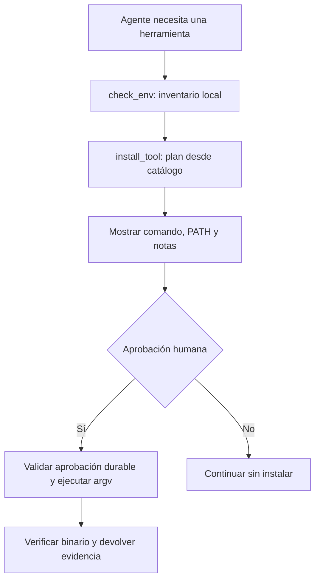

# BAJIOWARE NEXUS

> **NEXUS Sovereign 3.0:** la consola propia y el runtime durable son ahora el
> camino principal. Consulte [la guía Sovereign](docs/NEXUS_SOVEREIGN.md).

NEXUS es un kernel y directorio empresarial de agentes. REST, CLI, MCP y A2A son gateways del mismo control plane; ChatGPT, Claude u otro cliente pueden servir como interfaz sin convertirse en dependencia arquitectónica.

## Capacidades

- AI Directory multi-tenant: organizaciones, departamentos, identidades, agentes, tools, recursos, ambientes y capacidades.
- RBAC más decisiones ABAC/ReBAC centralizadas, aprobaciones durables y auditoría append-only encadenada por hash.
- Tareas y workflows persistentes con idempotencia, leases, timeout, retry/backoff, DLQ, outbox, cancelación y compensaciones.
- Tool Gateway con schema, política, cuota, sandbox, límites y auditoría.
- Model Router intercambiable: Fake LLM, OpenAI, Google GenAI, OpenAI-compatible, y contratos preparados para Ollama/vLLM.
- Memoria durable y privada con tenant, clasificación, retención y búsqueda offline. Un vector store es un índice opcional.
- MCP 2.0, REST, CLI, A2A y Desktop Connector mTLS.
- Evolution Lab gobernado: workspace aislado, evaluador independiente, aprobación humana, canary y rollback.
- Marketing como primer departamento instalable, no como código especial del kernel.

## Instalación

### Requisitos

- Python 3.12+ y un entorno virtual.
- Linux (Ubuntu/Debian/Fedora/Arch) o macOS. Las recetas disponibles dependen
  del gestor y sus repositorios; no todas las herramientas tienen receta en cada sistema.
- API key del proveedor elegido para usar un LLM cloud. Fake permite probar
  sin claves; Ollama requiere un servidor y modelo local ya disponibles.

### Instalación de desarrollo

```bash
git clone https://github.com/bajioware/omni-agentcs
cd omni-agentcs
python3.12 -m venv .venv
source .venv/bin/activate
pip install -r requirements-prod.in
mkdir -p ~/.local/bin
ln -s "$PWD/omni.py" ~/.local/bin/omni
export PATH="$HOME/.local/bin:$PATH"
omni
```

Activa el venv en cada terminal: el ejecutable usa el Python de `PATH`.
Para instalaciones reproducibles, usa `pip install --require-hashes -r
requirements-prod.lock`. No necesitas copiar `.env` para el onboarding.

### Distribución futura

Los comandos previstos son `pip install omni-agentcs` y
`npm i -g @bajioware/omni-agentcs`. Esta entrega todavía no publica esos
paquetes: utiliza la instalación desde el repositorio descrita arriba.

### Primera ejecución

`omni` abre el wizard si falta la configuración y hay una terminal interactiva:

1. Detecta sistema, gestores y las diez herramientas del catálogo.
2. Ofrece revisar las herramientas ausentes y solicita aprobación por comando.
3. Configura Groq, OpenAI, Anthropic, Gemini, Ollama o Fake y el modelo.
4. Opcionalmente crea un engagement firmado con dominios/CIDRs autorizados,
   una instantánea DNS y validez de 24 horas. Muestra su ID para usarlo con
   `omni --engagement ID --objective "..."`.
5. Guarda la configuración de forma atómica. Ctrl+C cancela el guardado;
   las instalaciones ya aprobadas y completadas permanecen en el sistema.

No se hacen llamadas pagadas para validar claves en el wizard. Si ya existe
configuración, el wizard no se repite. En CI, tests, sin TTY o con
`--no-wizard`, se usan la configuración existente y los defaults.

### Configuración global

| Contenido | Ruta predeterminada | Variable XDG |
|---|---|---|
| Configuración TOML | `~/.config/omni/config.toml` | `XDG_CONFIG_HOME` |
| SQLite por defecto | `~/.local/share/omni/control.db` | `XDG_DATA_HOME` |
| Historial del CLI | `~/.local/state/omni/history` | `XDG_STATE_HOME` |
| Caché | `~/.cache/omni/` | `XDG_CACHE_HOME` |

Se ignoran variables XDG vacías o relativas, según la
[especificación XDG](https://specifications.freedesktop.org/basedir/0.8/).
Los directorios se crean con permisos `700`; config y sus respaldos, con `600`.
Las claves se guardan en texto plano protegido por esos permisos.
Integración con keyring: pendiente para una entrega posterior.

Precedencia: entorno del proceso, `.env` del checkout, configuración global,
defaults. `DATABASE_URL` conserva la selección del backend; `NEXUS_DB_PATH`
conserva la DB explícita. No se migra una DB existente silenciosamente.
Si `.env` contiene `LLM_PROVIDER=fake`, seguirá teniendo prioridad sobre el
proveedor del wizard; edita esa variable para usar otro proveedor.

```toml
schema_version = 1
[llm]
default_provider = "groq"
default_model = "openai/gpt-oss-20b"
[provisioning]
auto_install = false
prefer_user_install = true
install_dir = "~/.local/bin"
```

`auto_install` nunca omite aprobaciones. Un config corrupto se conserva como
`config.toml.bak` (con sufijo único si ya existe) y se regenera con defaults.
Si no hay permisos para recuperarlo, se avisa y se usan defaults en memoria.

### Comandos útiles

```bash
omni --doctor --no-wizard       # diagnóstico local
omni --doctor --json            # JSON sin claves ni tokens
omni --config                  # editar en $EDITOR (nano por defecto)
omni --config-path              # imprimir la ruta efectiva
omni --reset-config            # respaldar config y repetir wizard si hay TTY
omni --no-wizard                # ejecución sin onboarding
```

Doctor informa versiones, gestores, rutas, DB SQLite, últimos cinco eventos
de auditoría y estado local de msfrpcd. La comprobación de su puerto no
autentica RPC. Una versión puede aparecer vacía si el binario tarda más de
tres segundos. Las bases PostgreSQL se identifican sin consultar el servidor.

## Auto-provisioning

| Meta-tool durable | Riesgo | Scope | Aprobación |
|---|---|---|---|
| `nexus.system.check_env` | READ_ONLY | No | No |
| `nexus.system.install_tool` | HIGH | No | Siempre, ligada al plan exacto |



El LLM puede elegir herramienta y gestor del catálogo, nunca proporcionar
un comando. La aprobación vincula herramienta, gestor, argumentos resueltos
y modo dry-run. Si cambia el plan, se requiere una nueva aprobación.
`dry_run=true` devuelve el plan sin instalar y también requiere aprobación
cuando pasa por el gateway HIGH. Se ejecuta sin shell, con timeout de diez
minutos y verificación posterior; no hay fallback de gestor automático.

Se prefieren instalaciones de usuario (`go`, `pipx`, `brew`) cuando existe
receta. Go usa `GOBIN=~/.local/bin` o el `install_dir` configurado. Tras una
instalación verificada, se añade su directorio al PATH de `.bashrc` o `.zshrc`
de forma idempotente y al proceso actual. Los comandos administrativos usan
`sudo -n`: si faltan privilegios, fallan con evidencia; el CLI no captura ni
almacena la contraseña de sudo. El operador puede ejecutar manualmente el
comando mostrado o preparar los privilegios antes de volver a aprobarlo.

El catálogo no añade repositorios del sistema. Metasploit necesita un
repositorio que publique `metasploit-framework`; su daemon se configura
por separado con [el instalador systemd](scripts/install_msfrpcd_service.sh).
Los templates de nuclei también se provisionan por separado. Se distingue
el binario [httpx de ProjectDiscovery](https://docs.projectdiscovery.io/opensource/httpx/install)
del paquete Python del mismo nombre. Las recetas Go siguen las instrucciones
de [subfinder](https://docs.projectdiscovery.io/opensource/subfinder/install),
[nuclei](https://docs.projectdiscovery.io/opensource/nuclei/install),
[ffuf](https://github.com/ffuf/ffuf) y [gobuster](https://github.com/OJ/gobuster).

## Desarrollo sin GPU, APIs ni tokens

Requiere Python 3.12. Las dependencias reproducibles se instalan desde el lock con hashes:

```bash
python3.12 -m venv .venv
.venv/bin/pip install --require-hashes -r requirements.lock
cp .env.example .env
```

Configure un administrador explícito en `.env`; no existen credenciales predeterminadas. Mantenga `LLM_PROVIDER=fake` y ejecute:

```bash
PATH=.venv/bin:$PATH make lint typecheck test test-api test-mcp
.venv/bin/python nexus_cli.py fake-llm "hola" --scenario echo
.venv/bin/python nexus_cli.py enqueue-debug "hola" --idempotency-key demo-1
.venv/bin/python nexus_worker.py --once
```

Arranque local:

```bash
.venv/bin/uvicorn nexus_api.main:app --host 127.0.0.1 --port 8000
.venv/bin/python -m nexus_mcp.server
```

MCP por `stdio` permite depurar desde clientes compatibles sin publicar un puerto. Una cuenta gratuita de una interfaz no garantiza que esa interfaz permita MCP remoto: eso depende del producto, plan y soporte vigentes. NEXUS siempre puede operarse por CLI/REST y probarse con Fake LLM.

## Producción

Producción requiere PostgreSQL, secretos explícitos, TLS, workers separados y un sandbox OCI. SQLite es solamente para desarrollo pequeño. El backend de Compose se publica únicamente en loopback; MCP remoto exige OIDC/OAuth y el Desktop Connector entra por un gateway mTLS.

```bash
cp .env.example .env
# Definir POSTGRES_PASSWORD, JWT_SECRET_KEY, admin, CORS y URLs públicas.
docker compose up -d backend worker frontend
# Opcional: requiere PKI provisionado.
docker compose --profile connector up -d connector-gateway
```

No se instala Ollama ni se fuerza un proveedor cloud. Las rutas de datos confidenciales con `allow_cloud=false` se rechazan si no existe un proveedor privado disponible.

## Requisitos del sistema

- Python 3.12 y `.venv` del repo para todo lo demás.
- Los binarios de las tools que se vayan a usar, en `PATH`: `nmap`,
  `subfinder`, `httpx`, `nuclei`, `ffuf`.
- **Templates de nuclei en `/opt/nuclei-templates`** (o donde apunte
  `NEXUS_NUCLEI_TEMPLATES`). `nexus.web.nuclei` falla cerrado
  (`nuclei_templates_missing`) si el directorio no existe: nunca se queda
  descargando templates hasta agotar el timeout del sandbox.

```bash
# Instalar los templates una sola vez
nuclei -update-templates
sudo ln -s "$HOME/nuclei-templates" /opt/nuclei-templates   # o exporta NEXUS_NUCLEI_TEMPLATES
# Selección puntual por si el directorio vive en otro sitio:
#   NEXUS_NUCLEI_TEMPLATES=/srv/nuclei-templates
```

Nota: `nuclei` **no sigue un directorio symlinkeado**, por lo que el handler
pasa siempre la ruta canónica (`Path(...).resolve()`) aunque el default
configurado sea `/opt/nuclei-templates`.

## Gateways y operación

- API: `/health`, `/docs` solo en desarrollo y `/system/metrics` autenticado.
- MCP: `python -m nexus_mcp.server`; Streamable HTTP requiere OIDC salvo loopback explícito.
- CLI: `python nexus_cli.py --help`.
- Worker: `python nexus_worker.py --help`.
- Backup SQLite: `./nexus_backup.sh --database data/nexus_pro.db`.
- Restore aislado: `./nexus_restore.sh ARCHIVO --database /ruta/nexus.db`.

Documentación clave:

- [Plan de implementación](PLAN_IMPLEMENTACION_NEXUS.md)
- [Auditoría base](AUDITORIA_NEXUS_2026-08-04.md)
- [Despliegue on-premise](docs/DEPLOYMENT_ON_PREM.md)
- [Desarrollo offline](docs/runbooks/DEVELOPMENT_OFFLINE.md)
- [Backup y restore](docs/runbooks/BACKUP_RESTORE.md)
- [Connector mTLS](docs/runbooks/CONNECTOR_MTLS.md)
- [SLO/SLI](docs/runbooks/SLO_SLI.md)
- [Gobierno de datos](docs/runbooks/DATA_GOVERNANCE.md)

## CLI interactivo omni

`omni` es la consola del bucle ReAct durable: el humano escribe un objetivo en
lenguaje natural, ve el razonamiento del agente en vivo y aprueba las acciones
de alto riesgo. El CLI nunca ejecuta herramientas por su cuenta: todo pasa por
el bucle ReAct y por el Tool Gateway (policy, scope, approval, sandbox y
auditoría).

Requisitos:

- `.env` con `GROQ_API_KEY` o `OPENAI_API_KEY` o `GEMINI_API_KEY` (con solo
  `fake` el bucle funciona, pero sin razonamiento real).
- un `EngagementScope` creado en el control store (sin scope, las herramientas
  que lo exigen se deniegan).

Uso básico:

```bash
./.venv/bin/python omni.py --engagement eng-scanme
```

Dentro del REPL:

```text
┌──(OmniAgentCS)─[scanme-test]
└─$ Escanea scanme.nmap.org en puertos 22, 80 y 443
```

Comandos meta:

| Comando | Descripción |
| --- | --- |
| `/scope` | muestra el engagement activo |
| `/tools` | lista las tools durables con su riesgo y si exigen scope |
| `/history` | historial (mensajes durables) del run actual |
| `/clear` | limpia el contexto local (mantiene el engagement y la auditoría) |
| `/export` | exporta la sesión a Markdown |
| `/approvals` | lista aprobaciones durables pendientes |
| `/help` | ayuda |
| `/exit` / `/quit` | salir |

One-shot (sin REPL):

```bash
./.venv/bin/python omni.py --engagement eng-scanme \
    --objective "Escanea scanme en puertos 22 y 80"
```

Listar engagements y ver los flags disponibles:

```bash
./.venv/bin/python omni.py --list-engagements
./.venv/bin/python omni.py --help
```

Ctrl+C interrumpe la línea de entrada sin matar la sesión; durante un run pide
cancelación cooperativa y el run se puede reanudar con
`omni --resume <run_id>`. Ctrl+D sale limpiamente. Las acciones de riesgo alto
piden aprobación explícita (`y` aprobar, `n` rechazar, `e` editar argumentos,
`?` ver la definición de la tool) y cada aprobación queda registrada como fila
durable en `kernel_approvals`, con separación de deberes entre el agente que
pide y el humano que aprueba.

## Tools durables

Todas se registran en `nexus_core/tools/registry.py::durable_tool_definitions()`,
se ejecutan dentro del sandbox (nunca `subprocess` directo) a través del Tool
Gateway y declaran `scope_target_field` + `scope_required` cuando tocan un
target. El `engagement_id` del run se propaga a cada llamada, así que el scope
se valida siempre, incluso cuando el LLM encadena varias tools.

| Tool | Riesgo | Ruido | Campo de scope | Descripción |
| --- | --- | --- | --- | --- |
| `nexus.system.status` | read_only | — (interno) | — | estado del kernel, cuotas y worker |
| `nexus.workspace.search` | read_only | — (local) | — | búsqueda en el workspace vía sandbox |
| `nexus.recon.nmap` | medium | calculado por flags (low→high) | `target` | escaneo de puertos/servicios con XML parseado |
| `nexus.recon.subfinder` | read_only | low (pasivo, sin tráfico al target) | `domain` | enumeración pasiva de subdominios (OSINT) |
| `nexus.recon.httpx` | low | low ≤20 targets · medium ≤100 · high >100 | `targets` (lista) | fingerprinting HTTP: status, título, tecnologías |
| `nexus.web.nuclei` | medium | según severidad: info/low→low · medium→medium · high/critical→high | `targets` (lista) | escaneo de vulnerabilidades con templates |
| `nexus.web.ffuf` | medium | threads ≤2→low · ≤5→medium · >5→high (default 10 = high) | `url` | fuzzing de rutas/directorios con wordlist |

Notas de seguridad de las tools nuevas:

- `nuclei` corre con `-no-interactsh -silent -nc -jsonl` por defecto y prohíbe
  interactsh/OAST, `-dast`, `-headless`, `-code` y cualquier flag que fije el
  target o redirija la salida. Las severidades por defecto son `low,medium` y se
  excluyen los tags `intrusive,fuzz,fuzzing,dos,brute-force`.
- `ffuf` **siempre** aplica `-rate` (default 50 req/s; ffuf por defecto es
  ilimitado) y exige que el wordlist viva dentro del workspace.
- `httpx` y `nuclei` reciben lotes de targets: el validador de scope exige que
  **todos** los elementos de la lista pasen; si uno falla, se deniega el lote
  completo.
- `subfinder` es pasivo (no genera tráfico al target) y por eso su ruido es
  siempre `low`.

Ejemplos en el REPL:

```text
└─$ Descubre subdominios de nmap.org y luego haz fingerprint HTTP de los que respondan
└─$ Haz fingerprint HTTP de http://scanme.nmap.org e intenta detectar tecnologías
└─$ Busca directorios comunes en http://scanme.nmap.org/FUZZ con el wordlist /workspace/words.txt, 5 threads
```

## Metasploit RPC

El catálogo durable incluye nueve tools. Metasploit Framework se ejecuta como
servicio systemd separado; NEXUS se comunica exclusivamente por RPC. No se
añaden dependencias: utiliza `httpx` y `msgpack` del entorno existente.

La instalación local verificada usa **MessagePack en `/api/`**, escuchando en
`127.0.0.1:55552`. Ver [diagnóstico](MSF_DAEMON_DIAG.md) y
[resultado del servicio](MSF_DAEMON_RESULT.md). Con el archivo de credenciales
`/etc/default/msfrpcd` ya creado por el operador (variable `MSFRPC_PASSWORD`,
permisos `600`, propietario `root:root`), instalar o reparar la unidad:

```bash
sudo bash scripts/install_msfrpcd_service.sh
systemctl status msfrpcd --no-pager
sudo journalctl -u msfrpcd -n 50 --no-pager
```

El script guarda la unidad anterior y comprueba login y versión mediante curl
sin imprimir credenciales ni tokens. El servicio habilitado arranca sin sudo
interactivo. `scripts/msf_verify.py` permite repetir el chequeo con la contraseña
en `MSF_RPC_PASSWORD` o `MSFRPC_PASSWORD` del entorno.

Configurar `.env` (la contraseña debe coincidir con la del servicio):

```dotenv
MSF_RPC_URL=http://127.0.0.1:55552
MSF_RPC_USER=msf
MSF_RPC_PASSWORD=
MSF_RPC_TRANSPORT=msgpack
```

`omni.py` carga este archivo; los workers desplegados deben recibir las mismas
variables de entorno. `MSF_RPC_URL` es el origen HTTP, sin ruta ni credenciales.
No se usan proxies del entorno ni se siguen redirecciones HTTP del daemon.

| Tool | Riesgo | Scope |
| --- | --- | --- |
| `nexus.exploit.msf_search` | READ_ONLY | No requerido |
| `nexus.exploit.msf_auxiliary` | MEDIUM | Obligatorio, campo `target` |

En el REPL:

```text
/tools
Busca módulos MSF para MS17-010, máximo 10 resultados.
Ejecuta auxiliary/scanner/smb/smb_version contra scanme.nmap.org con THREADS=1 y RPORT=445 dentro del engagement activo.
```

También puede consultarse el catálogo con:

```bash
./.venv/bin/python omni.py --engagement eng-scanme \
  --objective "Busca módulos MSF para MS17-010"
```

La búsqueda acepta `query`, `module_type`, `platform`, `cve` (`CVE-AAAA-NNNN`)
y `limit` (1–100). Auxiliary acepta `module`, un único host `target`,
`options` y `timeout_seconds` (1–300, default 60). `THREADS` es 1 por defecto
y como máximo 32; `RPORT` debe estar entre 1 y 65535.

ScopeValidator valida el target y sus direcciones; se envía una IP autorizada
al daemon, prefiriendo IPv4. Las opciones no pueden sustituir RHOST/RHOSTS,
introducir proxies, listeners, sesiones, comandos o archivos locales mediante
las opciones bloqueadas por el handler. Se rechazan valores compuestos y
metacaracteres. La salida normalizada incluye SHA-256 del resultado RPC.

El polling usa `module.results` cada dos segundos. Solo `completed` produce un
resultado verificado; completar un módulo no afirma que el host sea vulnerable
ni que el puerto esté abierto. Si vence el timeout, se solicita `job.stop`
(hasta cinco segundos adicionales) y el resultado sigue siendo no verificado.
Si el daemon falla no hay reintento; un job remoto puede continuar cuando no
se logra contactar al daemon. Las respuestas no incluyen el secreto RPC ni
los tokens; los tokens temporales expiran según la configuración del daemon.

La alternativa `MSF_RPC_TRANSPORT=json` utiliza `/api/v1/json-rpc` y autenticación
HTTP Bearer: en ese caso `MSF_RPC_PASSWORD` debe contener el **token de API**
del servicio JSON, no una contraseña de `auth.login`. La build usa `-j` para
ese servidor y exige un token configurado o usuarios con token en la base de
datos. JSON está cubierto con MockTransport; el transporte probado en vivo es
MessagePack.

Tests opt-in (los tests unitarios no requieren daemon):

```bash
.venv/bin/python -m pytest nexus_core/tests/unit -q
NEXUS_E2E=1 .venv/bin/python -m pytest \
  nexus_core/tests/integration/test_metasploit_e2e.py -v
```

Los E2E comprueban búsqueda, ejecución de `smb_version` contra scanme y
denegación fuera de scope con auditoría; se omiten sin opt-in, credenciales o
daemon disponible. Los errores de autenticación configurada hacen fallar la
prueba.

## Sandbox

Las tools que ejecutan binarios locales pasan por `sandbox_for_environment(...)`.
Las tools Metasploit usan HTTP RPC hacia el daemon administrado por systemd;
sus módulos se ejecutan con los permisos de ese servicio, fuera del sandbox
de procesos de NEXUS. El gateway aplica identidad, políticas, scope y auditoría.

- **`LocalSandbox` (desarrollo)** lanza cada proceso con un entorno mínimo
  (`PATH`, `LANG`, `LC_ALL`, `TZ`, `NEXUS_SANDBOX=1`) y un **HOME efímero dentro
  del workspace**: `<workspace>/.sandbox_home`, con `XDG_CONFIG_HOME`,
  `XDG_CACHE_HOME` y `XDG_DATA_HOME` apuntando dentro. Así las CLIs que resuelven
  su configuración desde `$HOME` (httpx, subfinder, nuclei…) no ensucian el repo
  ni el home real del usuario. El directorio está en `.gitignore` y
  `resolve_workspace` bloquea su navegación: es fontanería del sandbox, no datos
  del agente.
- **`OCISandbox` (producción)** mantiene `--network none`, `--read-only`,
  `--cap-drop ALL`, `no-new-privileges` y `--user 65532:65532`, y añade un tmpfs
  efímero en `/home/sandbox` (`mode=1777`) con `HOME`/XDG apuntando ahí. Si el
  binario necesita una caché caliente (templates de nuclei) debe venir en la
  imagen o montarse de solo lectura.

## Seguridad

No exponga el API, MCP o conectores antes de configurar identidad, TLS y políticas. Las funciones heredadas de ejecución directa están deshabilitadas por defecto y siempre en producción. Un pentest independiente sigue siendo obligatorio antes de atender clientes o datos reales.
