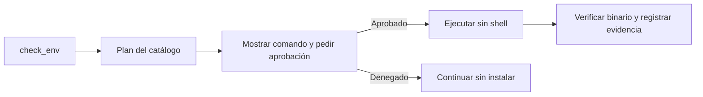

# OmniAgentCS-CLI

Agente autónomo de ciberseguridad ofensiva para terminal. Combina un bucle
ReAct durable, proveedores LLM intercambiables, alcance de pentesting firmado
con HMAC, auditoría encadenada por hash y aprobación humana de acciones de
alto riesgo. Úsalo únicamente sobre objetivos autorizados en tu engagement.

## Instalación

Requiere Python 3.12+. El CLI y el provisioner reconocen Linux y macOS;
la ejecución de cada herramienta depende del binario y sandbox disponibles.

```bash
git clone https://github.com/bajioware/omni-agentcs
cd omni-agentcs
python3.12 -m venv .venv
source .venv/bin/activate
pip install -r requirements-prod.in
mkdir -p ~/.local/bin
ln -s "$PWD/omni.py" ~/.local/bin/omni
export PATH="$HOME/.local/bin:$PATH"
omni
```

Activa el venv en cada terminal; el ejecutable usa el Python de `PATH`.
Las herramientas externas se detectan y pueden instalarse con aprobación
por comando. El catálogo no añade repositorios del sistema. Los paquetes
pip/npm del producto todavía no se publican; la instalación actual es desde
este repositorio. Los locks antiguos de la plataforma están archivados y no
son manifiestos de instalación del CLI; los requisitos actuales usan rangos
de versiones, sin prometer una resolución reproducible.

## Primera ejecución y configuración

El wizard se ejecuta si no hay configuración global y hay una TTY. Detecta
herramientas, ofrece instalaciones, pide proveedor/modelo/API key y permite
crear un engagement firmado de 24 horas con dominios/CIDRs autorizados.
No se repite si existe config, ni se ejecuta en CI, tests o con `--no-wizard`.

Proveedores: Groq, OpenAI, Anthropic, Gemini, Ollama y Fake. Los proveedores
cloud requieren su API key; Fake funciona offline. Ollama necesita un servidor
local y un modelo disponible. Sin clave del proveedor seleccionado se usa Fake.

| Contenido | Ruta por defecto |
|---|---|
| Configuración | `~/.config/omni/config.toml` |
| SQLite | `~/.local/share/omni/control.db` |
| Historial | `~/.local/state/omni/history` |
| Caché | `~/.cache/omni/` |

Se respetan `XDG_CONFIG_HOME`, `XDG_DATA_HOME`, `XDG_STATE_HOME` y
`XDG_CACHE_HOME` cuando son rutas absolutas. Precedencia: entorno, `.env`
del checkout, configuración TOML, defaults. `.env` es opcional; consulta
[.env.example](.env.example). `NEXUS_DB_PATH` y `DATABASE_URL` explícitos
prevalecen sobre la DB global. El worker usa la misma configuración.

Config se escribe atómicamente con permisos `600` en directorios `700`.
Las claves se guardan en texto plano con esos permisos; keyring queda pendiente.
Un config corrupto se respalda como `.bak` y se recupera con defaults.
`--reset-config` conserva un respaldo antes de reiniciar el onboarding.

## Uso

```bash
omni                                      # selección de engagement y REPL
omni --doctor --no-wizard                  # diagnóstico local
omni --doctor --json                       # diagnóstico JSON, sin secretos
omni --config                             # editar con $EDITOR
omni --config-path                        # ruta del config
omni --list-engagements
omni --engagement eng-scanme --objective "Busca módulos MSF para MS17-010"
omni --engagement eng-scanme --trust-mode --objective "Explota el host autorizado"
omni --no-wizard                          # modo sin onboarding
python nexus_worker.py --once             # reclamar como máximo una tarea
python nexus_worker.py                    # worker durable
```

Usa un ID listado por `--list-engagements`. Un checkout nuevo no incluye
engagements ni credenciales: créalos en el wizard con tu alcance autorizado.
En el REPL, `/help` muestra comandos; `/ask`, `/scope`, `/tools`, `/history`,
`/approvals`, `/trust`, `/sessions`, `/session`, `/detach`, `/kill-session`,
`/findings`, `/report`, `/timeline` y `/exit` permiten inspeccionar y controlar
la sesión.

Doctor muestra sistema, herramientas, gestores, rutas, SQLite, últimos eventos
de auditoría y puerto/systemd de msfrpcd. El sondeo del puerto no autentica RPC.
Una versión vacía puede indicar que venció el timeout de tres segundos.
PostgreSQL se identifica sin consultar el servidor; el kernel conserva ese backend.

## Herramientas y aprovisionamiento

El catálogo durable contiene **38 herramientas**:

- `nexus.system.status`, `nexus.workspace.search`.
- `nexus.knowledge.record_fact`, `nexus.knowledge.query_facts` — blackboard
  durable de hechos tipados con procedencia (memoria del engagement).
- `nexus.recon.nmap` (perfiles `quick`/`full_tcp`/`service`/`top_udp`),
  `nexus.recon.subfinder`, `nexus.recon.httpx`.
- `nexus.recon.ftp` (login anónimo, `list`/`download`, read-only).
- `nexus.cred.bruteforce` (prueba usuario + wordlist del workspace contra
  `ssh`/`ftp` con hydra; intentos acotados).
- `nexus.post.ssh_exec` (HIGH, ejecuta UN comando vía SSH con una credencial
  validada; rechaza comandos destructivos), `nexus.post.enum_system` (MEDIUM,
  enumera identidad, usuarios, `sudo -l`, SUID, capabilities y cron),
  `nexus.post.privesc_hints` (READ_ONLY, correlaciona ese surface con vectores
  GTFOBins y propone el comando de prueba `uid=0`; no ejecuta nada).
- `nexus.recon.gobuster` (dir/dns/vhost, wordlist confinada al workspace),
  `nexus.recon.whatweb` (fingerprinting profundo vía `--log-json`).
- `nexus.web.nuclei`, `nexus.web.ffuf`, `nexus.web.sqlmap` (batch, solo
  detección por defecto), `nexus.web.dalfox` (XSS, sin blind callbacks).
- `nexus.exploit.searchsploit` (lookup local de Exploit-DB, sin red ni scope),
  `nexus.exploit.msf_search`, `nexus.exploit.msf_auxiliary`,
  `nexus.exploit.msf_exploit`.
- `nexus.recon.netexec` (enumeracion SMB/LDAP), `nexus.recon.bloodhound_python`
  (recoleccion del grafo AD).
- `nexus.attack.impacket_secretsdump` (HIGH, volcado SAM/LSA/NTDS),
  `nexus.attack.impacket_getuserspns` (MEDIUM, Kerberoasting),
  `nexus.attack.impacket_psexec` (DESTRUCTIVE, ejecucion remota RemComSvc).
- `nexus.session.list`, `nexus.session.interact`, `nexus.session.kill`.
- `nexus.c2.sliver_server`, `nexus.c2.sliver_implants`, `nexus.c2.sliver_sessions`,
  `nexus.c2.sliver_exec` (HIGH), `nexus.c2.sliver_pivot` (HIGH).
- `nexus.report.generate`.
- `nexus.system.check_env`, `nexus.system.install_tool`.

`check_env` es de solo lectura. `install_tool` es HIGH y siempre requiere
aprobación durable del plan exacto, incluso en dry-run. El modelo elige
herramienta y gestor del catálogo; nunca proporciona argv. Si cambia el plan,
se necesita otra aprobación. No hay instalación automática sin permiso.



Se prefieren instalaciones de usuario. Go usa `~/.local/bin` o el `install_dir`
configurado. Tras verificar se actualiza PATH en `.bashrc`/`.zshrc` sin duplicar
entradas. Los comandos administrativos usan `sudo -n`: si faltan privilegios,
fallan y muestran evidencia; el CLI no almacena la contraseña de sudo.

Nuclei necesita templates previamente instalados y `NEXUS_NUCLEI_TEMPLATES`
apuntando a su directorio; el handler no los descarga durante un escaneo.
El binario httpx es el de ProjectDiscovery, distinto del paquete Python.
Los escaneos pasan por scope y sandbox. Producción utiliza imágenes OCI
permitidas y exige PostgreSQL; no se incluye un despliegue web/Compose.

## Metasploit RPC

La integración usa RPC y no invoca msfconsole desde los handlers. El servicio
local verificado habla MessagePack en `127.0.0.1:55552/api/`.

```bash
sudo bash scripts/install_msfrpcd_service.sh
omni --doctor --no-wizard
```

El script necesita Metasploit instalado y configura el servicio systemd.
Usa `MSF_RPC_URL`, `MSF_RPC_USER`, `MSF_RPC_PASSWORD` y
`MSF_RPC_TRANSPORT=msgpack`; la contraseña del cliente debe coincidir con la
del daemon. `msf_search` no requiere scope; `msf_auxiliary` sí lo requiere.
Los resultados y diagnóstico históricos están en
[docs/missions/MSF_DAEMON_RESULT.md](docs/missions/MSF_DAEMON_RESULT.md).

### Explotación y sesiones

`nexus.exploit.msf_exploit` es **HIGH**: siempre exige aprobación humana
`y/n/e/?` (o `--trust-mode`) antes de ejecutar nada, y hace scope gating sobre
`target`. Puede abrir una sesión Meterpreter/shell; **un exploit puede tumbar
servicios del objetivo**, así que úsalo solo dentro del alcance autorizado.

El modelo nunca elige la dirección de callback: `LHOST`/`LPORT` se toman de
`MSF_LHOST`/`MSF_LPORT`, y `PROXIES`/`RHOSTS`/`LHOST`/`LPORT` se rechazan dentro
de `options`. Si el modelo omite `RPORT`, se usa el default declarado por el
módulo (`module.options`), no uno inventado. Un exploit que corre sin abrir
sesión devuelve `status=timeout` con `verified=true` (la ejecución se verificó).

Las sesiones se gestionan con `nexus.session.list` (solo lectura, filtra por
tipo y engagement) y `nexus.session.kill` (MEDIUM, cleanup por UUID). Ambas
van por el gateway y quedan auditadas; ningún handler abre un shell.

`kernel_sessions` registra tenant, engagement, run de origen y target validado.
Las sesiones nuevas solo se atribuyen si el UUID del job (`exploit_uuid`) y el
host reportado coinciden con la operación autorizada. Las sesiones anteriores
sin registro, de origen incierto, cerradas o de otro engagement se deniegan;
no se importan automáticamente desde el daemon. El listado del CLI también
aplica este filtro. Un registro no puede reasignarse a otro engagement.

### Interacción con sesiones

Después de explotar un target, la sesión queda activa y puedes interactuar con
ella desde el REPL. Todo lo que **no** empieza por `/` se envía a la sesión
adjunta; los comandos meta siguen funcionando igual.

```text
┌──(OmniAgentCS)─[scanme-lab]
└─$ /sessions

UUID       Type          Peer             Via                    User
abc123     meterpreter   10.0.0.1:51234   ms17_010_eternalblue   NT AUTHORITY\SYSTEM

┌──(OmniAgentCS)─[scanme-lab]
└─$ /session attach abc123
Attached to session abc123 (meterpreter)
Target: 10.0.0.1
User:   NT AUTHORITY\SYSTEM
Escribe comandos directamente, /help para los comandos de Omni, /detach para salir.

┌──(OmniAgentCS)─[scanme-lab]─[session abc123/meterpreter]
└─$ sysinfo
Computer        : WIN-DC-01
OS              : Windows Server 2019
...

┌──(OmniAgentCS)─[scanme-lab]─[session abc123/meterpreter]
└─$ /detach
Detached from session abc123. Session remains active.
```

Dentro del modo sesión: `/detach` vuelve al modo normal (la sesión sigue viva),
`/session info` muestra los datos de la sesión adjunta, `/sessions` lista las
activas y `/kill-session [uuid]` (o `all`) termina sesiones. Si la sesión muere
(por ejemplo el target se reinicia), el prompt vuelve solo a modo normal y avisa.

Cada comando enviado a la sesión pasa por el gateway (`nexus.session.interact`,
HIGH, con scope vigente y pertenencia registrada) igual que cualquier otra tool: se
pide aprobación `y/n/e/?` por comando, o se auto-aprueba con `--trust-mode`, y
cada uno queda auditado con el `engagement_id` actual. Los comandos que cerrarían
la sesión (`exit`, `quit`, `background`, …) se rechazan: usa `/kill-session`.

### Herramientas AD

Cinco tools amplían la cobertura de Active Directory. Todas piden scope, se
ejecutan por el sandbox y usan un allowlist de flags; el modelo nunca obtiene
un shell ni elige ejecutables fuera del catálogo.

- `nexus.recon.netexec` (MEDIUM): enumeración SMB/LDAP con NetExec. La
  operación (`shares`, `users`, `groups`, `smb_sessions`, `disks`, ...) se
  traduce al flag real (por ejemplo `--shares` o `--smb-sessions`), siempre con
  `--no-progress` (NetExec no expone `-q`). Ejecución, módulos y volcado
  (`-x`, `-X`, `-M`, `--sam`, `--ntds`) están prohibidos.
- `nexus.recon.bloodhound_python` (MEDIUM): recolección del grafo con
  bloodhound-python. Fuerza `--auth-method ntlm`, usa `-dc HOST` y
  `-ns NAMESERVER` (no `ComputerOnly`) y deja los JSON en el workspace.
- `nexus.attack.impacket_secretsdump` (HIGH): SAM/LSA/NTDS. `-outputfile` es un
  prefijo; genera `.sam`, `.secrets`, `.cached` y `.ntds`. `-just-dc` solo NTDS.
- `nexus.attack.impacket_getuserspns` (MEDIUM): Kerberoasting. El positional es
  `domain/username:password`; el DC se indica con `-dc-ip`.
- `nexus.attack.impacket_psexec` (DESTRUCTIVE): ejecución remota con psexec de
  Impacket, basado en **RemComSvc**. Siempre requiere aprobación humana, incluso
  en `--trust-mode`.

El resolver acepta las variantes `impacket-<nombre>` (Kali), `<nombre>.py`
(pipx) y `<nombre>`. NetExec se resuelve como `nxc`/`netexec` y BloodHound como
`bloodhound-python`. Los binarios se ejecutan por ruta absoluta, porque el PATH
del sandbox no incluye `~/.local/bin`. psexec no abre una sesión durable, así
que no registra fila en `kernel_sessions`.

### Sliver C2

Cinco tools integran el C2 moderno **Sliver** vía gRPC (`sliver-py`), sin
subprocess: el bridge habla mTLS con el *multiplayer* del team server usando el
operator config que indica `SLIVER_OPERATOR_CONFIG`.

- `nexus.c2.sliver_server` (READ_ONLY): versión, operadores conectados y jobs.
- `nexus.c2.sliver_implants` (READ_ONLY): builds y profiles de implants. No
  genera implants.
- `nexus.c2.sliver_sessions` (READ_ONLY, scope): lista sessions y beacons y los
  registra en `kernel_sessions`; solo muestra los del engagement actual.
- `nexus.c2.sliver_exec` (HIGH, scope): ejecuta UN comando en una session o
  beacon ya registrado por el engagement. Rechaza metacaracteres de shell y un
  conjunto de comandos destructivos (`shutdown`, `mkfs`, `format`, ...).
- `nexus.c2.sliver_pivot` (HIGH, scope): pivoting (`portfwd`, `socks5`, `list`,
  `kill`).

Todas fallan cerrado: si el team server no responde o el config no existe,
devuelven `verified=false` (`sliver_unavailable` / `sliver_auth_missing`) en vez
de un error. En el REPL, `/sliver` muestra el estado del server, `/implants`
lista builds y profiles y `/sessions --sliver` lista las sessions del engagement;
`attach_session` es vía `/session attach <id>` desde esa lista. El prompt de modo
sesión las marca con el prefijo `[sliver:<id>/<kind>]` y los comandos se
enrutan por `nexus.c2.sliver_exec`.

### Trust mode

`--trust-mode` (o `/trust on` en el REPL) auto-aprueba las tools de alto riesgo
del engagement sin pausar, salvo las de riesgo `DESTRUCTIVE`, que siguen
pidiendo confirmación. Cada auto-aprobación crea igualmente una aprobación
durable y escribe auditoría con `trust_mode=true` y `trusted_by=<usuario>`, para
distinguirla en el reporte. Úsalo solo en laboratorios controlados.

## Reportes de engagement

Al final de un engagement, genera el entregable que el cliente recibe. La
capa de reporte lee el audit trail y los `ToolResult` persistidos y **nunca
inventa un hallazgo**: solo transcribe lo que el toolkit verificó.

```text
┌──(OmniAgentCS)─[scanme-lab]
└─$ /report

Generating report for engagement scanme-lab...
  ✓ 8 findings de 17 eventos de auditoría
  ✓ severidad: 2 critical, 1 high, 0 medium, 1 low, 4 info
  ✓ CVSS: heurística determinista (/report --llm-cvss)
  ✓ cadena de auditoría: válida
  ✓ Markdown (23.0 KB) + HTML (45.0 KB)

Report: ~/.local/share/omni/reports/scanme-lab-20260929-143012/
  - report.md
  - report.html
  - report.json

Report SHA256: 21be4bc4bf0affd4...
```

El reporte incluye resumen ejecutivo (conteo por severidad), alcance firmado,
metodología (toolkit usado), hallazgos (con CVSS, MITRE ATT&CK, CWE/CVE y
evidencia), intentos fallidos, cronología completa y chain of custody (hash
SHA256 de cada evidencia y del reporte).

### Comandos

- `/findings` — lista resumida de hallazgos del engagement activo.
- `/report` — genera Markdown + HTML + JSON del engagement actual.
- `/report --llm-cvss` — pide al LLM un vector CVSS 3.1 (validado y puntuado
  localmente; si no hay proveedor, cae en la heurística determinista).
- `/report export <dir>` — escribe el entregable en un directorio, con
  `report.sha256` y `manifest.json` para verificar la evidencia.
- `/timeline` — cronología de acciones leídas del audit trail.

### Formatos

- **Markdown**: para revisar y editar antes de entregar.
- **HTML**: autocontenido (CSS embebido, sin JS ni CDN), listo para PDF
  (navegador → imprimir → guardar como PDF).
- **JSON**: para consumo programático (CI, dashboards, integraciones).

La tool durable `nexus.report.generate` es `READ_ONLY` y no exige scope: lee el
registro, no toca objetivos. Cada entregable queda registrado como artefacto
content-addressed con `sha256`. Si la cadena de auditoría no valida, el reporte
se genera igualmente y se marca visiblemente como **NO VERIFICADA**.

## Presentación

### Interfaz

En terminales interactivos, OmniAgentCS usa una Application de `prompt_toolkit`
con cuatro regiones: historial de salida, indicador de trabajo, entrada
multilínea y barra de estado. El prompt y la barra permanecen abajo, con
autocompletado mediante Tab. Se usa la pantalla principal (`full_screen=False`),
sin borrar el terminal al arrancar ni cambiar a una pantalla alternativa.
El banner aparece una vez; el ASCII usa el color predeterminado, sin negrita.

PageUp y PageDown recorren todo el historial del panel; al volver al final se
reanuda el seguimiento automático. Se conserva en memoria toda la salida
mostrada, sin el límite previo de 2000 líneas. El historial anterior del
terminal permanece intacto, pero su rueda de scroll no sustituye a PageUp:
el contenido que el panel desplaza se conserva en el buffer de la aplicación,
no se duplica en el scrollback nativo. Usa `/history` o `/export` para consultar
o guardar la conversación antes de cerrar la CLI.

```text
┌──(OmniAgentCS)─[scanme-lab]
└─$ _
scanme-lab · groq/openai/gpt-oss-120b · 2.3k tok · ~$0.0200 · 5m12s
```

La barra muestra engagement, sesión adjunta, trust, proveedor/modelo, tokens,
coste estimado y tiempo. En reposo se refresca cada dos segundos; la aplicación corre
en un hilo dedicado, así que permanece activa durante llamadas síncronas.
El spinner de stderr se desactiva en TUI: una línea sobre el prompt muestra
la operación y su duración. Se anima a 4 Hz y se oculta al terminar.
Los eventos se acumulan durante 50 ms y se añaden al buffer en el hilo de la
interfaz. El renderizador aplica diferencias, con límite de 4 frames/s durante
la actividad; las transiciones de inicio y cierre pueden añadir un frame.
Mientras se ejecuta un comando, la entrada queda bloqueada salvo las
aprobaciones solicitadas; Ctrl+C sigue interrumpiendo la operación.

### Frontera única de escritura

Toda escritura visible pasa por el router de la TUI. Esto incluye:

- Output del agente y de las tools.
- Logs de Python, vía `DeferredStreamHandler`, que resuelve `sys.stdout` en cada
  emisión en lugar de capturarlo al construir el logger.
- Warnings y excepciones no capturadas (`sys.excepthook`).
- Mensajes de librerías (httpx, urllib3, etc.), que escriben al stream actual.

Al arrancar el REPL con TUI, `sys.stdout` y `sys.stderr` se sustituyen por
proxies hacia el scrollback y se restauran al salir (incluso si el REPL termina
por una excepción). El fallback sin TTY conserva el comportamiento anterior: no
se instala ningún proxy.

Si necesitas ver el log interno para depurar:

```bash
NEXUS_LOG_LEVEL=info omni
```

Los logs aparecen en el scrollback, sin mover el cursor fuera del renderizador.

### Ayuda contextual

```text
└─$ /ask que puedes hacer
```

`/ask` construye su *system prompt* con el estado real de la CLI: catálogo de
comandos registrados, tools durables, engagement activo y proveedor resuelto.
Responde con las capacidades concretas de Omni y el comando o el objetivo que
las activa, no con teoría genérica de pentesting. Sigue sin ejecutar tools ni
tocar el engagement o la auditoría.

### Vista del agente en ejecución

Ejemplo de una ejecución real; las líneas de nmap se derivan de su resultado
estructurado, porque el mensaje durable no conserva el stdout crudo:

```text
🤖 [OmniAgent]: Escanea scanme.nmap.org con nmap, puertos 22,80,443.
⚙️  [Recon-NMAP] nmap -sT -p 22,80,443 -oX - scanme.nmap.org
   -> Host up: 45.33.32.156
   ...
   -> Puerto 443/tcp filtered: https
   -> Nmap done: 1 host(s) up · 1.85s
   ✓ 2 puertos abiertos · 1 hosts up · noise: high · 1.85s

 ⠹ Working... (29s · esc to interrupt)
┌──(OmniAgentCS)─[scanme-lab]
└─$ _
scanme-lab · groq/openai/gpt-oss-120b · 6.3k tok · $— · 37s
```

Cada tool muestra como máximo tres líneas de datos: primera y últimas dos,
con un único `...` adicional cuando se omite contenido. Se filtran líneas
vacías, separadores y progreso idéntico consecutivo. Las líneas largas se
recortan a 100 caracteres. El resumen usa las métricas y la verificación
disponibles; no inventa duración, ruido ni comandos. Para herramientas cuyo
argv depende del handler se muestra la solicitud durable con sus argumentos.
El polling obtiene acciones y resultados cada 0,5 s; no hay streaming de tokens
ni acceso al stdout de un proceso mientras la herramienta todavía se ejecuta.

`/timeline` muestra auditoría, no stdout completo. `/history` permite consultar
los mensajes durables disponibles; `/ask` es conversacional y no ejecuta comandos.

### Interrumpir

- **Esc durante un run** registra `react.cancel_requested`: el bucle se detiene
  al llegar al siguiente punto seguro. Una tool ya iniciada puede terminar antes.
- **Esc durante `/ask` o una invocación directa** cancela la tarea asíncrona de
  esa operación; no garantiza terminar trabajos remotos ya iniciados.
- **Ctrl+C** cancela la entrada actual; durante un run conserva la interrupción
  existente y devuelve el control al REPL.
- **Ctrl+D**, con el prompt vacío, sale del REPL.

Los tokens se acumulan desde las respuestas reales del modelo durante esta
sesión de CLI, incluidas consultas `/ask`. Las llamadas ReAct registran su
consumo por run mediante el store; `/ask` mantiene sus estadísticas locales.
No se recupera consumo anterior al inicio de esta sesión. El coste usa
`NEXUS_TUI_INPUT_USD_PER_MTOK` y `NEXUS_TUI_OUTPUT_USD_PER_MTOK`, tarifas que
el operador debe ajustar al modelo activo. Sin ambas tarifas muestra `$—`;
Fake y Ollama tienen coste de API cero (no incluye infraestructura).
En terminales estrechos la barra se trunca al ancho disponible.

### Desactivar la TUI

```bash
NEXUS_NO_TUI=1 omni
omni --no-tui
```

También aceptan `true` y `yes` en `NEXUS_NO_TUI`. El fallback a `input()` y
readline es automático si **stdin o stdout** no es TTY, o si `prompt_toolkit`
no se puede importar. Conserva el comportamiento anterior. En fallback
sin TTY el banner se omite; en un terminal con `--no-tui` sigue apareciendo.
Los modos one-shot no activan la TUI. `--no-color` y `NO_COLOR` desactivan
los colores; la TUI sigue necesitando secuencias de control para dibujar.

### Historial y status bar

El historial persiste en `~/.local/state/omni/history`, respetando un
`XDG_STATE_HOME` absoluto. Flecha arriba recupera comandos previos.
Un adaptador de `FileHistory` conserva el formato de readline para alternar
entre ambos modos; el archivo tiene permisos 600 y el directorio se crea
con 700. Ctrl+D sale; una línea vacía simplemente vuelve a pedir entrada.

```text
/status          # ver si la barra está habilitada
/status on       # activar
/status off      # ocultar
/status show     # imprimir el estado como texto plano
```

La preferencia se guarda atómicamente con permisos 600 en
`~/.config/omni/tui.json` (respeta `XDG_CONFIG_HOME`). Este archivo separado
conserva intacto el esquema de `config.toml`. En fallback también puedes
cambiar la preferencia para la siguiente sesión TUI.

### Autocompletado y sintaxis

Tab completa comandos `/`, herramientas `nexus.`, argumentos de sus esquemas,
engagements `@` y rutas que empiezan por `/`, `./`, `../` o `~/`. Si hay varias
opciones, Tab abre el menú y las siguientes pulsaciones recorren las sugerencias.
El menú también aparece mientras escribes; incluye la ayuda de cada comando.

```text
└─$ /he<TAB>                 → /help
└─$ nexus.recon.<TAB>        → nexus.recon.httpx
                              nexus.recon.nmap
                              nexus.recon.subfinder
└─$ nexus.recon.nmap <TAB>   → target=, flags=, timeout_seconds=, …
```

Los comandos, tools, argumentos, cadenas y rutas tienen colores distintos;
`--no-color` los desactiva. Completar una tool o `@engagement` solo inserta
texto: no invoca herramientas directamente ni cambia el engagement activo.
El prompt normal sigue recibiendo objetivos; usa `/ask` para preguntas.

### Multi-línea

Alt+Enter inserta una línea nueva; Enter envía todo el objetivo. La entrada
crece hasta cinco líneas editables y muestra `·` como continuación.
El historial en disco convierte los saltos de línea en espacios para mantener
la compatibilidad con readline. El fallback conserva su entrada de una línea.

### Markdown en respuestas

En TUI, `/ask` y la vista previa de `/report` renderizan encabezados, negritas,
cursivas, listas, código, enlaces y tablas con bordes ASCII. Se usa un
renderizador ligero sin dependencias nuevas; admite este subconjunto de
Markdown, no todo CommonMark. Los bloques de código conservan su texto literal.
Las variantes `<br>`, `<br/>` y `<br />` se convierten en saltos de línea (las
usan los modelos dentro de tablas). El texto se envuelve a 100 columnas de
ancho de lectura, o al ancho del terminal menos 4 si es menor, con
indentación de continuación en listas. Las tablas se adaptan a ese ancho:
las celdas demasiado largas se recortan con `…` en vez de desbordar. Los
encabezados se distinguen con color (H1 negrita + subrayado + cian, H2 negrita
+ cian, H3+ negrita).
La vista previa de reportes se limita a 65 536 caracteres; el archivo generado queda completo.
En fallback se conserva la salida anterior sin transformar Markdown.

### Ver un job en vivo

```text
/exploit view-live <job_uuid>
/exploit watch <job_uuid>      # alias
```

Consulta el estado y los resultados del job MSF cada dos segundos en una
ventana tmux separada si hay `$TMUX`, o mediante `x-terminal-emulator` si hay
`$DISPLAY`. Requiere un engagement activo y acceso RPC configurado. La vista
es de solo lectura: no lanza exploits ni consume el output de la consola MSF.
Muestra `module.results`, no un stream crudo de stdout/stderr.
Ctrl+C cierra la vista; al finalizar el job, Enter permite cerrarla.
Sin terminal secundario, o en un pipeline, muestra una instantánea del estado.
Un UUID inválido, inexistente o una consulta denegada no abre ninguna ventana.

### Banner y actividad

Al arrancar `omni` sin argumentos (modo REPL), se muestra un banner con el
estado real del sistema: catálogo de tools, proveedores LLM configurados,
engagement activo, validez de la cadena de auditoría, versión de msfrpcd y el
modelo resuelto.

```text
 ██████╗ ███╗   ███╗███╗   ██╗██╗
██╔═══██╗████╗ ████║████╗  ██║██║
██║   ██║██╔████╔██║██╔██╗ ██║██║
██║   ██║██║╚██╔╝██║██║╚██╗██║██║
╚██████╔╝██║ ╚═╝ ██║██║ ╚████║██║
 ╚═════╝ ╚═╝     ╚═╝╚═╝  ╚═══╝╚═╝
   A G E N T C S   ·   C L I

       =[ OmniAgentCS v3.0.0                                              ]
 + -- --=[ 38 tools · 1 providers · engagement: scanme-lab                ]
 + -- --=[ audit-chain ok · msfrpcd 6.5.3-dev- · groq/openai/gpt-oss-120b ]

 Tip: Use /trust on to auto-approve high-risk actions during an engagement.
```

En fallback interactivo, durante una operación larga el spinner
escribe en **stderr**, con tiempo transcurrido, sin interferir con `readline`
ni con la salida de los comandos:

```text
⠋ Ejecutando nmap contra scanme.nmap.org  [2s]
✓ Ejecutando nmap contra scanme.nmap.org  [4s]
```

Para dudas conversacionales ("qué puedo hacer", "explica este módulo") usa
`/ask`: consulta al modelo sin ejecutar ninguna herramienta y sin tocar el
engagement ni la auditoría.

```text
┌──(OmniAgentCS)─[scanme-lab]
└─$ /ask para qué sirve el trust mode

OmniAgent ·
  El trust mode auto-aprueba las tools de alto riesgo del engagement…
```

El prompt resume el estado en una línea: engagement, sesión adjunta y trust
mode, además del último reporte generado.

```text
┌──(OmniAgentCS)─[scanme-lab]
└─$ /report
┌──(OmniAgentCS)─[scanme-lab]─[session a1b2c3d4/meterpreter]─[TRUST MODE]
└─$ id
```

Control de presentación:

- `NEXUS_NO_BANNER=1` — omite el banner (útil en CI).
- `NEXUS_NO_SPINNER=1` — omite el spinner durante las tool calls.
- `NEXUS_TIP_SEED=<int>` — fija el tip rotativo (útil para tests).
- `--no-color` — desactiva ANSI; el banner sigue apareciendo en texto plano.

El banner **solo** aparece en modo REPL: `--objective`, `--help`, `--version`,
`--config`, `--config-path`, `--doctor` y `--list-engagements` no lo muestran.
Tampoco aparece si stdout no es un terminal, de modo que los pipelines y la
salida redirigida siguen siendo texto plano.

### Comandos conversacionales

- `/ask <pregunta>` — consulta al LLM sin ejecutar tools, sin ReAct y sin
escribir en el engagement ni en la auditoría. Mantiene un contexto local
(últimos 20 mensajes) para repreguntar y describe el catálogo real de comandos
y tools del producto.
- `/chat` — alias de `/ask`.

## Logging

Por defecto los logs internos (`LLMFactory`, `NexusLLM`, `LLMClient.*`) están en
`WARNING`, de modo que no aparecen durante el uso normal ni rompen la línea del
spinner. La precedencia es: `NEXUS_LOG_LEVEL` en el entorno, luego `.env` y
finalmente `warning`; un valor desconocido también cae en `warning`. El
`.env.example` distribuido trae `NEXUS_LOG_LEVEL=warning`. Para depurar:

```bash
NEXUS_LOG_LEVEL=info omni --engagement eng-scanme    # detalle de proveedores y llamadas
NEXUS_LOG_LEVEL=debug omni                           # incluye la construcción de clientes
```

### Selección de proveedor LLM

La elección de proveedor se resuelve en un único sitio
(`nexus_core/cli/llm_env.py`) y la comparten el CLI, el worker y el bucle ReAct:

1. `NEXUS_LLM_DEFAULT_PROVIDER` explícito, si ese proveedor tiene credenciales.
2. `LLM_PROVIDER` o el proveedor de `config.toml`.
3. El primer proveedor real disponible.
4. `fake` (offline, determinista) si no hay ninguno.

Un `LLM_PROVIDER=fake` heredado **no** desplaza a un proveedor real ya
configurado, y un proveedor sin credenciales nunca se anuncia como activo.

## Estructura

```text
omni.py                     entry point del CLI
nexus_worker.py             worker durable
nexus_core/kernel/          policy, auditoría, approvals, store y sandbox
nexus_core/scope/           engagements y validación de alcance
nexus_core/agent/           bucle ReAct (singular)
nexus_core/tools/           catálogo, handlers y parsers
nexus_core/report/          extracción de hallazgos y render Markdown/HTML
nexus_core/cli/             REPL, banner, spinner, selección LLM, wizard y doctor
nexus_core/config/          config TOML y rutas XDG
nexus_core/provisioner/     catálogo e instalación aprobada
nexus_core/integrations/   cliente Metasploit RPC
nexus_core/llm/             proveedores LLM y Fake
nexus_core/utils/           logging y utilidades compartidas
nexus_core/tests/           pruebas del proyecto actual
scripts/                   administración y diagnósticos manuales
docs/missions/             reportes e historia de desarrollo
```

Se conserva el nombre interno `nexus_core`, el schema del control store y las
firmas públicas de ejecución. `kernel/memory.py` es memoria durable actual;
los runtimes antiguos `agents/`, `core/`, `state/` y el vector store se retiraron.
Las guías de plataforma en `docs/missions/platform/` son históricas.

## Desarrollo y pruebas

```bash
pip install -r requirements-dev.txt
make syntax lint test
python -m pytest nexus_core/tests/unit -q
```

Los E2E de red son opt-in con `NEXUS_E2E=1` y requieren binarios, credenciales,
servicios y alcance adecuados. No se ejecutan automáticamente al correr la
suite normal. Los scripts manuales pueden ejecutar acciones reales; se invocan
explícitamente. CI prueba el CLI y el backend PostgreSQL del kernel.

Las decisiones y el balance de tests del cleanup están en
[CLEANUP_DECISIONS.md](CLEANUP_DECISIONS.md) y
[el informe final](docs/missions/CLEANUP_RESULT_V3.md).

## Licencia

Por definir. Este repositorio no incluye todavía una licencia de distribución.

### Persistencia de credenciales y aprobaciones

Mensajes, auditoría, eventos y resultados durables redactan campos de
credenciales también cuando aparecen en JSON incompleto, fences Markdown o
asignaciones como `password=...`. El saneamiento solo cambia la copia persistida;
no repara solicitudes inválidas ni sustituye los argumentos en memoria que usa
la ejecución. Reconoce campos conocidos: no detecta cualquier secreto arbitrario
en prosa y no borra filtraciones históricas ya almacenadas.

Las aprobaciones se consumen con una actualización condicional atómica en
SQLite y PostgreSQL. La inicialización incorpora `consumed_at` también a bases
PostgreSQL existentes. La prueba contra PostgreSQL real requiere `DATABASE_URL`
y permiso para crear un esquema temporal exclusivo; no utiliza tablas de la
aplicación.
