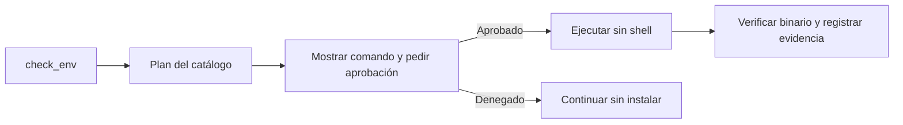

# OmniAgentCS-CLI

Agente autónomo de ciberseguridad ofensiva para terminal. Combina un bucle
ReAct durable, proveedores LLM intercambiables, alcance de pentesting firmado
con HMAC, auditoría encadenada por hash y aprobación humana de acciones de
alto riesgo. Úsalo únicamente sobre objetivos autorizados en tu engagement.

## Instalación

Requiere Python 3.12+. El CLI y el provisioner reconocen Linux y macOS;
la ejecución de cada herramienta depende del binario y sandbox disponibles.

```bash
git clone https://github.com/bajioware/omni-agentcs
cd omni-agentcs
python3.12 -m venv .venv
source .venv/bin/activate
pip install -r requirements-prod.in
mkdir -p ~/.local/bin
ln -s "$PWD/omni.py" ~/.local/bin/omni
export PATH="$HOME/.local/bin:$PATH"
omni
```

Activa el venv en cada terminal; el ejecutable usa el Python de `PATH`.
Las herramientas externas se detectan y pueden instalarse con aprobación
por comando. El catálogo no añade repositorios del sistema. Los paquetes
pip/npm del producto todavía no se publican; la instalación actual es desde
este repositorio. Los locks antiguos de la plataforma están archivados y no
son manifiestos de instalación del CLI; los requisitos actuales usan rangos
de versiones, sin prometer una resolución reproducible.

## Primera ejecución y configuración

El wizard se ejecuta si no hay configuración global y hay una TTY. Detecta
herramientas, ofrece instalaciones, pide proveedor/modelo/API key y permite
crear un engagement firmado de 24 horas con dominios/CIDRs autorizados.
No se repite si existe config, ni se ejecuta en CI, tests o con `--no-wizard`.

Proveedores: Groq, OpenAI, Anthropic, Gemini, Ollama y Fake. Los proveedores
cloud requieren su API key; Fake funciona offline. Ollama necesita un servidor
local y un modelo disponible. Sin clave del proveedor seleccionado se usa Fake.

| Contenido | Ruta por defecto |
|---|---|
| Configuración | `~/.config/omni/config.toml` |
| SQLite | `~/.local/share/omni/control.db` |
| Historial | `~/.local/state/omni/history` |
| Caché | `~/.cache/omni/` |

Se respetan `XDG_CONFIG_HOME`, `XDG_DATA_HOME`, `XDG_STATE_HOME` y
`XDG_CACHE_HOME` cuando son rutas absolutas. Precedencia: entorno, `.env`
del checkout, configuración TOML, defaults. `.env` es opcional; consulta
[.env.example](.env.example). `NEXUS_DB_PATH` y `DATABASE_URL` explícitos
prevalecen sobre la DB global. El worker usa la misma configuración.

Config se escribe atómicamente con permisos `600` en directorios `700`.
Las claves se guardan en texto plano con esos permisos; keyring queda pendiente.
Un config corrupto se respalda como `.bak` y se recupera con defaults.
`--reset-config` conserva un respaldo antes de reiniciar el onboarding.

## Uso

```bash
omni                                      # selección de engagement y REPL
omni --doctor --no-wizard                  # diagnóstico local
omni --doctor --json                       # diagnóstico JSON, sin secretos
omni --config                             # editar con $EDITOR
omni --config-path                        # ruta del config
omni --list-engagements
omni --engagement eng-scanme --objective "Busca módulos MSF para MS17-010"
omni --engagement eng-scanme --trust-mode --objective "Explota el host autorizado"
omni --no-wizard                          # modo sin onboarding
python nexus_worker.py --once             # reclamar como máximo una tarea
python nexus_worker.py                    # worker durable
```

Usa un ID listado por `--list-engagements`. Un checkout nuevo no incluye
engagements ni credenciales: créalos en el wizard con tu alcance autorizado.
En el REPL, `/help` muestra comandos; `/scope`, `/tools`, `/history`,
`/approvals`, `/trust`, `/sessions`, `/session`, `/detach`, `/kill-session` y
`/exit` permiten inspeccionar y controlar la sesión.

Doctor muestra sistema, herramientas, gestores, rutas, SQLite, últimos eventos
de auditoría y puerto/systemd de msfrpcd. El sondeo del puerto no autentica RPC.
Una versión vacía puede indicar que venció el timeout de tres segundos.
PostgreSQL se identifica sin consultar el servidor; el kernel conserva ese backend.

## Herramientas y aprovisionamiento

El catálogo durable contiene **15 herramientas**:

- `nexus.system.status`, `nexus.workspace.search`.
- `nexus.recon.nmap`, `nexus.recon.subfinder`, `nexus.recon.httpx`.
- `nexus.web.nuclei`, `nexus.web.ffuf`.
- `nexus.exploit.msf_search`, `nexus.exploit.msf_auxiliary`, `nexus.exploit.msf_exploit`.
- `nexus.session.list`, `nexus.session.interact`, `nexus.session.kill`.
- `nexus.system.check_env`, `nexus.system.install_tool`.

`check_env` es de solo lectura. `install_tool` es HIGH y siempre requiere
aprobación durable del plan exacto, incluso en dry-run. El modelo elige
herramienta y gestor del catálogo; nunca proporciona argv. Si cambia el plan,
se necesita otra aprobación. No hay instalación automática sin permiso.



Se prefieren instalaciones de usuario. Go usa `~/.local/bin` o el `install_dir`
configurado. Tras verificar se actualiza PATH en `.bashrc`/`.zshrc` sin duplicar
entradas. Los comandos administrativos usan `sudo -n`: si faltan privilegios,
fallan y muestran evidencia; el CLI no almacena la contraseña de sudo.

Nuclei necesita templates previamente instalados y `NEXUS_NUCLEI_TEMPLATES`
apuntando a su directorio; el handler no los descarga durante un escaneo.
El binario httpx es el de ProjectDiscovery, distinto del paquete Python.
Los escaneos pasan por scope y sandbox. Producción utiliza imágenes OCI
permitidas y exige PostgreSQL; no se incluye un despliegue web/Compose.

## Metasploit RPC

La integración usa RPC y no invoca msfconsole desde los handlers. El servicio
local verificado habla MessagePack en `127.0.0.1:55552/api/`.

```bash
sudo bash scripts/install_msfrpcd_service.sh
omni --doctor --no-wizard
```

El script necesita Metasploit instalado y configura el servicio systemd.
Usa `MSF_RPC_URL`, `MSF_RPC_USER`, `MSF_RPC_PASSWORD` y
`MSF_RPC_TRANSPORT=msgpack`; la contraseña del cliente debe coincidir con la
del daemon. `msf_search` no requiere scope; `msf_auxiliary` sí lo requiere.
Los resultados y diagnóstico históricos están en
[docs/missions/MSF_DAEMON_RESULT.md](docs/missions/MSF_DAEMON_RESULT.md).

### Explotación y sesiones

`nexus.exploit.msf_exploit` es **HIGH**: siempre exige aprobación humana
`y/n/e/?` (o `--trust-mode`) antes de ejecutar nada, y hace scope gating sobre
`target`. Puede abrir una sesión Meterpreter/shell; **un exploit puede tumbar
servicios del objetivo**, así que úsalo solo dentro del alcance autorizado.

El modelo nunca elige la dirección de callback: `LHOST`/`LPORT` se toman de
`MSF_LHOST`/`MSF_LPORT`, y `PROXIES`/`RHOSTS`/`LHOST`/`LPORT` se rechazan dentro
de `options`. Si el modelo omite `RPORT`, se usa el default declarado por el
módulo (`module.options`), no uno inventado. Un exploit que corre sin abrir
sesión devuelve `status=timeout` con `verified=true` (la ejecución se verificó).

Las sesiones se gestionan con `nexus.session.list` (solo lectura, filtra por
tipo) y `nexus.session.kill` (MEDIUM, cleanup por UUID). Ambas van por el
gateway y quedan auditadas; ningún handler abre un shell.

### Interacción con sesiones

Después de explotar un target, la sesión queda activa y puedes interactuar con
ella desde el REPL. Todo lo que **no** empieza por `/` se envía a la sesión
adjunta; los comandos meta siguen funcionando igual.

```text
┌──(OmniAgentCS)─[scanme-lab]
└─$ /sessions

UUID       Type          Peer             Via                    User
abc123     meterpreter   10.0.0.1:51234   ms17_010_eternalblue   NT AUTHORITY\SYSTEM

┌──(OmniAgentCS)─[scanme-lab]
└─$ /session attach abc123
Attached to session abc123 (meterpreter)
Target: 10.0.0.1
User:   NT AUTHORITY\SYSTEM
Escribe comandos directamente, /help para los comandos de Omni, /detach para salir.

┌──(OmniAgentCS)─[scanme-lab]─[session abc123/meterpreter]
└─$ sysinfo
Computer        : WIN-DC-01
OS              : Windows Server 2019
...

┌──(OmniAgentCS)─[scanme-lab]─[session abc123/meterpreter]
└─$ /detach
Detached from session abc123. Session remains active.
```

Dentro del modo sesión: `/detach` vuelve al modo normal (la sesión sigue viva),
`/session info` muestra los datos de la sesión adjunta, `/sessions` lista las
activas y `/kill-session [uuid]` (o `all`) termina sesiones. Si la sesión muere
(por ejemplo el target se reinicia), el prompt vuelve solo a modo normal y avisa.

Cada comando enviado a la sesión pasa por el gateway (`nexus.session.interact`,
HIGH, sin scope: la sesión ya está abierta) igual que cualquier otra tool: se
pide aprobación `y/n/e/?` por comando, o se auto-aprueba con `--trust-mode`, y
cada uno queda auditado con el `engagement_id` actual. Los comandos que cerrarían
la sesión (`exit`, `quit`, `background`, …) se rechazan: usa `/kill-session`.

### Trust mode

`--trust-mode` (o `/trust on` en el REPL) auto-aprueba las tools de alto riesgo
del engagement sin pausar, salvo las de riesgo `DESTRUCTIVE`, que siguen
pidiendo confirmación. Cada auto-aprobación crea igualmente una aprobación
durable y escribe auditoría con `trust_mode=true` y `trusted_by=<usuario>`, para
distinguirla en el reporte. Úsalo solo en laboratorios controlados.

## Estructura

```text
omni.py                     entry point del CLI
nexus_worker.py             worker durable
nexus_core/kernel/          policy, auditoría, approvals, store y sandbox
nexus_core/scope/           engagements y validación de alcance
nexus_core/agent/           bucle ReAct (singular)
nexus_core/tools/           catálogo, handlers y parsers
nexus_core/cli/             REPL, wizard y doctor
nexus_core/config/          config TOML y rutas XDG
nexus_core/provisioner/     catálogo e instalación aprobada
nexus_core/integrations/   cliente Metasploit RPC
nexus_core/llm/             proveedores LLM y Fake
nexus_core/utils/           logging y utilidades compartidas
nexus_core/tests/           pruebas del proyecto actual
scripts/                   administración y diagnósticos manuales
docs/missions/             reportes e historia de desarrollo
```

Se conserva el nombre interno `nexus_core`, el schema del control store y las
firmas públicas de ejecución. `kernel/memory.py` es memoria durable actual;
los runtimes antiguos `agents/`, `core/`, `state/` y el vector store se retiraron.
Las guías de plataforma en `docs/missions/platform/` son históricas.

## Desarrollo y pruebas

```bash
pip install -r requirements-dev.txt
make syntax lint test
python -m pytest nexus_core/tests/unit -q
```

Los E2E de red son opt-in con `NEXUS_E2E=1` y requieren binarios, credenciales,
servicios y alcance adecuados. No se ejecutan automáticamente al correr la
suite normal. Los scripts manuales pueden ejecutar acciones reales; se invocan
explícitamente. CI prueba el CLI y el backend PostgreSQL del kernel.

Las decisiones y el balance de tests del cleanup están en
[CLEANUP_DECISIONS.md](CLEANUP_DECISIONS.md) y
[el informe final](docs/missions/CLEANUP_RESULT_V3.md).

## Licencia

Por definir. Este repositorio no incluye todavía una licencia de distribución.
