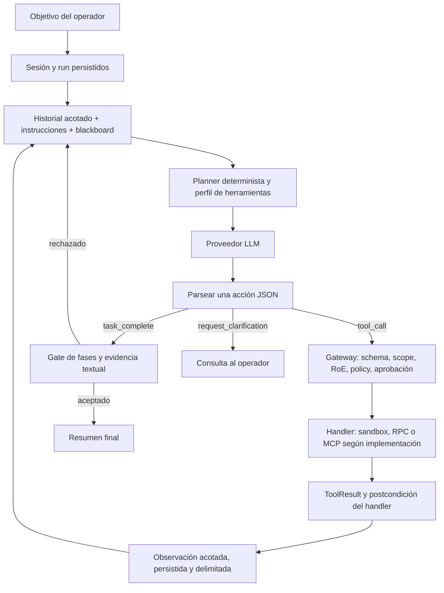

# Súper auditoría de potencia CLI/TUI — segunda opinión independiente

**Proyecto:** OmniAgentCS 3.0.0 · **Fecha:** 2026-10-07 · **Revisión local:** `2332136`.

**Alcance:** producto completo: orquestación, interfaz, seguridad, herramientas, proveedores, contexto, persistencia, concurrencia, reportes, extensiones, instalación y calidad. Se compara la ingeniería del agente con Claude Code, Codex CLI, Gemini CLI, Warp y Freebuff; no se exige que un producto de pentesting copie todas las funciones de un agente de programación.

**Método:** lectura del código y sus rutas de ejecución; revisión de manifiestos, entry points y CI; dos baterías de pruebas existentes; lint; sondas locales de funciones con datos sintéticos; consulta de documentación primaria. La auditoría anterior se consultó después de identificar los hallazgos principales. No se modificó código ni se ejecutaron misiones contra objetivos. Las sondas y logs temporales quedaron en `/tmp`; este Markdown es el único archivo añadido al repositorio por la auditoría.

**Convenciones:** **confirmado** significa observado en código y, cuando se indica, reproducido; **riesgo inferido** requiere una prueba adicional; **no verificado** no significa inexistente. Las referencias a líneas corresponden al checkout auditado. Las funciones de terceros se describen según documentación consultada en esta fecha, no según una versión instalada y ensayada localmente.

## 1. Resumen Ejecutivo

### Veredicto: **6,0 / 10 en madurez integral**

OmniAgentCS tiene una base funcional importante y reutilizable: 43 herramientas registradas en el catálogo observado, gateway común, resultados tipados, alcance de engagement, aprobaciones durables, almacenamiento SQLite/PostgreSQL, ReAct persistente, TUI con regiones independientes, streaming y reportes especializados. **Python no es el problema principal y no recomiendo reescribir el producto.**

La distancia frente a una CLI de élite está en la consistencia de sus garantías. Algunas capacidades están implementadas pero incompletamente conectadas; otras reciben nombres más fuertes que su comportamiento real. Destacan el cierre basado en hechos que el propio modelo puede declarar, dos selectores de sandbox que discrepan, ausencia de Plan Mode con restricciones ejecutables, y perfiles llamados subagentes que comparten conversación. La interfaz necesita resolver el pegado extenso, la visibilidad del contexto y las sesiones largas.

La nota es un juicio de ingeniería, no un benchmark de inteligencia ni una medida de efectividad ofensiva. Pondera funciones existentes **y** sus límites:

| Dimensión | Peso | Nota | Motivo principal |
|---|---:|---:|---|
| Orquestación y verificación | 20% | 6,0 | Loop real y gates existentes; evidencia débil y plan rígido. |
| Seguridad y consistencia de permisos | 20% | 5,0 | Buen gateway; discrepancias en sandbox, firma opcional y extensiones. |
| UX/TUI y accesibilidad | 15% | 6,5 | Regiones, streaming y tarjetas; falta paste collapse, contexto y control durante trabajo. |
| Estado, recuperación y contexto | 10% | 6,0 | Persistencia y compacción; recuperación no equivale a idempotencia. |
| Herramientas, reportes y extensibilidad | 10% | 8,0 | Buena especialización y separación handler/parser; límites en contratos y confianza. |
| Proveedores y presupuestos | 10% | 6,0 | Varios adapters; capacidades y contabilidad desiguales. |
| Calidad, distribución y operación | 15% | 5,5 | Pruebas y CI útiles; faltan garantías de instalación y cobertura operacional. |
| **Resultado ponderado** | **100%** | **6,0** | Redondeado a una décima. |

### Las tres mejoras más críticas

1. **Hacer que “verificado”, “completado”, “sandbox” y “aprobado” describan garantías reales.** Verificación por objetivo con referencias de evidencia; un único selector de sandbox; firmas obligatorias cuando se promete alcance firmado; controles efectivos para MCP; códigos de salida que distingan tarea terminada e incompleta.
2. **Completar la experiencia de control del operador.** Pegado colapsado sin perder contenido, historial multilínea, Plan Mode aplicado en el gateway, HUD con contexto y permisos efectivos, cancelación y estados claros. Son funciones centrales del producto, no decoración.
3. **Cerrar las brechas de ejecución prolongada.** Contextos independientes para delegación, identidad durable de cada llamada, reanudación segura, presupuestos completos, salida acotada y una ruta de instalación reproducible. Escalar primero las garantías existentes.

### Qué cambiaría respecto de la auditoría anterior

La valoración de **8,3/10** en `AUDIT_POTENCIA_CLI.md` resulta demasiado optimista para las garantías observadas. Coincido en conservar el stack y aprovechar el kernel, pero discrepo en puntos verificables:

| Afirmación anterior | Segunda opinión y evidencia |
|---|---|
| Los perfiles cumplen aislamiento de contexto. | No: `run_react_loop` conserva un `conversation_id` y reconstruye el historial del mismo run aunque cambie el perfil. Reducir herramientas no crea otra ventana de conversación. |
| El cierre impide hallazgos sin soporte de forma suficiente. | Parcial: coincidencia de tokens; un hallazgo coincidente evita que `fabricated_evidence` bloquee otros marcados como stale. El planner también cuenta hechos no verificados. |
| Selección determinista implica imposibilidad de manipulación por prompt. | No: el selector es determinista, pero consume un blackboard al que el modelo puede escribir. La determinación del algoritmo no autentica sus entradas. |
| Auditoría hash implica trazabilidad no repudiable. | La cadena detecta alteraciones respecto de una historia conocida; no acredita no repudio frente a quien puede reescribir toda la DB. Falta anclaje externo y estudiar concurrencia. |
| Solo faltan UX, hooks e instrumentación; 2–4 sprints bastan. | Hay trabajo en seguridad, recuperación, contratos, instalación y CI. Un MVP de UX cabe en ese plazo; cerrar toda la auditoría requiere más. |
| “2245 tests verdes” como estado actual demostrado. | La auditoría anterior declara no haber ejecutado la suite. Aquí se acreditan **448 pruebas seleccionadas aprobadas**, no una suite completa verde. |

### Evidencia de validación de esta revisión

- **Batería A: 306 passed en 15,11 s.** Parser y loop ReAct, completion gates existentes, memoria, perfiles, fan-out, planner, MCP, alcance, RoE, aprobaciones, blackboard, entrada multilínea, HUD, layout, flicker, acordeones y modos de sandbox.
- **Batería B: 142 passed en 5,01 s.** Contratos/streaming/selección LLM, secretos, NDJSON, sesiones de trabajo, extractores/renderizado/SARIF, inyección, registro de tools e instrucciones del proyecto.
- **Lint configurado: aprobado.** `.venv/bin/ruff check nexus_core omni.py nexus_worker.py --select F,E9 --no-cache`.
- **Entorno:** Python **3.14.7** de `.venv`; el proyecto declara `>=3.12` y CI prueba 3.12. No se interpreta el resultado como validación de todas las versiones.
- **Sondas confirmadas:** modo anunciado `oci` con ejecutor `LocalSandbox`; cinco hechos `verified=False` llevan el plan a `reporting` sin objeciones de fase; evidencia mixta no bloqueada; `minimum` numérico ignorado por el validador; catálogo efectivo de 43 tools.
- **Límites:** el primer intento amplio se interrumpió; contenía errores de preparación por faltar el directorio padre de `--basetemp`, corregidos antes de las baterías válidas. No son defectos del producto. El test `test_heartbeat_renews_on_interval` no terminó en una sonda aislada de 12 s, que salió por timeout; **causa no determinada**, no se declara fallo confirmado del worker. Se excluyó de la batería B. El test de bootstrap revisado tampoco aísla toda la ruta Sliver: no se siguió ejecutando el conjunto indiscriminadamente.
- No se validaron proveedores cloud con credenciales, una misión E2E, contenedores OCI, PostgreSQL real, cancelación de contenedores, rendimiento bajo carga ni una matriz real de terminales. Las pruebas con dobles y `DummyOutput` no sustituyen esas verificaciones.

## 2. Auditoría de Orquestación (El Cerebro)

### 2.1 Mapa de ejecución real

No es un wrapper pequeño. `nexus_core` contiene **191 archivos Python de producción y 42.747 líneas físicas**, excluyendo tests. Hay **202 módulos `test_*.py`**: 183 unitarios y 19 de integración. El nombre `nexus_core` conserva la historia del proyecto; la entrada del producto es `omni`.

| Pieza | Ruta | Responsabilidad observada |
|---|---|---|
| Entrada instalada | [pyproject.toml](../../../pyproject.toml), [omni.py](../../../omni.py) | `omni = omni:main`; configuración, secretos, wizard y despacho. |
| CLI | [cli/main.py](../../../nexus_core/cli/main.py) | Flags, engagement, ejecución interactiva y headless. |
| Sesión | [cli/session.py](../../../nexus_core/cli/session.py) | REPL, contexto de trabajo, herramientas manuales, aprobación y ejecución del objetivo. |
| Agente | [agent/react.py](../../../nexus_core/agent/react.py), L743 | Loop iterativo, persistencia, decisión, límites y cierre. |
| Contrato | [agent/parser.py](../../../nexus_core/agent/parser.py) | JSON textual: `tool_call`, `task_complete`, `request_clarification`. |
| Plan/perfiles | [planner.py](../../../nexus_core/agent/planner.py), [subagents.py](../../../nexus_core/agent/subagents.py) | Fases derivadas de hechos; subconjuntos de herramientas y presupuestos. |
| Ejecución gobernada | [runtime.py](../../../nexus_core/kernel/runtime.py), L236; [tool_gateway.py](../../../nexus_core/kernel/tool_gateway.py), L45 | Validación, alcance, RoE, policy, aprobación y resultado. |
| Trabajo durable | [nexus_worker.py](../../../nexus_worker.py), [workflows.py](../../../nexus_core/kernel/workflows.py) | Claims, leases, heartbeat, retries y reconciliación. |



El matiz del diagrama importa: el gateway gobierna la invocación, pero no ejecuta universalmente todos los handlers dentro de un sandbox. Esa garantía depende de cada ruta.

### 2.2 ¿Reactivo o proactivo? Ambos, con autonomía acotada

**Sí hay un agente iterativo.** El modelo selecciona la próxima herramienta de un catálogo, recibe su resultado y puede cambiar de estrategia. Hay feedback por JSON inválido, herramienta inexistente, denegación humana y fallo de ejecución. Existen límites por iteraciones y tokens, degradación de herramientas indisponibles y cancelación cooperativa.

La planificación metodológica es externa al modelo: un planner deriva la fase de los hechos y el modelo decide dentro del subconjunto permitido. Esto puede ser una ventaja para tareas repetibles y auditables. El problema no es usar ReAct, Python o una acción por turno; es que la metodología se aplica sin suficiente adaptación al objetivo.

El contrato usa JSON dentro de texto del asistente, no tool calling nativo: el parser valida la respuesta y las observaciones regresan como mensajes `user` delimitados, según `react.py` L1085 y `_inject_observation`. Es portable entre proveedores y comprobable, aunque añade turnos de reparación y hace menos expresivo el paralelismo. Conviene mantenerlo como fallback y añadir un adapter de llamadas estructuradas con IDs para proveedores compatibles.

### 2.3 O-01 — La verificación existe, pero permite autovalidación indirecta **[P0 · confirmado]**

**Lo positivo:** `ToolResult.success` exige `verified`, ausencia de timeout y un exit code aceptado cuando existe. `ToolGateway.invoke` rechaza una postcondición fallida. `_completion_objections` rechaza cerrar antes de `reporting` y ciertas evidencias stale. No sería correcto decir que no hay verificación determinista.

**La brecha es la fuerza de la prueba:**

1. [knowledge_facts.py](../../../nexus_core/tools/handlers/knowledge_facts.py), L78, deja que el modelo proporcione `source` y `verified`; este último vale `True` por defecto. Confirma que guardó un registro, no que el hecho ocurrió.
2. [blackboard.py](../../../nexus_core/kernel/blackboard.py), L163, cuenta hechos sin filtrar `verified`, procedencia ni vigencia.
3. [planner.py](../../../nexus_core/agent/planner.py), L224, completa una fase cuando basta un conteo del tipo adecuado.
4. [evidence.py](../../../nexus_core/agent/evidence.py), L158, considera soporte una intersección de tokens. Compartir la IP no demuestra que se obtuvo root.
5. `fabricated_evidence`, L221, bloquea cuando hay stale **y ningún** grounded; con uno grounded y otro stale devuelve falso. No valida semánticamente `final_summary`.

**Sondas:** guardar cinco hechos sintéticos no verificados (`host`, `endpoint`, `access`, `privilege`, `artifact`) produjo `plan_phase=reporting` y `completion_objections=[]`. Una observación que solo decía que un host estaba vivo bastó para clasificar como grounded una afirmación de acceso root con la misma IP; al añadir otra afirmación stale, `blocks_completion=False`.

Esto demuestra límites de las funciones, no la explotación de una misión real. Aun así, la garantía de cierre es insuficiente: el modelo puede alimentar los datos que habilitan su propia conclusión.

**Corrección:** separar `asserted_fact` de `verified_fact`; reservar la promoción a parsers/verificadores confiables; exigir `invocation_id`, fuente, target y referencia de evidencia; validar cada afirmación relevante. Un hallazgo no verificado puede aparecer como hipótesis, pero nunca adquirir estado verificado por coincidencia de texto. El generador de reportes ya dispone de un modelo `Evidence` con `ref_id` y hash que puede reutilizarse.

### 2.4 O-02 — El plan confunde terminar el objetivo con completar una kill chain **[P0 · confirmado]**

`PHASES` exige reconocimiento, enumeración, acceso inicial, escalada y postexplotación antes del reporte; solo lateral movement es opcional. `build_plan(objective, ...)` conserva el texto del objetivo, pero no lo usa para elegir fases.

**Impacto:** una misión autorizada de “solo inventario de puertos” puede quedar incompleta por no tener acceso/privilegios/loot. A la inversa, hechos de otro objetivo del mismo engagement pueden marcar fases como completas sin demostrar cobertura del objetivo actual. El conteo es global, no por host, servicio o requisito. Sin hallazgos, una tarea puede haber terminado correctamente y no tener un tipo de hecho que lo represente.

**Corrección:** construir un `GoalSpec` versionado con criterios de aceptación y acciones permitidas. Usar plantillas `inventory`, `web-assessment`, `credential-validation`, `full-assessment`, `report-only`; el operador acepta la misión y el planner selecciona pasos compatibles. Añadir resultados `completed_no_findings`, `partial`, `blocked` y `not_applicable` con razones verificables. El plan orienta; no amplía el alcance.

### 2.5 O-03 — Perfiles de especialización ≠ subagentes con contexto aislado **[P1 · confirmado]**

Hay nueve perfiles con tools, foco y presupuesto. El loop selecciona uno en L951, filtra el catálogo y cambia la instrucción de sistema. **No crea una conversación hija ni un segundo loop**: sigue usando el historial del mismo run y el mismo `conversation_id`. El filtrado por run sí evita parte de la contaminación entre objetivos; no separa los perfiles dentro de ese run.

`gather_readonly` permite concurrencia acotada y `OmniSession.fan_out_tool` la utiliza. Es paralelismo de llamadas, no delegación de razonamiento. El contrato del modelo sigue admitiendo una acción; no observé una herramienta `spawn/join` integrada en ReAct ni un comando de usuario que exponga ese fan-out.

**Corrección incremental:** conservar los perfiles como políticas; añadir `AgentRun(parent_id, conversation_id, scope_snapshot, budget, cancellation)` con contexto propio. El padre entrega instrucciones mínimas y recibe resumen más referencias, no todo el transcript. Compartir un blackboard verificado no obliga a compartir mensajes. Limitar profundidad, concurrencia y gasto global. La delegación tampoco garantiza ahorrar tokens: puede reducir contaminación y aumentar el consumo total, como advierte la [documentación de subagentes de Codex](https://learn.chatgpt.com/docs/agent-configuration/subagents).

### 2.6 O-04 — Fan-out: la seguridad declarada pertenece al perfil, no a cada llamada **[P1 · confirmado por lectura]**

`fan_out_tool`, [session.py](../../../nexus_core/cli/session.py) L1107, construye llamadas con un `tool_id` arbitrario y `arguments={"target": ...}`. `gather_readonly` solo comprueba `subagent.parallel_safe`; no inspecciona el tool ni sus efectos. No basta pasar un perfil readonly para demostrar que todos los callables son readonly.

El gateway sigue aplicando policy y aprobaciones; no se afirma un bypass universal. La brecha es que puede paralelizar una tool no segura para concurrencia si su propia policy la permite. Además, tools con parámetros distintos de `target` no encajan.

**Corrección:** planificar batches de invocaciones tipadas; comprobar `permits`, efectos, recursos compartidos, rate limits y cancelación por llamada antes de programarlas. No usar riesgo LOW/MEDIUM como sinónimo de ausencia de efectos.

### 2.7 O-05 — Verificación final extensible y semántica headless **[P0/P1 · confirmado]**

Falta un contrato general `CompletionVerifier` configurable por misión. La suite de CI valida el producto durante desarrollo; no verifica automáticamente cada misión que ejecuta el usuario. Tampoco se necesita ejecutar `npm test` al cerrar cualquier pentest: el verificador debe comprobar sus propios criterios, incluyendo reportes, cobertura y referencias.

En [headless.py](../../../nexus_core/cli/headless.py), L276, el proceso devuelve **0 para `max_iterations` y `clarification`**, además de `completed`. Puede ser una convención válida para “proceso ejecutado”, pero resulta peligrosa si una automatización interpreta exit 0 como objetivo cumplido.

**Corrección:** documentar y versionar códigos: éxito verificable, incompleto, bloqueado por aprobación/clarificación, fallo y cancelado. Añadir `completion_verified` y `termination_reason` al JSON. Los verificadores deben tener timeout, salida acotada, entorno definido y digest de configuración; una excepción debe impedir declarar éxito. No cargar comandos ejecutables automáticamente desde instrucciones de un repositorio no confiable.

### 2.8 Refactorización propuesta

Extraer componentes pequeños del loop de 1.757 líneas, preservando gateway y parsers:

| Componente | Qué centraliza | Resultado esperado |
|---|---|---|
| `GoalSpec` / `MissionPlanner` | Objetivo, límites y criterios aceptados | El plan coincide con la petición. |
| `ContextAssembler` | Instrucciones, memoria, datos no confiables y presupuesto | Contexto acotado y explicable. |
| `ActionDecoder` | Tool calls nativas y fallback JSON | Contrato uniforme por proveedor. |
| `InvocationRunner` | Policy, aprobación exacta, ejecución, timeout e idempotencia | Una ruta de efectos auditable. |
| `CompletionVerifier` | Comprobación por objetivo y evidencia | “Completado” tiene significado operacional. |
| `AgentSupervisor` | Conversaciones hijas, límites y agregación | Delegación real, incremental. |
| `RunEvent` | Eventos tipados para CLI, TUI, headless y worker | Mismo estado visible en cada interfaz. |

No introducir microservicios ni otro framework de agentes solo para reducir el tamaño de un archivo.

## 3. Auditoría de UI/UX (La Cara)

### 3.1 Base que conviene conservar

[layout.py](../../../nexus_core/cli/tui/layout.py) separa transcript, actividad, entrada y HUD. La aplicación de `prompt_toolkit` corre en un hilo propio; las mutaciones de buffer se despachan al loop de UI. Existe captura de stdout/stderr y logs, tarjetas colapsables, panel de plan, modal de aprobación, Markdown, streaming y fallback sin TUI. `NO_COLOR` y ancho en celdas están contemplados.

El spinner braille funciona a **4 Hz** en `_render_busy`; el refresco es adaptable y no bloquea la ejecución del agente. No hay razón funcional para imponer 120 ms: la frecuencia es una decisión de rendimiento y accesibilidad. No observé un panel de progreso de agentes paralelos; hoy se representa principalmente el run/perfil activo.

### 3.2 U-01 — Pegado largo: conserva contenido, pero no lo colapsa **[P0 de UX · confirmado]**

`test_tui_multiline.py` verifica bracketed paste y preservación de saltos de línea. El editor es multilínea y `_input_height`, [session.py](../../../nexus_core/cli/tui/session.py) L198, limita la región a cinco filas. Esto **evita crecimiento ilimitado en altura**, pero no crea `[Pasted Content N chars]`: el texto sigue entero en el buffer y `_accept`, L393, lo imprime completo al transcript.

No confundir el colapso de **salidas de herramientas** con el colapso del **prompt de entrada**. El primero ya existe; el segundo es la brecha que motivó esta auditoría. No se midió lag con un pegado masivo; el riesgo se deduce del recorrido completo de líneas y del eco.

**Diseño recomendado:**

- Entrada compuesta por segmentos `Text` y `PasteRef`, con ID estable y contenido asociado; no sustituir ciegamente texto buscando un marcador con regex.
- Umbral inicial configurable: más de cuatro líneas o más de 1.000 caracteres; es una elección para Omni, no una constante universal de la industria.
- Mostrar `[Pegado #1 · 6.967 caracteres · 132 líneas]`, con acción explícita de expandir/editar/eliminar. No depender exclusivamente de ratón ni de volver a pegar.
- Al enviar, reconstruir exactamente el contenido y posición de cada segmento. El historial de conversación muestra una vista compacta; la solicitud al modelo conserva el contenido permitido completo.
- Guardar borrador y referencias de forma atómica, con permisos privados, límites de tamaño y retención. Una referencia faltante debe producir un error claro; jamás mandar el placeholder como si fuera el prompt original.
- Tratar controles ANSI/OSC y Unicode invisible en una capa específica. Para código o evidencia forense, no borrar caracteres silenciosamente: ofrecer una representación visible y registrar cualquier normalización.

**Criterios de aceptación:** varios pegados mezclados con texto; contenido que imita un marcador; undo/redo; CRLF, tabulaciones y Unicode; cancelación; reanudación de historial; redimensionamiento; stdin sin TTY. Un bloque de 100 KB debe mantener la entrada utilizable y llegar íntegro al destino salvo normalización explícita.

La referencia actual de Claude documenta colapso con **más de 800 caracteres o más de tres líneas**, manteniendo el contenido completo al enviar. No conviene convertir “unas cuatro líneas” o “pegar dos veces” en un contrato universal. [Claude: configuración de terminal](https://code.claude.com/docs/en/terminal-config#paste-large-content).

### 3.3 U-02 — Historial de entrada pierde estructura **[P1 · confirmado]**

[history.py](../../../nexus_core/cli/tui/history.py), L24, comparte formato con readline y sustituye `\n` por espacios al persistir. Un prompt multilínea reabierto pierde estructura: afecta código, YAML, logs y ejemplos. No significa que se haya perdido el original enviado o toda la conversación; son almacenes distintos.

**Corrección:** historial versionado JSONL/SQLite con texto y segmentos; migrador del formato antiguo; índice acotado para navegar. Separar historial de edición, transcript de UI y contexto del modelo. La entrada de secretos ya tiene un flujo enmascarado sin historial: conservarlo y extender la redacción a pegados sensibles.

### 3.4 U-03 — HUD útil, con métricas incompletas **[P1 · confirmado]**

[status.py](../../../nexus_core/cli/tui/status.py) muestra modelo/proveedor, tokens acumulados, coste aproximado, tiempo, fase, hechos y alertas de trust/session. Recorta segmentos por prioridad y protege alertas/fase; esto es una buena decisión de UX.

Faltan **ocupación de contexto**, límite de ventana, indicador de compacción, rama Git, permisos efectivos y lista de tareas/agentes. Los tokens se pintan siempre verdes: no es un indicador de saturación. Gasto acumulado no equivale a tokens presentes en el próximo prompt. Git puede ser opcional en este producto; sandbox, engagement y alcance tienen más prioridad.

**HUD propuesto, sin depender solo del color:**

```text
OMNI · lab-autorizado · PLAN · local_strict · perfil: inventory
✓ Inventario     ⠹ Correlación     · Verificación     · Reporte

> Revisa esta salida [Pegado #1 · 6.967 caracteres · 132 líneas]

modelo/proveedor · contexto 38% usado · gasto 42k tok · ~$0,03 · git:main
```

Separar `contexto usado`, `gasto del run` y `límite de tasa`; presentar “desconocido” o “estimado” donde corresponda. Para porcentaje **usado**, verde bajo, amarillo intermedio y rojo alto. Si se muestra **restante**, invertir la escala. La investigación original mezclaba ambos significados.

La status line de Claude permite campos de contexto y personalización; Codex documenta campos de modelo, contexto, límites, Git y tokens. No todo aparece necesariamente por defecto. [Claude status line](https://code.claude.com/docs/en/statusline), [Codex comandos](https://learn.chatgpt.com/docs/developer-commands?surface=cli).

### 3.5 U-04 — `/plan` es un visor, no Plan Mode **[P0 · confirmado]**

`cmd_plan`, [commands.py](../../../nexus_core/cli/commands.py) L608, imprime fases o abre el panel; F2 cambia su visibilidad. No persiste un modo de permisos ni impide invocaciones con efectos. `/ask` tampoco lo reemplaza: es consulta al modelo, no investigación autónoma con herramientas restringidas.

**Diseño:** diferenciar `/plan show` de `/mode plan`. Persistir modo, versión del plan y aprobación de transición; imponer restricciones en el gateway para REPL, headless, worker, MCP y tool manual. Permitir lectura de evidencia existente; un escaneo de red no es automáticamente “sin efectos” por llamarse reconocimiento. Admitir la escritura del artefacto de plan como excepción explícita y confinada.

Los modos de planificación de referencia permiten investigación y, según producto, escribir el propio plan; no significan “ninguna escritura en ningún lugar”. Gemini documenta restricciones en su policy engine y un directorio de planes permitido. [Gemini Plan Mode](https://geminicli.com/docs/cli/plan-mode/), [Claude permisos](https://code.claude.com/docs/en/permissions).

### 3.6 U-05 — Sesiones largas y rendimiento de renderizado **[P1 · confirmado por estructura; latencia no medida]**

`_lines`, `_segments`, `_cards`, `_styled_lines` y el buffer retienen representaciones del transcript sin una política de retención. `_flush_scrollback`, L610, concatena todo el texto previo con el nuevo. `_rebuild_state_locked`, L578, recorre todos los segmentos al expandir una tarjeta. La suma de copias puede crecer de forma cuadrática con muchos pequeños append, aunque las inserciones se agrupan cada 50 ms y los estilos se parsean incrementalmente.

**Corrección:** documento por bloques con ventana visible, páginas antiguas en disco, límites de memoria y cola con backpressure. Un resultado grande se representa por resumen y referencia al artefacto. No hace falta cambiar `prompt_toolkit` para conseguirlo. Medir 10.000 eventos, 100 KB de entrada y una sesión de una hora antes de decidir otro renderer.

### 3.7 U-06 — Control, descubribilidad y accesibilidad **[P1/P2]**

- `_can_edit` bloquea la entrada durante trabajo salvo preguntas explícitas. Se puede cancelar, pero no hay una cola general de mensajes para orientar al agente mientras continúa. Proponer “enviar al terminar” y “interrumpir con instrucción”, con estados distintos.
- Hay Alt+Enter, Ctrl+C, Ctrl+D, Escape y F2. Mostrar atajos cerca de la entrada y ofrecer editor externo para textos complejos; no asumir que Shift+Enter viaja igual en todos los terminales.
- Mouse capture está siempre activo en TUI; la selección nativa requiere Shift. Debe ser visible y configurable. `/expand` es global; añadir navegación por teclado a tarjetas individuales.
- Los paneles usan anchos fijos de 46 y 64 columnas: probar 40/80/120 columnas, resize y prioridad de modales. Esto es una necesidad de validación, no un fallo visual medido.
- Conservar modo inline y `NO_COLOR`; añadir modo lector de pantalla/reduced motion y fallback por capacidades de terminal. No asumir que `NO_COLOR` elimina braille, emoji o redraw.
- El campo `thought` que el modelo genera es texto solicitado por el contrato, no una prueba de su razonamiento interno. Mostrarlo como “actividad” o “explicación breve” y priorizar acciones, evidencia y bloqueos observables.

## 4. Auditoría de Arquitectura y Lenguaje

### 4.1 Stack y modularidad

**Mantener Python 3.12+ y `prompt_toolkit`.** La mayor parte de la latencia potencial está en inferencia, RPC, procesos externos, DB y transferencia de resultados. `asyncio` y subprocesses son adecuados para ese trabajo. No se obtuvo un perfil que atribuya el cuello de botella al intérprete.

Rust/Go podrían aportar binario único, límites de memoria o un renderer especializado si las mediciones lo justifican. Node/TypeScript simplificaría determinados ecosistemas de UI, pero una migración no corrige verificación, scope ni reanudación. El `package.json` existente es un **launcher npm del backend Python**, no evidencia de una segunda implementación del agente.

La separación `handler → parser → ToolResult`, el gateway y las capas `agent`, `kernel`, `scope`, `llm`, `report`, `config`, `provisioner` son activos. La concentración en `react.py` (1.757 líneas), `commands.py` (1.550) y `cli/session.py` (1.385) indica acoplamiento y dificultad para evolucionar, no por sí sola código incorrecto. Extraer contratos y servicios por responsabilidad tiene mejor retorno que cambiar de lenguaje.

### 4.2 S-01 — El sandbox anunciado puede no ser el ejecutado **[P0 · reproducido]**

[sandbox_modes.py](../../../nexus_core/kernel/sandbox_modes.py), L109, interpreta `NEXUS_SANDBOX_MODE`; doctor y banner lo consultan. Pero [sandbox.py](../../../nexus_core/kernel/sandbox.py), L447, `sandbox_for_environment` solo consulta `NEXUS_ENV`, y numerosos handlers llaman esta última función.

**Reproducción sin ejecutar procesos:** con `NEXUS_ENV=development` y `NEXUS_SANDBOX_MODE=oci`, `active_mode()` devuelve `oci`, mientras `sandbox_for_environment(tempdir)` crea **`LocalSandbox`**. Es una divergencia de configuración efectiva, no una opinión sobre el nivel de aislamiento.

Además, `local_strict` ofrece allowlist, cwd, entorno reducido y grupo de procesos; **no es aislamiento del filesystem o red a nivel del SO**. El módulo de garantías lo reconoce. El confinamiento de cwd no impide que un ejecutable autorizado acceda a otras rutas mediante sus argumentos o APIs.

OCI usa `--network none`, restricciones de recursos, usuario no root y bind del workspace en escritura. `oci_network` está declarado pero sin implementar. La consecuencia es un conflicto operacional: el modo aislado no sirve por defecto para las herramientas de red centrales del producto.

**Corrección:** un único `SandboxPolicy.resolve()` que genere ejecutor, diagnósticos y metadatos de cada invocación; fallar ante modos desconocidos/no soportados. Diseñar egress autorizado para el entorno de pentesting con pruebas de redirecciones, DNS y destino efectivo. No llamar aislado a un modo local que no lo es.

### 4.3 S-02 — Firma de alcance opcional en el verificador **[P0 · confirmado]**

[validator.py](../../../nexus_core/scope/validator.py), L86, retorna sin verificar si falta firma **o** `signing_secret`. El loader no sustituye esa comprobación. La ruta normal del wizard crea engagements firmados, pero el runtime no exige esa propiedad universalmente. El worker tampoco carga el secret store como `omni.py`: usa `.env` y configuración, con riesgo de divergencia cuando el secreto vive solo en keyring.

**Corrección:** distinguir expresamente un modo de laboratorio con scopes sin firma y un modo gobernado que los rechaza. Compartir bootstrap de secretos/configuración entre CLI y worker; exigir validación de firma, vigencia y tenant antes de cualquier ruta que prometa alcance firmado. Redacción de secretos y mensajes de error accionables, sin exponer claves.

Validar el target inicial no garantiza confinamiento de conexiones posteriores: los redirects y una nueva resolución DNS del binario son riesgos a comprobar en laboratorio. No se afirma que se haya demostrado una salida de scope por red en esta revisión.

### 4.4 S-03 — MCP no hereda automáticamente sandbox y scope **[P0 antes de ampliar extensiones · confirmado]**

Fortalezas: allowlist de servidores/tools, entorno reducido para stdio, timeouts, descripción marcada como no confiable, registro sin reemplazar builtins por defecto y ejecución a través del gateway.

Brechas en [gateway_bridge.py](../../../nexus_core/integrations/mcp/gateway_bridge.py), L91, y [client.py](../../../nexus_core/integrations/mcp/client.py), L235:

- La definición MCP no declara `scope_required` ni `scope_target_field`; ambos quedan con sus defaults. No obtiene validación de target solo por atravesar el gateway.
- El servidor stdio se inicia mediante el SDK, fuera de `LocalSandbox`/`OCISandbox`. Un entorno reducido no confina el proceso. Un servidor HTTP ejecuta efectos en otro entorno.
- El riesgo por defecto es MEDIUM; solo las tools incluidas en `requires_approval` pasan a HIGH. Eso exige una configuración consciente por parte del operador.
- `permits` admite los IDs `mcp.*` en cualquier perfil. Un perfil etiquetado readonly puede ver extensiones cuyos efectos no se han demostrado readonly.
- La postcondición `mcp_response_received` demuestra respuesta sin `is_error`, no cumplimiento semántico del efecto externo.

**Corrección:** manifiesto de capacidades por tool con efectos, target, entorno de ejecución y requisitos; incorporar esa información a scope, RoE y modo de operación. Extensiones desconocidas requieren una política explícita. Servidores locales no confiables necesitan aislamiento de proceso/FS/red; los remotos, un contrato que declare los límites de lo verificable. Corregir los docstrings que prometen herencia automática de sandbox.

### 4.5 S-04 — Aprobación durable buena, pero no enlazada universalmente a argumentos **[P1 · confirmado]**

`ApprovalService.consume` hace un UPDATE condicional de un solo uso y vincula tenant/run/acción. Es mejor que un booleano volátil. Sin embargo, la acción normal es `execute:tool:<tool_id>`; no incluye digest de argumentos, target, versión de policy ni expiración. La instalación sí usa un plan exacto: ese patrón se puede extender.

La ruta interactiva normal entrega al gateway los argumentos revisados; no se demostró sustitución en esa ruta. La debilidad del contrato aparece cuando se reutiliza un approval ID por otra vía antes de consumirlo para la misma tool/run.

**Corrección:** vincular la aprobación al hash canónico de invocación y contexto de autorización, con TTL y consumo transaccional. `required_permissions` aparece en definiciones pero `PolicyEngine.decide` decide principalmente sobre rol, permisos generales y riesgo; convertir los requisitos de cada tool en comprobaciones efectivas o documentar su carácter informativo.

### 4.6 A-01 — Persistencia durable no significa ejecución exactamente una vez **[P1 · riesgo inferido]**

SQLite usa WAL y claims con transacción; existen leases, renovación, reintentos y dead letter. Es una buena base. Falta una identidad durable y reconciliación del **efecto** de cada llamada:

- Una caída después del efecto y antes de guardar la observación puede dejar una acción sin resultado. Reanudar el loop no demuestra que sea seguro repetirla.
- `ToolGateway` no mantiene un registro general `prepared/running/succeeded/unknown` por `invocation_id` ni idempotency key para handlers externos.
- Los límites de iteraciones/perfil y herramientas retiradas tienen estado en memoria; hay que definir qué se reconstruye al retomar un worker.
- `run_evidence` comienza vacío al entrar al loop; no observé su reconstrucción desde observaciones ya persistidas. La verificación posterior a resume puede perder su corpus local aunque exista historia durable.

**Corrección:** journal de invocaciones con request hash, resultado y referencias; reanudación por estados; reintentos automáticos solo para efectos idempotentes. Para un efecto desconocido, verificar antes de repetir o pedir decisión. Añadir checkpoints de contexto/objetivo, sin prometer “deshacer” acciones remotas que no tienen compensación.

### 4.7 A-02 — Concurrencia de DB y auditoría **[P1 · riesgos inferidos]**

- `AuditWriter.append` lee el último hash y luego inserta, sin serialización explícita alrededor de ambas operaciones. Dos escritores pueden elegir el mismo padre. Requiere ensayo concurrente en SQLite y PostgreSQL y una estrategia de bloqueo/secuencia por cadena.
- `verify_chain` recorre toda la historia global. Una cadena hash local tampoco impide recomputarla si se controla su almacenamiento; para evidencia fuerte, usar checkpoints firmados y destino externo de solo anexado.
- El adapter PostgreSQL traduce SQL de SQLite, incluidos placeholders y `BEGIN IMMEDIATE → BEGIN`. Hay smoke test, pero no equivale a demostrar comportamiento concurrente; evaluar `FOR UPDATE SKIP LOCKED`, pooling y migraciones específicas.
- Llamadas síncronas a DB ocurren en el loop async; bajo contención pueden retrasar cancelación y renovación de leases. Medir antes de migrar driver; centralizar un writer o usar offloading acotado.
- `Blackboard.list_facts` limita filas **antes** de deduplicar; `summary` usa el límite por defecto de 100. Muchas versiones recientes pueden ocultar hechos antiguos y alterar el plan. Consultar la última versión por clave en SQL y paginar explícitamente.

### 4.8 A-03 — Contexto y presupuesto: varias cotas, sin una contabilidad integral **[P1 · confirmado]**

Ya hay compacción lógica, redacción, aislamiento por run, cola durable de mensajes y artefactos para observaciones grandes. [observations.py](../../../nexus_core/agent/observations.py) limita historial crudo a 8.000 caracteres y compacta observaciones mayores de 20.000; [memory.py](../../../nexus_core/agent/memory.py) resume a partir de una estimación de tokens, preservando diez mensajes finales.

Límites que deben hacerse explícitos:

1. El presupuesto de 8.000 caracteres no incluye necesariamente system prompt, schemas, instrucciones, skills y blackboard. El mensaje más reciente puede excederlo.
2. Ventana de contexto, TPM y presupuesto de gasto son restricciones distintas. Usar caracteres/4 ayuda como estimación; no demuestra el tamaño del payload del proveedor.
3. La compacción llama al LLM por otra ruta. `_record_response_tokens` contabiliza las respuestas de acción; los resúmenes no pasan por esa función. El metering de UI puede registrar algunos costes, pero no garantiza contabilizarlos en el mismo carril de presupuesto que consulta ReAct.
4. El corte se comprueba antes del turno con gasto ya acumulado; no reserva de forma general prompt + salida + subagentes. Puede haber sobrepaso de un turno.
5. En sesiones compartidas, otras conversaciones del engagement no llegan completas al modelo: se aprovechan objetivos previos y blackboard. Hay continuidad parcial deliberada, no memoria íntegra de todo el diálogo.

**Corrección:** un medidor en el adapter LLM para toda llamada, incluyendo resúmenes y fallbacks; reservar/conciliar uso; ensamblar prompt contra ventana y margen de salida del modelo. Mantener procedencia, objetivo, decisiones y evidencia en checkpoints versionados. Recuperar artefactos por referencia cuando sean necesarios.

### 4.9 A-04 — Proveedores: buena abstracción, soporte desigual **[P1]**

[abstraction.py](../../../nexus_core/llm/abstraction.py) incluye OpenAI-compatible, Gemini async, Ollama, Fake y coordinación de fallback; Anthropic tiene adapter propio sobre HTTP. OpenAI-compatible tiene streaming y lógica de 413/429; los demás heredan en varios casos un `stream` que entrega la respuesta completa de una vez. **Tener el método no implica streaming incremental.**

La elección de cliente puede caer a Fake cuando falta el proveedor seleccionado. El README lo reconoce; en un producto operativo debe ser imposible confundir simulación con una misión real. El modo Fake debe ser explícito o estar acompañado de estado/exit code inequívocos, especialmente en automatizaciones.

La función de streaming del wrapper no actualiza sus estadísticas igual que `complete`; un error de stream puede provocar una segunda petición completa. Añadir contabilidad de gasto parcial, trazas de intento y política de retry consistente. La tabla de precios local usa coincidencias por substring y fallback de proveedor: presentarla como estimación con fecha y origen, no facturación exacta. No se verificaron precios vigentes en esta auditoría.

**Contrato recomendado:** capacidades declaradas (`streaming`, tool calls, salida estructurada, contexto, token counting, cancelación), errores normalizados y fixtures de conformidad por adapter; lifecycle explícito para cerrar/reutilizar clientes HTTP. Validar campos como `max_tokens`/`temperature` por familia de modelo en lugar de asumir compatibilidad universal.

### 4.10 A-05 — Extensibilidad, validación y confianza **[P1 · confirmado]**

El registro permite decoradores y entry points `nexus.tools`, con catálogo builtin y overlay. Hay skills activadas explícitamente y soporte de instrucciones `OMNI.md`, `AGENTS.md`, `CLAUDE.md`. Esto permite crecer sin modificar el kernel para cada tool.

Dos límites:

- [schema_validation.py](../../../nexus_core/kernel/schema_validation.py) valida un subconjunto de JSON Schema, pero ignora `minimum`, `maximum`, `pattern`, combinadores y otras restricciones. La sonda aceptó `limit=-1` con `minimum=1`. Para MCP puede aceptar entradas inválidas o rechazar schemas legales con tipos compuestos. Usar un validador estándar con dialecto explícito y comprobar schemas al registrarlos.
- Los entry points se importan como código Python dentro del proceso y pueden solicitar reemplazo de builtins. No son extensiones no confiables aisladas. Exigir inventario, opt-in, procedencia y versión; no prometer sandbox por el hecho de usar el gateway.

Las instrucciones de proyecto se escanean y delimitan, pero solo se carga el primer archivo candidato de la raíz y se trunca a 16 KB. No hay semántica jerárquica completa por subdirectorio. Además, llamarlas “instrucciones” y luego “solo datos” crea una ambigüedad: definir niveles de confianza sin permitir que un repo amplíe permisos. Las heurísticas de prompt injection son defensa adicional, no una frontera de seguridad.

### 4.11 A-06 — I/O, cancelación y procesos interactivos **[P1 · mixto]**

`LocalSandbox` usa argv sin shell, stdin cerrado, timeout y grupo de procesos con terminación escalonada. Son buenas decisiones para tools batch. El límite de salida se aplica tras `communicate()`: los bytes ya se acumularon antes de truncar a un millón de caracteres. También el gateway serializa el resultado antes de aplicar su límite de bytes.

**Corrección:** leer stdout/stderr incrementalmente con cuotas de RAM/disco, conservar tail y artefacto, y emitir progreso limitado. Un mensaje truncado debe decirlo.

Para OCI se termina el grupo del proceso cliente Docker/Podman; no observé parada explícita del contenedor por su ID/nombre en la ruta de cancelación. **Riesgo pendiente de probar:** terminar el cliente no siempre garantiza terminar el workload gestionado por el daemon. Añadir `stop/kill` y confirmar estado final del contenedor en tests reales.

El producto tiene sesiones remotas especializadas; eso no equivale a una terminal local PTY interactiva general. Si se incorpora, deberá gestionar stdin, resize, attach/detach, señales y secretos por separado. Warp CLI documenta un PTY propio para ese caso: es una referencia de UX, no motivo para convertir todas las tools batch en shells interactivas. [Warp Agent CLI](https://docs.warp.dev/agents/cli/).

### 4.12 A-07 — Reportes, evidencia y privacidad **[P1/P2]**

El área de reportes es una fortaleza: modelos inmutables, referencias a evidencia, deduplicación, severidad, CVSS, SARIF/HTML/Markdown y enriquecimiento CVE desde caché. El renderer HTML usa escape y el enriquecimiento de presentación evita consultas de red implícitas. Es valor de dominio que no debe sacrificarse para imitar un coding agent.

Mejoras: separar hallazgo confirmado/hipótesis/inventario, medir cobertura por objetivo, mostrar fuente de cada score y antigüedad de caché, verificar links de evidencia y generar manifest del reporte con hashes. Un hash acredita integridad de bytes, no veracidad del hallazgo.

La redacción reconoce campos y asignaciones nombradas; no detecta cualquier secreto en texto libre. `Blackboard.record` y `LocalArtifactStore.put` no imponen en su propia frontera toda la política de redacción/cifrado/permisos. Definir qué almacena secretos, qué usa referencias al vault y qué puede enviarse a cada proveedor. Revisar historial, DB, artefactos, logs y exportaciones como un sistema; los permisos XDG de config no son garantía suficiente para cualquier raíz de artefactos configurada.

### 4.13 A-08 — Distribución, documentación y CI **[P1 · confirmado/riesgo estático]**

- Los paquetes pip/npm aún no se anuncian como publicados en README. Debe evaluarse la instalación desde checkout como ruta actual, no fingir disponibilidad de distribución.
- [packaging/npm/bin/omni.js](../../../packaging/npm/bin/omni.js) publica el comando `omni` y ejecuta `spawnSync("omni", ...)`. Si el shim es el primer `omni` en PATH, puede invocarse a sí mismo recursivamente. **Riesgo estático no ejecutado**. Usar ruta inequívoca al backend o un nombre diferente.
- `postinstall` invoca `pipx install --force` como best effort; el fallo acaba en exit 0. La instalación npm puede parecer correcta sin backend utilizable. Probar ese escenario antes de publicar.
- Los manifiestos usan rangos y hay varias listas de dependencias. README reconoce que no prometen resolución reproducible. Crear un lock de release para plataformas soportadas y ensayar wheel/sdist/launcher fuera del checkout.
- README afirma que keyring está pendiente, pero `config/secrets.py` y `/secrets` ya lo implementan. Documenta 42 tools; se observaron 43, incluyendo `workspace.read`. Generar catálogo y flags desde definiciones para reducir deriva.
- CI ejecuta sintaxis, lint F/E9, tests y un smoke PostgreSQL; también hay gitleaks. No exige mypy, cobertura mínima, evaluación conductual ni pruebas de instalación. Tener `mypy`, `pytest-cov` y `pip-audit` en dependencias no significa ejecutarlos como gates.
- `test_run_bootstrap_with_yes_executes` sustituye el instalador de binarios, pero no toda la rama Sliver que `run_bootstrap` consulta al host. Los tests unitarios deben negar red/instalación por defecto. Resolver también el timeout del heartbeat antes de atribuirlo al código o al entorno.

No se propone instalar más dependencias o crear más tests por volumen: se necesitan pruebas de las garantías concretas que hoy faltan.

## 5. Matriz de Brechas vs. Estado del Arte

### 5.1 Comparación directa con Claude Code

**Lectura:** “parcial” distingue mecanismo presente de garantía completa; “no observado” se limita a las rutas revisadas. Las celdas Claude describen documentación, no una certificación de su implementación. La prioridad es para Omni y su dominio.

| Característica | Este Proyecto | Claude Code | Prioridad de Implementación |
|---|---|---|---|
| Loop adaptativo con feedback | Sí, ReAct + JSON textual | Loop de contexto, acción y verificación. [Arquitectura Claude][C1] | Conservar |
| Cierre verificable por objetivo | Parcial: fase + coincidencia textual; O-01/O-02 | Hooks de cierre configurables; no garantizan tests por defecto. [Hooks][C2] | **P0** |
| Plan Mode aplicado a permisos | No: `/plan` es visor | Modo `plan` de permisos. [Permisos][C6] | **P0** |
| Pegado extenso colapsado | No; cinco filas y eco completo | Placeholder, contenido completo al enviar. [Pegado][C3] | **P0 UX** |
| Status line | Sí: tokens, coste, fase, alertas | Personalizable con campos de contexto. [HUD][C4] | P1: completar |
| Contexto usado/restante | No se muestra | Datos de ventana disponibles. [Contexto del HUD][C4] | P1 |
| Rama y workspace Git | No en HUD | Configurable. [HUD][C4] | P2 |
| Spinner y feedback | Sí, braille y streaming condicionado | Actividad e interacción de terminal. [Interacción][C5] | Mantener; P1 claridad |
| Delegación con contexto propio | No; perfiles en el mismo loop | Subagentes con contexto propio. [Subagentes][C7] | P1 |
| Paralelismo integrado al agente | Helper y API de sesión; no en contrato ReAct | Trabajo delegado concurrente según configuración. [Subagentes][C7] | P1 |
| Aprobaciones | Durables y de un solo uso; binding parcial | Permisos por herramientas/modos. [Permisos][C6] | P1: argumentos y TTL |
| Sandbox efectivo | Local sin aislamiento FS/red; selector discrepante | Sandbox de shell configurable y opt-in; MCP/hooks quedan fuera. [Sandbox][C8] | **P0** |
| Scope firmado y RoE de pentest | Especialización propia, firma no siempre exigida | No atribuido como capacidad nativa equivalente | **P0: hacer efectivo** |
| Persistir/reanudar conversación | Sí, DB y work sessions | Persistencia, resume y fork. [Sesiones][C1] | P1: recuperación de efectos |
| Compacción | Sí, límites por mensajes/caracteres | Gestión y compacción de contexto. [Arquitectura][C1] | P1: métricas y preservación |
| Skills/instrucciones del proyecto | Sí, activación y raíz; jerarquía limitada | Instrucciones y skills documentadas. [Extensiones][C1] | P1/P2 |
| MCP | Sí, allowlist; restricciones incompletas | Integración y herramientas externas. [Arquitectura][C1] | **P0 frontera**, P1 protocolo |
| Undo/checkpoints | No observé rewind transaccional general | Checkpoints de archivos/conversación. [Checkpoints][C9] | P2, solo efectos reversibles |
| Headless automatizable | JSON/NDJSON; exit 0 también incompleto | Interfaz programática documentada. [Headless][C10] | **P0 códigos**, P1 contrato |
| Reportes especializados | HTML/Markdown/SARIF y evidencia de pentest | No atribuido como suite nativa equivalente | Conservar; P1 calidad |
| Evaluación de calidad | Tests amplios; sin benchmark reproducido completo | La documentación de funciones no acredita una tasa de éxito comparable | P1 evals propios |

### 5.2 Contraste ampliado con los otros referentes

| Referente | Capacidades verificadas en fuentes primarias | Qué trasladar a Omni | Qué no asumir |
|---|---|---|---|
| **Codex CLI** | Comandos `/plan`, `/goal`, `/resume`, `/compact`, HUD configurable; subagentes y sandbox local documentados. [Comandos][O1], [subagentes][O2], [sandbox][O3] | Estado de objetivo separado del turno, UI de permisos efectivos, contextos hijos y visibilidad del contexto. | `/goal` no implica éxito garantizado ni una cifra universal de llamadas; no basta una instrucción para sustituir el sandbox. |
| **Gemini CLI** | Paste placeholders expandibles, Plan Mode por policy, subagentes con loop independiente y checkpoints configurables. [Teclado][G1], [plan][G2], [subagentes][G3], [checkpoints][G4] | Modelo de entrada por segmentos, modo aplicado en policy, snapshots y contratos de delegación. | Checkpointing no está necesariamente activado; “solo lectura” puede permitir el artefacto del plan. |
| **Warp** | CLI independiente con streaming, revisión/aprobación y PTY; planificación y orquestación también documentadas en su plataforma. [CLI][W1], [plan][W2], [orquestación][W3] | Control de procesos largos, contexto por bloques y estados parent/child observables. | No trasladar automáticamente funciones del terminal gráfico o cloud a una TUI local ni atribuir a todos el mismo aislamiento. |
| **Freebuff** | Existe CLI oficial, distribución npm y repositorio del fabricante. [Producto][F1], [README CLI][F2] | Referencia de onboarding/distribución y acceso a un agente de terminal. | No se verificó aquí su implementación interna de Stop hooks, sandbox o aislamiento de subagentes. Funciones publicitadas para Desktop no acreditan funciones de CLI. |

Freebuff es un producto identificable; no se corrigió su nombre por suposición a “Codebuff”. Tampoco se usaron comparaciones comerciales de un proveedor como prueba de defectos de otro.

### 5.3 Investigación original: correcciones y ampliaciones necesarias

1. **Loop ≠ garantía de finalización.** Reintroducir una salida al modelo es observación; una garantía requiere un criterio externo y una decisión de cierre que el modelo no pueda falsear por sí mismo.
2. **Stop hooks: no cualquier exit distinto de cero bloquea.** Claude documenta el código **2** como señal de bloqueo para eventos aplicables; otros códigos pueden representar errores no bloqueantes. Un wrapper de tests debe mapear su resultado al protocolo del hook, o usar la decisión JSON correspondiente. Evitar bucles de Stop sin límite. [Hooks de Claude][C2]
3. **El umbral de pegado depende del producto y versión.** Hay soporte oficial de placeholder en Claude y Gemini; no se documentó una preferencia universal `pasteCollapseThreshold`. El comportamiento de re-pegado debe verificarse en la versión concreta. [Claude terminal][C3], [Gemini teclado][G1]
4. **La limpieza de invisibles tiene una fuente específica.** Claude documenta eliminación al enviar el prompt, incluidos segmentos colapsados. No generalizarlo a todos los agentes ni asumir que toda eliminación es adecuada para evidencia forense. [Claude interacción][C5]
5. **Subagente no exige otro proceso, pero sí estado conversacional separado para afirmar aislamiento de contexto.** Un cambio de system prompt y tools no lo consigue. El filesystem puede seguir compartido incluso con contextos separados. [Claude subagentes][C7], [Codex subagentes][O2], [Gemini subagentes][G3]
6. **Planificación, modo de permisos y sandbox son capas distintas.** Diseñar las tres y comprobar sus interacciones. Los tests/linters también pueden escribir caches y acceder a red; “verificar” no los convierte en lectura pura.
7. **Un comando con exit 0 no demuestra todo el objetivo.** Verificar qué se ejecutó, sobre qué versión/target, qué cobertura ofrece, si usó datos actuales y qué efectos produjo. Hacer visibles estados parciales y negativos válidos.
8. **Añadir al estándar: recuperación, suministro y automatización.** Idempotencia, crash windows, límites de output, contrato NDJSON, códigos de salida, dependencia reproducible, privacidad de prompts, accesibilidad y evals conductuales tienen tanto peso como el loop y el spinner.
9. **Los referentes también tienen límites de confianza.** Claude documenta que su sandbox de shell es opt-in y no incluye MCP ni hooks. La recomendación para Omni de aislar extensiones no confiables es una mejora de arquitectura propia, no una supuesta garantía universal de Claude. [Alcance del sandbox de Claude][C8]

### 5.4 Fuentes primarias consultadas

Las referencias respaldan las capacidades indicadas; la fecha de consulta es 2026-10-07. No se extrapolan sus garantías a Omni.

- **C1:** [Claude — How Claude Code works](https://code.claude.com/docs/en/how-claude-code-works).
- **C2:** [Claude — Hooks reference](https://code.claude.com/docs/en/hooks#exit-code-2).
- **C3:** [Claude — Terminal configuration / large paste](https://code.claude.com/docs/en/terminal-config#paste-large-content).
- **C4:** [Claude — Status line](https://code.claude.com/docs/en/statusline).
- **C5:** [Claude — Interactive mode](https://code.claude.com/docs/en/interactive-mode).
- **C6:** [Claude — Permissions](https://code.claude.com/docs/en/permissions).
- **C7:** [Claude — Subagents](https://code.claude.com/docs/en/sub-agents).
- **C8:** [Claude — Sandboxing](https://code.claude.com/docs/en/sandboxing).
- **C9:** [Claude — Checkpointing](https://code.claude.com/docs/en/checkpointing).
- **C10:** [Claude — Headless/programmatic use](https://code.claude.com/docs/en/headless).
- **O1:** [OpenAI — Developer commands / CLI](https://learn.chatgpt.com/docs/developer-commands?surface=cli).
- **O2:** [OpenAI — Subagents](https://learn.chatgpt.com/docs/agent-configuration/subagents).
- **O3:** [OpenAI — Sandboxing](https://learn.chatgpt.com/docs/sandboxing).
- **G1:** [Gemini — Keyboard shortcuts / paste placeholders](https://geminicli.com/docs/reference/keyboard-shortcuts/).
- **G2:** [Gemini — Plan Mode](https://geminicli.com/docs/cli/plan-mode/).
- **G3:** [Gemini — Subagents](https://geminicli.com/docs/core/subagents/).
- **G4:** [Gemini — Checkpointing](https://geminicli.com/docs/cli/checkpointing/).
- **W1:** [Warp — Agent CLI](https://docs.warp.dev/agents/cli/).
- **W2:** [Warp — Planning](https://docs.warp.dev/agents/capabilities/planning/).
- **W3:** [Warp — Multi-agent orchestration](https://docs.warp.dev/platform/orchestration).
- **F1:** [Freebuff — Sitio oficial](https://freebuff.com/).
- **F2:** [Freebuff — README de CLI en repositorio del fabricante](https://github.com/CodebuffAI/freebuff/blob/main/freebuff/cli/release/README.md).

[C1]: https://code.claude.com/docs/en/how-claude-code-works
[C2]: https://code.claude.com/docs/en/hooks#exit-code-2
[C3]: https://code.claude.com/docs/en/terminal-config#paste-large-content
[C4]: https://code.claude.com/docs/en/statusline
[C5]: https://code.claude.com/docs/en/interactive-mode
[C6]: https://code.claude.com/docs/en/permissions
[C7]: https://code.claude.com/docs/en/sub-agents
[C8]: https://code.claude.com/docs/en/sandboxing
[C9]: https://code.claude.com/docs/en/checkpointing
[C10]: https://code.claude.com/docs/en/headless
[O1]: https://learn.chatgpt.com/docs/developer-commands?surface=cli
[O2]: https://learn.chatgpt.com/docs/agent-configuration/subagents
[O3]: https://learn.chatgpt.com/docs/sandboxing
[G1]: https://geminicli.com/docs/reference/keyboard-shortcuts/
[G2]: https://geminicli.com/docs/cli/plan-mode/
[G3]: https://geminicli.com/docs/core/subagents/
[G4]: https://geminicli.com/docs/cli/checkpointing/
[W1]: https://docs.warp.dev/agents/cli/
[W2]: https://docs.warp.dev/agents/capabilities/planning/
[W3]: https://docs.warp.dev/platform/orchestration
[F1]: https://freebuff.com/
[F2]: https://github.com/CodebuffAI/freebuff/blob/main/freebuff/cli/release/README.md

## 6. Plan de Acción (Roadmap de Potenciación)

### 6.1 Prioridades y esfuerzo

Estimaciones en **días-persona** de ingeniería, incluyendo implementación y pruebas específicas. Suponen una persona familiarizada con el código y acceso a un laboratorio autorizado. Son rangos de planificación, no compromisos; no incluyen operación de servicios externos ni soporte de todos los sistemas operativos. Los IDs remiten a los hallazgos anteriores.

| Prioridad / tarea | Entregable concreto | Esfuerzo | Criterio de aceptación |
|---|---|---:|---|
| **P0-1 · Objetivo y evidencia** | `GoalSpec`, separar hechos declarados/verificados, gate por criterio; O-01/O-02 | 6–10 d | No promover root por compartir IP; no contar hechos no verificados; inventario puede cerrar sin explotación; stale no queda legitimado por otro finding. |
| **P0-2 · Ejecución y alcance efectivos** | Un selector de sandbox, política de firmas y bootstrap CLI/worker; S-01/S-02 | 3–5 d | Modo mostrado = ejecutor real; firma/clave ausentes fallan en modo gobernado; modo no implementado se rechaza. |
| **P0-3 · Frontera MCP/efectos** | Manifiesto de permisos, scope y aislamiento declarado; S-03/O-04 | 4–7 d | MCP no elude Plan Mode; una llamada no readonly no entra al batch por llevar un perfil readonly. |
| **P0-4 · Semántica de éxito** | Exit codes documentados, `completion_verified`, Fake explícito; O-05/A-04 | 1–2 d | Agotar iteraciones o pedir aclaración no se confunde con tarea completada en CI. |
| **P0-5 · Plan Mode real** | Estado persistido y gate en todas las entradas; U-04 | 4–7 d | Tool manual, ReAct, worker y MCP obedecen el mismo modo; transición a ejecución vinculada al plan revisado. |
| **P0-6 · Pegado compacto** | Segmentos de entrada, expansión/edición y envío íntegro; U-01 | 3–5 d | Pegado de 100 KB utilizable, múltiples chips, ningún placeholder literal enviado por error. |
| **P1-1 · Verificadores enchufables** | Registro de verificadores de misión, resultados tipados y límites; O-05 | 3–5 d | Error/timeout no concede éxito; cada resultado identifica objetivo, versión y evidencia. |
| **P1-2 · HUD e historial** | Contexto/uso/tasa separados; historial multilínea y modo efectivo; U-02/U-03 | 3–5 d | Recall conserva saltos; coste desconocido se marca; contexto varía con compacción. |
| **P1-3 · Delegación aislada** | AgentSupervisor, conversaciones hijas, spawn/join y UI de tareas; O-03 | 8–12 d | Contexto principal no recibe todos los outputs hijos; cancelación y cuota global; trazabilidad parent/child. |
| **P1-4 · Recuperación durable** | Journal de invocaciones y reconciliación; A-01 | 6–10 d | Simular caída antes/después del efecto; no repetir ciegamente una acción no idempotente. |
| **P1-5 · DB y auditoría concurrente** | Append serializado, consultas por versión y ensayos PostgreSQL; A-02 | 4–7 d | Cadena válida con múltiples escritores; hechos no desaparecen por versiones recientes; claims consistentes. |
| **P1-6 · Contexto y proveedores** | Contabilidad de toda inferencia y capability matrix; A-03/A-04 | 4–7 d | Resúmenes/retries cuentan; reserva antes de llamada; streaming y fallback tienen contrato comprobado. |
| **P1-7 · I/O y UI acotados** | Spooling, backpressure, retención y cancelación OCI; U-05/A-06 | 4–7 d | Salida grande no crece sin cota en RAM; cancelar confirma finalización del workload. |
| **P1-8 · Contratos y aprobaciones** | JSON Schema completo para el dialecto elegido, binding de aprobación y control de plugins; S-04/A-05 | 3–5 d | Rechazo de límites inválidos; cambios de argumentos invalidan aprobación; plugins inventariados. |
| **P1-9 · Release y documentación** | Corregir launcher, lock de release, prueba de paquete limpio y docs generadas; A-08 | 3–5 d | Instalación fuera del checkout; no recursión por PATH; catálogo documentado coincide; backend ausente falla claramente. |
| **P1-10 · Calidad y reportes** | Tests herméticos, diagnóstico heartbeat, evals por objetivo y fuentes de evidencia; A-07/A-08 | 4–7 d | CI sin llamadas accidentales al host; negativos reales y hallazgos soportados medidos por separado. |
| **P2-1 · Accesibilidad y control en marcha** | Teclado por tarjetas, reduced motion, cola/steering, editor externo; U-06 | 4–7 d | Uso completo sin ratón; SSH/tmux/resize y modos sin color cubiertos. |
| **P2-2 · Snapshots y contexto jerárquico** | Fork/checkpoints locales e instrucciones por ámbito; A-01/A-05 | 4–7 d | Recuperación de conversación/archivos sin prometer rollback remoto; precedencia y confianza visibles. |
| **P2-3 · Aislamiento de red operativo** | Entorno OCI con egress validado para tools autorizadas; S-01/S-02 | 8–15 d | Laboratorio prueba destinos, redirects, DNS y cancelación; no solo flags de Docker. |
| **P2-4 · Operación y evidencia fuerte** | Retención, exportación de métricas, checkpoints de auditoría externos y privacidad; A-02/A-07 | 4–7 d | Restauración comprobada, manifest de evidencia verificable y datos sensibles controlados. |

**Orden de dependencia:** cerrar primero objetivo/evidencia, selector real y efectos de tools; después ampliar autonomía y paralelismo. El paste collapse y el historial pueden avanzar independientemente. No publicar un modo de aislamiento de red fuerte antes de terminar P2-3; si se necesita esa promesa para la siguiente release, esa tarea sube a P0.

El conjunto suma aproximadamente **83–142 días-persona**; hay solapamientos al compartir infraestructura, pero también incertidumbre de integración. Con dos personas y QA parcial, planificar aproximadamente **10–18 semanas**, revisando estimaciones al cerrar P0. La prioridad inicial puede entregarse en unas **3–5 semanas con dos personas**, si el alcance se mantiene. Un pulido visual menor requiere mucho menos; no equivale a cumplir todas las garantías.

### 6.2 Hitos revisables

1. **Hito A — Contratos honestos:** sandbox coherente, firma exigible, hechos declarados separados, salida headless inequívoca y reporte que distingue hipótesis. Publicar límites conocidos.
2. **Hito B — Operador en control:** pegado colapsado, historial íntegro, Plan Mode real, HUD de permisos/contexto y errores recuperables.
3. **Hito C — Trabajo prolongado confiable:** recuperación por invocación, presupuestos completos, output acotado, contexto hijo y progreso observable.
4. **Hito D — Release verificable:** paquetes probados en limpio, CI hermético, evals repetibles, matriz de terminales y laboratorio de aislamiento.

### 6.3 Métricas propuestas para decidir si se alcanzó el objetivo

Son **objetivos de aceptación**, no resultados obtenidos en esta auditoría:

| Área | Medición propuesta |
|---|---|
| Corrección | Cero `completed_verified` en fixtures con criterios incumplidos, evidencia stale, firma inválida o checks fallidos. |
| Cobertura del objetivo | Matriz por host/requisito: completado, negativo verificado, no aplicable o pendiente; nada desaparece por truncamiento silencioso. |
| Autonomía útil | Tasa de objetivos cumplidos, número de reparaciones del parser, intervención humana, coste y latencia por tarea; mismo modelo y corpus para comparar versiones. |
| Pegado y render | Entrada/scroll p95 menor de 100 ms como objetivo inicial con 100 KB de prompt y 10.000 eventos, en máquina/terminal especificados. |
| Memoria | RSS acotada durante una hora de output continuo; registrar retención y paginación, no solo consumo inicial. |
| Cancelación | Acuse visual menor de 250 ms como objetivo; finalización del proceso/contenedor dentro del periodo de gracia configurado. |
| Recuperación | Crash tests en cada transición durable; ninguna repetición automática de efecto no idempotente sin reconciliación. |
| Presupuesto | Toda inferencia atribuida, incluido resumen/fallback; gasto estimado y confirmado diferenciados; sobrepasos definidos y observables. |
| Seguridad | Misma decisión por CLI/TUI/headless/worker/MCP; capacidades desconocidas no obtienen permisos por defaults ambiguos. |
| Calidad de release | Artefactos instalables desde cero; unitarios sin red; suites separadas para DB, PTY, OCI, proveedores y laboratorio. |

La meta técnica es una CLI cuya interfaz explique fielmente lo que el runtime puede garantizar. El proyecto ya tiene suficientes componentes para lograrlo por evolución; el trabajo pendiente consiste en conectarlos con contratos verificables y medir el comportamiento completo.
