# BAJIOWARE — Fase 3: modelos de dominio y servicios ReAct

Fecha: 13 de octubre de 2026. Alcance: hallazgos P1 D13, D14 y D15. Se conservaron los cambios previos de concurrencia y almacenamiento.

## 1. Resultado arquitectónico

El parser entrega una unión discriminada de DTOs Pydantic v2. La fachada pública `agent/react.py` delega el ciclo en `ReActCoordinator`; los servicios especializados reciben dependencias e inputs explícitos. El extractor de reportes consulta el registro durable mediante un repositorio y selecciona parsers por un registro de capacidades, sin cadenas de `if/elif` por herramienta.

```mermaid
flowchart LR
    History[Historial y blackboard] --> Context[ContextBuilder]
    Context --> LLM[Cliente LLM]
    LLM --> Decoder[ActionDecoder]
    Decoder --> DTO[ToolCall / TaskComplete / RequestClarification]
    DTO --> Coordinator[ReActCoordinator]
    Coordinator --> Approval[ApprovalCoordinator]
    Approval --> Execution[ToolExecutionService]
    Execution --> Gateway[Gateway existente]
    Coordinator --> Completion[CompletionVerifier]
    Gateway --> Record[Registro durable]
    Record --> Repository[ReportRepository]
    Repository --> Snapshot[Observaciones y evidencias]
    Snapshot --> Registry[ExtractorRegistry]
    Registry --> Report[Ensamblado y renderizadores existentes]
```



## 2. Estructura modular

```text
nexus_core/
├── kernel/
│   ├── domain_dto.py          # Contratos Pydantic y adaptador de contenedores históricos
│   ├── models.py              # Fachadas históricas y conversiones to_dto()
│   ├── control_store.py       # Valida DomainEvent antes de persistir
│   └── tool_gateway.py        # Valida resultados antes de decisiones y persistencia
├── agent/
│   ├── parser.py              # Extrae JSON y valida la unión discriminada
│   ├── react.py               # API pública, compatibilidad y lifecycle session_end
│   ├── react_types.py         # Configuración y resultados públicos existentes
│   ├── react_coordinator.py   # Estado de un run y transiciones explícitas
│   ├── react_services.py      # Cinco servicios especializados e inyectables
│   └── react_support.py       # Presupuestos, historial, auditoría y adaptadores
└── report/
    ├── repository.py          # Consultas de auditoría, mensajes, artefactos y hechos
    ├── extraction_support.py  # Scope, selección de runs, correlación y procedencia
    ├── extractor_registry.py  # Registro de capacidades y categorías de extracción
    ├── extract_recon.py       # Nmap, subfinder, gobuster y whatweb
    ├── extract_web.py         # Nuclei, ffuf, sqlmap y dalfox
    ├── extract_access.py      # Explotación, sesiones, identidad y evidencias de acceso
    ├── extract_facts.py       # Conversión de hechos del blackboard
    └── extractor.py           # API pública y ensamblado/enriquecimiento del reporte
```

## 3. Contratos Pydantic — D13

Todos los DTOs heredan la configuración siguiente:

```python
class DomainDTO(BaseModel):
    model_config = ConfigDict(
        frozen=True,
        extra="forbid",
        strict=True,
        allow_inf_nan=False,
    )
```

Acciones:

```python
class ToolCall(AgentAction):
    action: Literal["tool_call"] = "tool_call"
    tool_id: str = Field(min_length=1)
    arguments: dict[str, JsonValue]
    expected_outcome: str | None = None

class TaskComplete(AgentAction):
    action: Literal["task_complete"] = "task_complete"
    summary: str = Field(min_length=1)
    findings: list[dict[str, JsonValue]] = Field(default_factory=list)

class RequestClarification(AgentAction):
    action: Literal["request_clarification"] = "request_clarification"
    question: str = Field(min_length=1)

Action = Annotated[
    ToolCall | TaskComplete | RequestClarification,
    Field(discriminator="action"),
]
ACTION_ADAPTER: TypeAdapter[Action] = TypeAdapter(Action)
```

Los validadores adicionales rechazan identificadores, preguntas y resúmenes vacíos o compuestos solo por espacios. `arguments` es obligatorio en `ToolCall`. Se rechazan tipos incorrectos, campos adicionales, campos pertenecientes a otra variante, números no finitos y claves JSON duplicadas. Los findings inválidos ya no se descartan silenciosamente.

Se conserva la tolerancia de transporte: Markdown, texto alrededor del JSON y selección de la primera acción cuando el proveedor devuelve varias. Las desviaciones se registran como warnings; **la acción seleccionada siempre pasa validación estricta**. `raw_response` y `warnings` los añade el parser: el LLM no puede suministrarlos como campos de su contrato. Los errores indican los campos inválidos sin reproducir sus valores sensibles.

Otros DTOs:

| DTO | Frontera de validación |
|---|---|
| `ApprovalDecisionDTO` | Construcción de la respuesta del operador y consumo por el coordinador de aprobación |
| `PolicyDecisionDTO` | Construcción de decisiones de política, conservando la fachada existente |
| `ToolResultDTO` | Resultado del handler antes de decisiones/assertions; resultado final con identificadores y assertions antes de persistencia |
| `DomainEvent` | `ControlStore.append_run_event()`, antes de redacción e INSERT |

Los payloads heterogéneos usan `JsonValue`, no objetos Python arbitrarios. `DomainEvent.event_type` sigue siendo extensible para eventos de plugins; lo cerrado y estricto es el sobre del evento. La redacción implementada en Fase 2 sigue activa después de validar.

`frozen=True` impide reasignar campos del DTO. No promete inmutabilidad profunda de los diccionarios/listas JSON contenidos; se mantienen esos contenedores por compatibilidad.

## 4. Servicios y coordinación — D14

| Servicio | Responsabilidad |
|---|---|
| `ContextBuilder` | Cargar historial, restringirlo al run, resumirlo, incorporar objetivos previos y blackboard, construir el prompt y delimitar observaciones no confiables |
| `ActionDecoder` | Extraer y validar la respuesta LLM; devolver un `Action` tipado o `ReActParseError` |
| `ApprovalCoordinator` | Consultar política y modo operativo, solicitar aprobación mediante el callback existente y aplicar argumentos editados; el gateway vuelve a comprobar autorización y scope |
| `ToolExecutionService` | Invocar exclusivamente el gateway de runtime, aplicar timeout y cancelar/drenar tareas ante cancelación cooperativa o externa |
| `CompletionVerifier` | Anotar soporte de findings, evaluar avance del plan, consultar hechos verificados y ejecutar el gate de cierre de hooks |

`ContextSnapshot` y `CompletionAssessment` expresan los resultados de los servicios sin modificar tablas. El constructor de `ReActCoordinator` acepta instancias alternativas de los cinco servicios para pruebas o integraciones.

El antiguo `_run_react_loop_impl` de más de mil líneas se sustituyó por una delegación. El ciclo central del coordinador tiene tres transiciones:

```python
class Transition(str, Enum):
    READY = "ready"
    NEXT_TURN = "next_turn"
    STOP = "stop"
```

Fragmento del despacho:

```python
if self._decode_action() is Transition.NEXT_TURN:
    continue
if isinstance(self.action, TaskComplete):
    transition = await self._complete()
elif isinstance(self.action, RequestClarification):
    transition = self._clarify()
else:
    transition = await self._tool_turn()
if transition is Transition.STOP:
    break
```

El coordinador conserva el estado de un run: contadores, presupuesto, fase, perfil activo, herramientas retiradas, evidencia y resultado final. La inicialización, guardas, selección de perfil, solicitud al proveedor, persistencia de decisiones y tratamiento de errores están en métodos separados. Los servicios concentran las operaciones de frontera; las decisiones de avance y los efectos de persistencia siguen siendo explícitos en las transiciones.

Se preservan límites de iteraciones y tokens, reserva previa al proveedor, scope, puertas de aprobación, retiro de herramientas defectuosas, cancelación, recuperación de historial, evidencia limitada al run y `session_end` garantizado. Se corrigió además la limpieza de la tarea hija cuando el await de una herramienta recibe cancelación externa mientras existe `cancel_event`.

## 5. Extracción de reportes — D15

`ReportRepository` encapsula SQL y lecturas de auditoría/blackboard. `_Collection` reúne el scope, los eventos, las observaciones seleccionadas y las referencias de evidencia. Los módulos de capacidades reciben `Observation` y contexto de procedencia; no realizan consultas ni renderizan HTML/Markdown.

```python
registry = ExtractorRegistry()
registry.register("custom.tool", custom_extractor)
# Para inventarios, referencias, superficies o evidencias:
registry.register("custom.inventory", inventory_extractor, kind="items")
```

Registrar dos veces una herramienta produce un error explícito. Una herramienta sin extractor devuelve un resultado vacío, conservando el comportamiento anterior. Las categorías `findings` e `items` evitan ejecutar parsers de una categoría al procesar la otra.

`findings_from_collection()` e `items_from_collection()` aceptan un registro inyectable y trabajan sobre snapshots, sin consultar almacenamiento. `build_report()` comparte la colección y los hechos entre findings, inventario y timeline, evitando repetir las consultas completas para cada recorrido. La consulta de metadatos y la verificación de cadena de auditoría se mantienen independientes.

Las APIs `extract_findings`, `extract_report_items`, sus wrappers síncronos y `build_report` mantienen firmas y formatos públicos. Severidad, deduplicación, CVSS, MITRE, frameworks y renderizadores existentes conservan sus responsabilidades.

## 6. Compatibilidad y despliegue

No se añadieron tablas, columnas ni dependencias. Pydantic v2 ya forma parte del proyecto. SQLite y PostgreSQL conservan los mismos registros de sesión, mensajes, eventos y resultados.

- `ReActAction` queda como adaptador histórico para consumidores existentes; el parser nuevo devuelve las variantes Pydantic. `to_dict()` conserva las claves históricas y los campos ausentes en `None`/listas vacías.
- `ApprovalDecision`, `PolicyDecision` y `ToolResult` mantienen sus constructores históricos, incluidos los argumentos posicionales usados por handlers. `to_dto()` introduce la validación en las fronteras.
- Las tuplas de payloads Python históricos se adaptan a arrays JSON. Esta es la representación que ya se almacenaba, sin convertir escalares inválidos como `"true"` a `True`.
- Se conservan nombres de eventos, formato del action log, avisos del parser, filtrado por run y APIs públicas de reportes.
- Los registros históricos se leen con los adaptadores existentes; no se obliga a revalidar retroactivamente todas las filas como acciones LLM nuevas.
- Rechazar nuevas respuestas malformadas es un cambio deliberado del contrato de entrada; el loop persiste la corrección y solicita otra respuesta sin ejecutar esa acción.

## 7. Validación

Resultados finales:

- **2.918 pruebas aprobadas, 35 omitidas y 0 fallos**, en 112,02 segundos, con PostgreSQL y SQLite.
- **46 pruebas dirigidas aprobadas**, incluidas validación de DTOs y compatibilidad de sesión/preflight/instalación.
- `make lint typecheck syntax`: aprobado; mypy sin errores en 50 archivos modificados/nuevos de las fases acumuladas.
- `mypy --strict`: sin errores en los seis módulos de fronteras, coordinación y repositorio especificados.
- Una advertencia de deprecación de `google.genai`, ajena al cambio.

Las ejecuciones comparten pruebas; sus conteos no se suman. Comandos y evidencia: [Fase3_validacion.txt](Fase3_validacion.txt).

La validación incluye la suite completa con PostgreSQL temporal y SQLite, las regresiones de sesiones, aprobación, cancelación, presupuestos, subagentes, cierres prematuros, atribución de evidencia y reportes por tipo de herramienta.

Las pruebas nuevas verifican unión discriminada, rechazo de extras y coerciones, modelos congelados, serialización histórica, rechazo de metadatos forjados, errores sin valores sensibles, eventos inválidos sin INSERT, limpieza por timeout/cancelación, objeciones de hooks, extensión del registro y conversión compatible de tuplas.

Se ejecutan `make lint typecheck syntax` y una comprobación adicional `mypy --strict` sobre DTOs, parser, servicios, coordinador, registro de extractores y repositorio. `pyproject.toml` configura mypy para resolver los tipos reales de Pydantic incluso cuando el gate incremental omite imports ajenos al cambio.

Los tests usan clientes LLM programados y gateways controlados; no requieren contactar modelos ni ejecutar operaciones contra objetivos externos. Las pruebas opt-in que requieren infraestructura adicional conservan sus condiciones de omisión.
