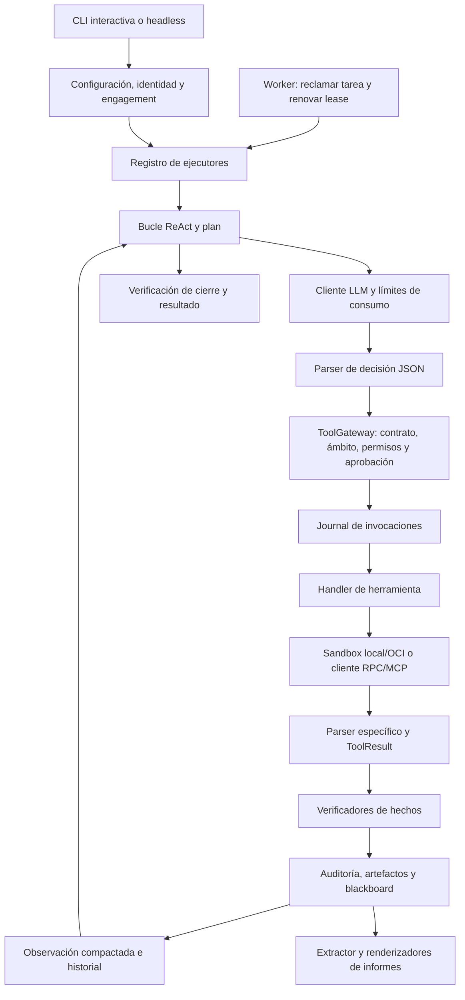

# BAJIOWARE — Auditoría arquitectónica y hoja de ruta técnica

**Fecha:** 12 de octubre de 2026.  
**Proyecto:** OmniAgentCS / NEXUS Core, versión declarada `3.0.0`, Python ≥ 3.12.  
**Referencia:** commit `363bba9be8386b1bb99d67911eb363a76b215c9a`; árbol de trabajo sin modificaciones reportadas al iniciar la auditoría.  
**Método:** inspección estática local; no se ejecutaron el framework, herramientas operativas, pruebas, instalaciones, llamadas LLM ni servicios externos. Los ejemplos siguientes describen contratos; no son resultados de ejecuciones.

**Alcance y límites:** se inventariaron 807 archivos versionados, se recorrieron los 806 archivos legibles como texto y se extrajeron por AST las declaraciones de los 491 archivos Python. De ellos, 239 están fuera de `nexus_core/tests` y 252 dentro; los 239 incluyen utilidades y un verificador histórico, no solamente código del producto. La revisión semántica se concentró en las rutas de ejecución, persistencia, validación, parsers y recuperación. El anexo identifica cada archivo versionado y los símbolos de los módulos Python ajenos a pruebas. Los documentos históricos y evidencias guardadas se consideran antecedentes, no validación del comportamiento actual. No se inspeccionaron valores de `.env`, credenciales locales, cachés, dependencias instaladas ni datos operativos no versionados. `OMNI.jpg` se inventarió como recurso binario, sin análisis visual.

**Dictamen ejecutivo:** existe un monolito modular con una arquitectura de ejecución gobernada considerablemente desarrollada. Cuenta con separación entre herramientas y parsers, contratos de resultados, auditoría, aprobaciones, tareas durables y evidencia verificable. La prioridad debe ser consolidar las garantías transaccionales y de recuperación antes de ampliar la concurrencia entre nodos. Los principales límites son la coordinación PostgreSQL, la captura de salida sin límite previo de memoria, los artefactos locales y la concentración de responsabilidades en el bucle ReAct y el extractor de informes. La existencia de pruebas y CI es positiva, pero esta auditoría no certifica que pasen.

## 1. VISIÓN GENERAL DE LA ARQUITECTURA

### 1.1 Patrones presentes

| Patrón | Implementación observable | Alcance real |
|---|---|---|
| ReAct | `agent/react.py`, `parser.py`, `prompts.py` | El modelo emite una decisión JSON; el motor valida, ejecuta y devuelve observaciones. |
| Máquina de estados persistente | `kernel/control_store.py`, `invocation_journal.py`, `agent/planner.py` | Hay estados separados de tarea, invocación y plan; no una única máquina formal que gobierne todos los estados. |
| Pipeline de transformación | `handlers → sandbox/RPC → parsers → ToolResult → verificadores → memoria/informe` | Los parsers son específicos por herramienta y desacoplados del transporte en numerosos adaptadores. |
| Gateway de políticas | `kernel/tool_gateway.py` | Centraliza contrato de entrada, ámbito, reglas de operación, permisos, aprobaciones, journal y evidencia. |
| Blackboard | `kernel/blackboard.py` sobre `knowledge.py` | Hechos compartidos por engagement, con procedencia y verificación. |
| Flujos DAG y compensaciones | `kernel/workflows.py` | Dependencias, tareas listas y compensaciones declaradas; requiere reforzar coordinación concurrente. |
| Eventos persistidos y outbox | `kernel_run_events`, `kernel_outbox`, auditoría | Hay publicación local/persistencia de eventos; no se identificó un despachador general de outbox hacia un broker externo. No es event sourcing integral. |
| Puertos y adaptadores parciales | Registro de ejecutores, clientes LLM, sandbox, MCP | Hay interfaces y registros, pero aún se comparten diccionarios libres, SQL y configuración ambiental entre capas. |

La unidad de distribución es un paquete Python con CLI. El empaquetado npm proporciona un lanzador y asistencia de instalación; no implementa un segundo motor. La CLI interactiva, la salida headless y el worker durable convergen en los mismos servicios del kernel, aunque conservan lógica propia de coordinación.

### 1.2 Puntos de entrada

- `omni.py:main`: inicializa configuración/secretos de manera explícita, resuelve rutas XDG, procesa onboarding, doctor y setup, publica el proveedor LLM y delega a la CLI.
- `nexus_core/cli/main.py:main`: interpreta argumentos y deriva hacia sesión interactiva, ejecución headless, herramientas individuales, informes y comandos administrativos.
- `nexus_core/cli/session.py:OmniSession`: coordina la sesión, engagement, historial, comandos, ejecución y presentación.
- `nexus_core/cli/headless.py:run_headless`: ejecuta un objetivo y produce JSON/NDJSON con códigos de salida; evita depender de la TUI.
- `nexus_worker.py:main`: consulta tareas disponibles, reclama una, ejecuta con renovación de lease y timeout, completa o reintenta y reconcilia workflows.
- `kernel/runtime.py:ExecutorRegistry`: despacha `debug.fake_llm`, `llm.complete`, `agent.run`, `conversation.respond`, `tool.invoke`, `brain.run`, `react.run`, `memory.index` y `evaluation.run`.
- `scripts/omni_tool.py`, `scripts/react_e2e_manual.py` y herramientas de QA: entradas auxiliares; su presencia no implica que formen parte del arranque normal.

### 1.3 Flujo principal



El motor reconstruye contexto, plan y catálogo permitido; solicita al LLM una acción; el parser admite `tool_call`, `task_complete` o `request_clarification`. Una llamada pasa por el gateway. La salida se transforma en una observación y puede actualizar hechos verificables. El cierre se contrasta con fases pendientes y evidencia; la declaración de éxito del modelo no es suficiente por sí misma. El supervisor usa conversaciones hijas y presupuestos compartidos, mientras que `kernel/batch.py` implementa lotes acotados dentro del proceso.

## 2. PIPELINE DE DATOS Y ESQUEMAS

### 2.1 Captura de stdout/stderr

`kernel/sandbox.py:LocalSandbox.run` usa `asyncio.create_subprocess_exec` con argumentos separados, `stdin=DEVNULL`, `stdout=PIPE`, `stderr=PIPE`, entorno controlado y `start_new_session=True`. Recoge ambos canales mediante `process.communicate()`. Espera salida, cancelación o vencimiento del tiempo; termina el grupo con SIGTERM y después SIGKILL cuando corresponde. Decodifica UTF-8 con `errors="replace"`.

El resultado de bajo nivel es `SandboxResult`, con código de salida, stdout, stderr, duración, timeout, cancelación y huérfanos detectados. `OCISandbox` construye la ejecución en contenedor y aplica sus restricciones propias. `sandbox_modes.py` declara las garantías de cada modo: no debe confundirse el runner local con aislamiento completo del sistema operativo.

**Límite importante:** el recorte `[:self.max_output_bytes]` ocurre después de `communicate()`. Acota el resultado devuelto, pero no la memoria consumida durante la captura. Además, stdout y stderr se recortan por separado. El gateway aplica otro límite al JSON serializado completo: esos límites no son equivalentes y pueden rechazar un resultado ya ejecutado. Un documento XML o JSON cortado antes de parsearse puede quedar inválido. Tampoco se conserva necesariamente la totalidad de la salida original.

Los handlers reutilizan `tools/handlers/_exec.py:run_in_sandbox`, construyen argv y aplican controles de parámetros. Metasploit y Sliver utilizan adaptadores RPC/gRPC; MCP normaliza respuestas de su SDK y transporte. Hay herramientas que leen archivos JSON generados por el proceso y otras que usan stdout directamente. Los scripts Python embebidos en algunos handlers constituyen otra superficie de mantenimiento.

### 2.2 Limpieza, normalización y almacenamiento

| Etapa | Comportamiento actual | Consideración |
|---|---|---|
| Captura | Bytes → texto UTF-8 con reemplazo y recorte | Se pueden perder bytes y secuencias multibyte; falta un manifiesto uniforme de truncamiento. |
| Parser | XML, JSON, JSONL, regex o respuesta RPC normalizada | La limpieza ANSI no es transversal: por ejemplo, SQLMap tiene su propia rutina `_clean`. |
| Resultado | `ToolResult` con output, evidencia, salida y señales de terminación | El contrato exterior es común; `output` y `evidence` siguen abiertos. |
| Verificación | `derive_assertions` y `persist_assertions` | Solo parsers/verificadores de confianza deben promover afirmaciones verificadas. |
| Persistencia | `redaction.sanitize` / `sanitize_text` en fronteras concretas | Reconoce campos y asignaciones de credenciales; no es detector universal de secretos. |
| Contexto LLM | `agent/injection.py` y `observations.py` | Delimita texto no confiable, neutraliza marcadores y compacta observaciones. |
| Archivo | `LocalArtifactStore`, SHA-256, escritura temporal, fsync y reemplazo | Almacena bytes recibidos; no redacta automáticamente ni cifra por sí mismo. |
| Auditoría | `AuditWriter`, JSON canónico y cadena SHA-256 | Sanitiza antes de calcular el hash. Cadena global verificable, pendiente de coordinación entre escritores. |
| Presentación | CLI/TUI y `report/*` | Los recortes visuales son distintos del recorte de captura y del de contexto. |

`InvocationJournal.finish` serializa una copia saneada del resultado; conserva una referencia a artefacto y hash, o JSON inline si no dispone de almacén. Las observaciones mayores de 20 000 caracteres intentan archivarse y se compactan; el archivo de observación es de mejor esfuerzo. `prepare_observation` no impone saneamiento universal al almacén: es necesario razonar sobre cada llamador. Los resúmenes para el modelo y los artefactos archivados no equivalen automáticamente a una captura forense completa.

### 2.3 Modelos actuales

Predominan `dataclass`, `dataclass(frozen=True)`, enums, `TypedDict` y diccionarios. Aunque Pydantic está declarado como dependencia, no se localizaron modelos propios basados en `BaseModel` en el código inspeccionado. Sí existe validación de entrada con `jsonschema.Draft202012Validator`, validación de esquemas al registrar herramientas y caché de validadores.

| Dominio | Modelos y campos significativos |
|---|---|
| Identidad y autorización | `Identity(subject_id, tenant_id, roles, groups, attributes)`, `Resource`, `PolicyDecision`. |
| Catálogo | `AgentDefinition`; `ToolDefinition(input_schema, risk, effect, timeout_seconds, max_output_bytes, scopes, scope_required, sandbox_required, idempotent)`. |
| Ejecución | `RunContext` incluye run/trace, identidad, ámbito, sesión, invocación, workspace, fase y objetivo; también dependencias vivas que no forman un DTO puro. `ExecutionContext` contiene store, tarea, worker y cancelación. |
| Salida | `ToolResult(output, verified, verification_method, evidence, exit_code, accepted_exit_codes, stdout, stderr, timed_out, tool_id, contract_version, parser_version, outcome)`. |
| Decisión | `ReActAction(thought, action, tool_id, arguments, expected_outcome, summary, findings, question, raw_response, warnings)`. |
| Bucle | `ReActConfig` y `ReActResult(status, iterations, final_summary, findings, conversation_id, actions, plan, subagent_id, evidence_stats, completion_verified)`. |
| Planificación | `Phase`, `PhaseStatus`, `Plan`, `SubAgentDefinition`, `SubAgentRun`, `SupervisorTree`; playbooks y pasos tipados. |
| Hechos | `Fact` es `TypedDict`: tipo, clave, valor, autor de afirmación, verificación, método e invocación; `Blackboard` conserva además procedencia y ámbito. |
| Ámbito | `EngagementScope`, `ScopeKind`, `ResolvedTarget`, `RulesOfEngagement`, `TimeWindow`. |
| LLM | `LLMConfig`, `LLMMessage`, `LLMResponse`, `LLMProvider`; clientes por proveedor. |
| Informes | `Evidence`, `Finding`, `ReportItem`, `FailedAttempt`, `TimelineEntry`, `FrameworkMapping`, `EngagementReport`; CVSS, CVSS4, EPSS, KEV y mapeos de marcos cuando están disponibles. |

`ToolResult.success` requiere `verified`, ausencia de timeout y código de salida aceptado o no informado. `completed` también admite resultados negativos, denegados o no soportados. El JSON derivado puede tener `outcome="success"`, aunque ese valor no pertenece al vocabulario permitido para declarar `outcome` en el constructor: es una asimetría relevante para deserialización.

Ejemplo ilustrativo de resultado serializado, sin representar una ejecución real:

```json
{
  "success": false,
  "outcome": "negative",
  "output": {"records": []},
  "verified": false,
  "verification_method": "consulta_completada_sin_coincidencias",
  "evidence": {},
  "exit_code": 0,
  "accepted_exit_codes": [0],
  "stdout": "",
  "stderr": "",
  "timed_out": false
}
```

El gateway añade `invocation_id`, `run_id`, `assertions` y versiones del contrato/parser. La versión del parser es hoy una constante global `PARSERS_VERSION="1.0.0"`, no una revisión independiente de cada adaptador.

### 2.4 Modelo relacional

`kernel/control_store.py:SCHEMA` define tablas con columnas escalares y muchos documentos JSON guardados en `TEXT`. La implementación PostgreSQL reutiliza y traduce este esquema; no constituye un diseño nativo basado sistemáticamente en JSONB.

| Conjunto | Tablas principales | Función |
|---|---|---|
| Identidad y catálogo | `kernel_tenants`, `kernel_organizations`, `kernel_environments`, grupos, usuarios, servicios, recursos, capacidades, agentes, herramientas y paquetes | Aislamiento lógico y definición de capacidades. |
| Ejecución | `kernel_runs`, `kernel_tasks`, `kernel_task_transitions`, `kernel_dead_letters` | Estado, payload, resultados, intentos, disponibilidad, lease y cancelación. |
| Flujos | `kernel_workflows`, `kernel_workflow_steps` | DAG, dependencias y compensaciones. |
| Historial | `kernel_conversations`, `kernel_messages`, `kernel_run_events` | Diálogo, pasos ReAct y eventos por run. |
| Evidencia | `kernel_artifacts`, `kernel_audit_events`, `kernel_knowledge_documents` | Archivos direccionados por contenido, decisiones y hechos. |
| Memoria y consumo | `kernel_memories`, `kernel_memory_summaries`, `kernel_usage_ledger`, `kernel_quotas` | Memoria duradera, resúmenes y contabilización. |
| Gobierno | `kernel_policies`, `kernel_policy_bindings`, `kernel_approvals`, `kernel_engagements`, `kernel_sessions` | Políticas, aprobaciones consumibles, ámbitos y sesiones remotas. |
| Infraestructura | `kernel_outbox`, `schema_migrations`, conectores y tablas `evolution_*` | Eventos pendientes, migraciones y capacidades de plataforma. Su existencia no demuestra un servicio activo para cada tabla. |
| Esquemas adicionales | `kernel_invocations`, `kernel_budget_reservations` | Se crean también desde sus servicios; la definición de esquema está distribuida. |

### 2.5 Parsers implementados

| Entrada | Módulos bajo `tools/parsers/` | Conversión |
|---|---|---|
| XML | `nmap.py` | `ElementTree`, manejo de namespaces, hosts, puertos, SO, estadísticas y SHA-256 del texto recibido. |
| JSONL | `_jsonl.py`, `httpx.py`, `nuclei.py`, `subfinder.py` | Extraen objetos válidos, cuentan líneas malformadas y normalizan campos; subfinder contempla formatos alternativos. |
| JSON/documentos | `ffuf.py`, `whatweb.py`, `searchsploit.py`, `dalfox.py`, `bloodhound.py` | Sobres, registros, tecnologías, referencias, hallazgos y metadatos de colecciones. |
| Texto/regex | `gobuster.py`, `nikto.py`, `sqlmap.py`, `netexec.py`, `dns.py` | Estados HTTP, rutas, banners, bloques de inyección, enumeración y respuestas DNS. |
| Texto especializado | `impacket_getuserspns.py`, `impacket_secretsdump.py`, `impacket_psexec.py` | SPN, resultados de credenciales y señales de ejecución. |
| Objetos RPC | `metasploit.py`, `sliver.py` | Módulos, sesiones, trabajos, interacción, inventario y resultados normalizados. |
| HTML y respuestas WordPress | `wordpress.py` | Versiones, activos, usuarios REST, nonce, texto y títulos. |
| Respuesta del modelo | `agent/parser.py` | JSON directo → bloques Markdown → objetos con llaves balanceadas; valida acción y tolera desviaciones con warnings. |
| Verificación semántica | `kernel/fact_verification.py`, `agent/evidence.py` | Deriva afirmaciones acotadas y contrasta hallazgos con evidencia de la ejecución. |
| Reconstrucción de informes | `report/extractor.py` | Combina observaciones, eventos, resultados y hechos; deduplica y clasifica hallazgos e intentos. |

No se identificó un motor AST general para interpretar stdout. El balanceo de llaves del parser ReAct es un escáner consciente de comillas/escapes, no un parser AST. `_pwn.py` analiza estructuras ELF binarias. El AST usado para el inventario de esta auditoría es una técnica de inspección, ajena al runtime del proyecto.

## 3. ORQUESTACIÓN Y GESTIÓN DEL ESTADO

### 3.1 Persistencia y contexto

`store_factory.get_control_store` selecciona SQLite o PostgreSQL según configuración. Producción exige PostgreSQL salvo la excepción explícita `NEXUS_ALLOW_SQLITE_PRODUCTION`. SQLite habilita WAL y claves foráneas; sirve para desarrollo y operación de un nodo.

`agent/memory.py` conserva pasos en conversaciones/mensajes, distingue sesiones de trabajo de runs y añade marcadores de resumen. Relee historial y filtra objetivos/acciones según ejecución. La compactación consulta hasta 500 mensajes, conserva el encabezado y una cola, y puede llamar al LLM para resumir. `observations.bounded_context` aplica 8 000 caracteres al historial seleccionado, pero permite conservar un último mensaje mayor que ese valor; el prompt de sistema se añade fuera de ese límite. Por tanto, no es un límite estricto de tokens de toda la solicitud.

El blackboard persiste hechos como documentos de conocimiento identificados por `blackboard/<engagement>/<type>/<key>`. `is_verified_fact` exige `asserted_by="verifier"`, método e identificador de invocación, además del booleano. `kernel/memory.py` representa memoria general distinta del historial ReAct. Las sesiones de Metasploit/Sliver mantienen asociaciones con engagement mediante `kernel/sessions.py`.

### 3.2 Estados y recuperación

```text
Tarea:
queued → running → completed
             ├── error recuperable → queued (available_at futuro)
             ├── intentos agotados → dead_letter
             └── cancelación → procesamiento de cancel_requested/estado terminal

Invocación:
prepared → running → succeeded
                 └── error/interrupción → unknown
unknown → decisión de recuperación/reintento o failed por decisión del operador

Plan:
fases pendientes → activas → completadas/bloqueadas según hechos y decisiones
```

Las transiciones anteriores resumen caminos principales; no constituyen una enumeración formal exhaustiva de todos los estados de cada subsistema. `Run.status`, `Task.status` y `ReActResult.status` pertenecen a planos diferentes: una tarea puede completar la ejecución del motor y contener un resultado funcional bloqueado o incompleto.

El journal usa hashes de argumentos y una `step_key` formada por herramienta, argumentos, fase y los primeros 200 caracteres del objetivo. Evita invocaciones simultáneas mediante índices únicos parciales; reutiliza resultados previos de operaciones no idempotentes y bloquea estados en vuelo. Un resultado desconocido no idempotente exige aprobación durable específica antes de reintentar. Esto reduce efectos duplicados, pero no prueba ejecución exactamente una vez sobre sistemas externos.

### 3.3 Reintentos, tiempos y fallos

| Capa | Implementación |
|---|---|
| Tareas | `enqueue_task`: por defecto tres intentos y timeout de 300 s. `fail_or_retry_task`: espera `min(300, 2**(attempts-1))`, sin jitter, y cola de errores al agotar intentos. |
| Worker | Consulta por defecto cada 2 s; una tarea por ciclo. El heartbeat se programa cada 30 s y renueva por 120 s; la reclamación inicial usa el valor por defecto del store, 60 s. |
| Lease | `claim_task` recupera tareas running con lease vencido; renovación y finalización comprueban identidad de propietario en algunas fases. Persisten ventanas de carrera descritas en §5. |
| Ejecutor | `asyncio.wait_for` limita el trabajo; `cancel_event` permite cancelación cooperativa. |
| Herramienta | Gateway aplica `definition.timeout_seconds` a handlers coroutine; handlers síncronos se llaman directamente. El bucle tiene además su propio límite, por defecto 600 s. |
| Proceso | Sandbox termina grupos de procesos con escalamiento SIGTERM/SIGKILL; contempla cancelación externa y drenaje de pipes. |
| Modelo | Clientes aplican manejo de errores y límites; OpenAI incorpora backoff y tratamiento de 413/429; `TokenPacer` administra consumo temporal; el facade ofrece fallback. No todos los adaptadores tienen la misma política. |
| JSON inválido | Se persiste la respuesta saneada, se genera `react.parse_error`, se añade corrección y se consume otra iteración. |
| Error de entrada/herramienta | El bucle distingue categorías; puede retirar herramientas repetidamente fallidas, cambiar de fase y abortar según contadores. |
| Gobierno/proveedor | Violación de scope detiene el camino; falta de aprobación puede producir `blocked`; otras denegaciones `governance_denial`; fallos de proveedor/timeout pueden terminar como `provider_error`. |
| Finalización | Gates de plan y evidencia rechazan cierres prematuros; se guarda el motivo y la verificación final. |

`BudgetLedger` reserva consumo antes de la llamada y liquida después. Su documentación excluye contabilidad exactamente una vez tras una caída. Además, la exclusión de reserva heredada de SQLite no es suficiente en PostgreSQL bajo aislamiento predeterminado. El supervisor y el batch ya tienen límites de concurrencia dentro del proceso; no deben describirse como un scheduler distribuido completo.

## 4. INVENTARIO DE MÓDULOS

### 4.1 Responsabilidades por subsistema

| Ruta | Función técnica |
|---|---|
| `nexus_core/agent` | Bucle, decisiones, prompts, historial, compactación, evidencia, plan, playbooks, instrucciones de proyecto, skills, especialización y supervisión. |
| `nexus_core/kernel` | Contratos, stores, SQL, tareas, workflows, gateway, sandbox, políticas, aprobaciones, auditoría, journal, memoria, hechos, consumo, sesiones, conectores, directorio y telemetría. |
| `nexus_core/tools` | Catálogo incorporado, registro extensible y cliente DPAPI; `handlers` adapta capacidades y `parsers` normaliza salidas. |
| `nexus_core/llm` | Abstracción multiproveedor, adaptadores, modelo de mensajes/respuestas, fallback, streaming y ritmo de tokens. |
| `nexus_core/scope` | Modelos y firmas de engagement, persistencia, resolución DNS, validación de objetivos y reglas de operación. |
| `nexus_core/integrations` | MCP, Metasploit RPC y Sliver gRPC, con clientes y traducciones hacia herramientas gobernadas. |
| `nexus_core/report` | Extracción, severidad, CVSS 3.1/4.0, enriquecimiento CVE, marcos, cronología y renderizado Markdown/HTML/SARIF. |
| `nexus_core/config` | Configuración TOML, rutas XDG, carga/guardado, bootstrap y backends de secretos. |
| `nexus_core/provisioner` | Detección, identidad de binarios, recetas confiables, dependencias y planes de instalación aprobados. |
| `nexus_core/hooks` | Eventos de ciclo de vida, confianza de configuración de hooks y bloqueos previos a herramientas. |
| `nexus_core/cli` | Argumentos, sesión, comandos, aprobaciones, setup, doctor, headless, reanudación y presentación. |
| `nexus_core/cli/tui` | Aplicación prompt_toolkit, salida centralizada, regiones, pegado, historial, autocompletado, paneles, estado y métricas de uso/costo. |
| `nexus_core/utils` | Logging y utilidades de validación/seguridad; deben delimitarse frente al kernel para evitar contratos paralelos. |
| `scripts` | Instalación, catálogo, conducción de herramientas, análisis de trazas y probes/manuales. |
| `packaging/npm` | Distribución del comando y enlace al entorno Python. |
| `nexus_core/tests`, `qa_runs` | Pruebas, fixtures, soportes, casos manuales y evidencias históricas. |
| `docs`, Markdown raíz | ADR, planes, runbooks, auditorías y resultados de misiones; no son prueba automática de capacidades activas. |

El **anexo A** enumera individualmente los 239 archivos Python fuera de pruebas, sus clases, métodos y funciones de nivel de módulo. Los auxiliares anidados quedan contenidos en el cuerpo de su función propietaria; no se presentan como API independiente. El **anexo B** clasifica los restantes archivos versionados, incluyendo todos los archivos de pruebas y recursos.

### 4.2 Controles de calidad existentes

Se localizaron 226 archivos `test_*.py` unitarios y 21 archivos Python de integración, además de utilidades y fixtures. Hay pruebas para leases, journal, PostgreSQL, cancelación, contratos, parsers, aprobación, evidencia, presupuestos, sesiones, salida headless, MCP, TUI y reportes. Estos conteos son de archivos, no de casos ni de cobertura.

`Makefile` declara sintaxis, lint, pruebas y tipado incremental. CI tiene jobs de CLI con Python 3.12 y E2E desactivado, smoke PostgreSQL 17 y detección de secretos. `mypy` usa `follow_imports="skip"` y no activa modo estricto global; el gate solo revisa archivos cambiados. `lint` selecciona `F,E9`. No se ejecutó ninguno de estos controles durante la auditoría, ni se atribuyen resultados actuales a XML/logs históricos.

## 5. DEUDA TÉCNICA Y CUELLOS DE BOTELLA

**Lectura de prioridades:** P0 = resolver antes de sostener garantías de concurrencia/continuidad entre nodos; P1 = siguiente ciclo de ingeniería; P2 = consolidación. “Observado” indica estructura presente en código. “Riesgo inferido” indica consecuencia razonada sin reproducción dinámica.

### 5.1 Hallazgos prioritarios

| ID / prioridad | Evidencia del código | Impacto y corrección propuesta |
|---|---|---|
| D01 / P0 | `budget_ledger.py:reserve` hace suma + inserción tras `BEGIN IMMEDIATE`; `postgres_store.py:_query` lo sustituye por `BEGIN`. | **Riesgo inferido:** dos reservas PostgreSQL pueden leer el mismo consumo y ambas pasar. Serializar por raíz mediante fila bloqueada/advisory lock o transacción serializable con reintento. La existencia del ledger no garantiza el techo concurrente. |
| D02 / P0 | `audit.py:append` lee el último hash global y luego inserta, sin bloqueo que serialice ambas acciones. | **Riesgo inferido:** escritores concurrentes pueden compartir predecesor y romper la cadena lineal; SQLite puede además producir contención. Usar cabeza por tenant bloqueada transaccionalmente o secuenciador explícito. |
| D03 / P0 | `control_store.py:complete_task` y `fail_or_retry_task` verifican propietario con SELECT, pero los UPDATE posteriores filtran solo por ID; `renew_task_lease` no exige lease vigente. | **Riesgo inferido:** al cambiar el propietario entre lectura y escritura, un worker viejo puede modificar la tarea. Añadir generación de lease monotónica, comparación atómica en cada UPDATE y comprobar rowcount. El worker debe manejar pérdida de propiedad sin volver a fallar por ella. |
| D04 / P0 | `runtime.py:ExecutorRegistry.execute` recupera journal con el ID del worker actual; `InvocationJournal.recover` solo acepta invocaciones sin propietario o del mismo ID. | **Inconsistencia observable:** una tarea retomada por B conserva invocación atribuida a A en `running`; el gateway la bloquea. Las pruebas de fencing cubren no tocar A y recuperación por A, pero no demuestran takeover completo A→B. Vincular invocación a tarea/generación y acreditar expiración del propietario anterior. Incluir también recuperación de `prepared`. |
| D05 / P0 | `workflows.py:reconcile` inserta tarea y luego actualiza paso con `task_id IS NULL`, sin comprobar el resultado ni bloquear previamente el paso. | **Riesgo inferido:** reconciliadores PostgreSQL simultáneos pueden insertar tareas duplicadas; la que pierde el vínculo permanece en cola. Reclamar el paso antes de insertar, con bloqueo/CAS y unicidad de tarea por paso y propósito. |
| D06 / P1 | `sandbox.py:LocalSandbox.run` y ruta OCI usan captura completa y recorte posterior. | **Observado:** salida arbitrariamente grande implica presión de RAM y datos estructurados truncados. Drenar incrementalmente a almacenamiento con límite, hashes y marcas explícitas. |
| D07 / P1 | `artifacts.py:LocalArtifactStore`; `_journal_artifact_store`; archivo XDG de observaciones. | **Observado:** referencias a rutas locales y dependencia de disco del nodo. Implementar interfaz y backend compartido; separar credenciales, retención y permisos por tenant. Asegurar lectura desde cualquier worker. |
| D08 / P1 | `tool_gateway.py:invoke` llama handlers síncronos directamente; stores SQL síncronos se usan desde corrutinas. | **Observado:** esas llamadas bloquean el event loop y no reciben el mismo timeout directo del gateway. Migrar IO a adaptadores async o ejecutores acotados; un hilo por sí solo no ofrece cancelación dura. |
| D09 / P1 | `nexus_worker.py:_execute_with_heartbeat`: error en `renew_loop` no se transforma en cancelación; el gather final usa `return_exceptions=True`. | **Riesgo inferido:** una excepción de base de datos puede dejar el ejecutor trabajando sin renovación. Propagar pérdida/fallo de heartbeat y exigir confirmación de propiedad al finalizar. |
| D10 / P1 | `invocation_journal.py:finish/result_of`: almacena `JSON + "|" + digest` y lee con `partition("|")`. | **Defecto de formato observable:** un carácter `|` dentro del JSON inline se interpreta como separador antes de terminar el documento. Usar columnas o referencia JSON tipada; validar hash también en la variante inline. |
| D11 / P1 | `observations.py:prepare_observation` captura errores del archivo y continúa; `LocalArtifactStore.put` recibe bytes sin saneamiento propio. | **Observado:** puede entregarse solo resumen sin evidencia completa; la política de redacción depende del origen. Emitir estado de archivo fallido, imponer política explícita y distinguir evidencia requerida de material opcional. |
| D12 / P1 | `control_store.py:claim_task` permite reclamar running expirado sin filtrar `attempts < max_attempts`. | **Riesgo inferido:** caídas reiteradas antes de `fail_or_retry_task` permiten superar el máximo sin DLQ. Aplicar política de agotamiento también al recuperar leases. |

Los hallazgos P0 no equivalen a incidentes confirmados; describen invariantes que el código actual no garantiza por sí solo bajo concurrencia. Las protecciones existentes —UPDATE condicional al reclamar, índices únicos del journal, aprobaciones consumibles y cancelación de procesos— deben conservarse durante la corrección.

### 5.2 Mantenibilidad y contratos

| ID / prioridad | Evidencia | Recomendación |
|---|---|---|
| D13 / P1 | `react.py` 1 985 líneas; `_run_react_loop_impl` concentra prompt, plan, budgets, parsing, callbacks, ejecución, fallos, memoria y cierre. | Extraer servicios y un estado explícito; conservar un coordinador corto que haga visibles las transiciones. El tamaño solo es un indicador: la mezcla de responsabilidades es el problema. |
| D14 / P1 | `report/extractor.py` 1 950 líneas; `cli/commands.py` 1 595; `cli/session.py` 1 417. | Registro de extractores por tipo y handlers de comandos; separar consulta del dominio de renderizado e interacción. |
| D15 / P1 | Dataclasses con `dict[str, Any]`, estados como strings y `default=str` en serializaciones. | Validación en fronteras, DTOs versionados y uniones discriminadas; evitar ocultar tipos no serializables mediante coerción. Un `frozen=True` con dict anidado no garantiza inmutabilidad profunda. |
| D16 / P1 | DDL en store, journal, presupuesto y otros servicios; traducción textual `? → %s`, `BEGIN IMMEDIATE → BEGIN`. | Migraciones únicas y repositorios por backend; las diferencias semánticas requieren SQL específico, no solo reemplazo de texto. |
| D17 / P2 | Constantes y reglas por herramienta en plan, playbooks, verificadores, registry y extractor; `_wp.py`/`_pivot.py` contienen código embebido. | Descriptores de capacidad con parser, verificador y extractor registrados; scripts auxiliares empaquetados y comprobables. Mantener cerradas las listas que representan controles de seguridad. |
| D18 / P2 | `PARSERS_VERSION` global y formatos de mensajes/eventos sin versión transversal. | Versionar sobre, payload y parser de forma diferenciada; migración de lectura y reproducción de evidencia antigua. |
| D19 / P1 | Excepciones amplias en contexto, contabilidad y archivo; `_record_response_tokens` puede tolerar errores. | Clasificar degradación opcional frente a persistencia obligatoria; registrar motivo, contador y resultado parcial. Evitar silencio en integridad o presupuesto. |
| D20 / P2 | Mypy incremental no estricto; dependencias repetidas y rangos amplios; documentación histórica extensa. | Tipado progresivo por subsistema, una fuente de dependencias y documento arquitectónico vigente con enlaces a archivos históricos. |

### 5.3 Límites de escala y casos de borde

- **Cola SQL:** `claim_task` compite por la primera fila elegible sin estrategia PostgreSQL `SKIP LOCKED`; aunque su UPDATE condicional evita algunas reclamaciones dobles, no distribuye óptimamente la contención. El worker procesa una tarea cada vez; aumentar procesos exige resolver primero D01–D05.
- **Conexiones:** `PostgresControlStore.connect` abre conexión por operación y no muestra pool. Eventos, auditoría, uso, journal y hechos generan varias transacciones por invocación.
- **Consistencia entre servicios:** efecto externo, hechos, auditoría y resultado no se confirman en una transacción única. Un error posterior al efecto puede dejar `unknown`; es conservador, pero exige reconciliación y evidencia recuperable.
- **Auditoría:** cadena global entre tenants, consulta completa para verificar y exportación con filtrado de run en Python. El costo crece con el historial; se necesitan índices, paginación, particiones y puntos de control verificables. Un hash no impide que un administrador reescriba toda la base y recalcule la cadena.
- **Contexto:** límites por caracteres y heurísticas de tokens no equivalen a tokens reales del proveedor; compactación y ventanas pueden perder detalles. Debe poder distinguirse hecho persistido de detalle que dejó de estar visible para el LLM.
- **Identidad de paso:** truncar objetivo a 200 caracteres puede confluir intenciones con prefijo común dentro del mismo run; documentar esa semántica o usar un identificador estable de paso.
- **Parser tolerante:** JSONL puede aceptar subconjuntos válidos; ReAct usa la primera acción y descarta el resto con warning. Exponer estado parcial/advertencias de manera uniforme para no confundir parsing parcial con resultado completo.
- **Estados:** el gateway registra métrica `status="success"` para todo `ToolResult.completed`, incluyendo negativos; el journal llama `succeeded` a una invocación terminada sin implicar hallazgo positivo. Distinguir éxito técnico, resultado del objetivo y confianza en métricas e informes.
- **Redacción:** campos como `session_id` son tratados como secretos; puede reducir trazabilidad cuando el identificador es operativo. A la vez, un secreto sin nombre reconocible puede permanecer en texto libre. Requiere clasificación por esquema y separación de identificadores y credenciales.

## 6. HOJA DE RUTA DE REFACTORIZACIÓN CLEAN CODE

### 6.1 Arquitectura objetivo

Conservar el monolito modular y fijar fronteras antes de plantear microservicios. El coordinador debe depender de protocolos pequeños: `TaskRepository`, `InvocationRepository`, `ConversationRepository`, `ArtifactStore`, `ProcessRunner`, `ToolExecutor`, `ModelClient` y `EventSink`. El dominio debe contener decisiones y transiciones; los adaptadores deben contener SQL, procesos, red, disco y presentación.

```text
CLI / worker / headless
        ↓
Servicios de aplicación: Orchestrator, ToolExecution, ReportBuilder
        ↓
Dominio: RunState, Action, ToolResult, Fact, Finding, Lease
        ↓ protocolos
Adaptadores: PostgreSQL/SQLite, procesos/OCI, LLM/RPC/MCP, artefactos
```

La UI recibe eventos de aplicación y no controla persistencia interna. Un único servicio de ejecución conserva el orden obligatorio de validación, autorización, journal, ejecución y verificación. Las capacidades se registran con contrato de entrada, salida, parser, verificador y extractor, evitando replicar catálogos en el motor y en informes.

### 6.2 Contratos propuestos

Introducir Pydantic v2 en fronteras externas/persistidas y mantener dataclasses internas cuando resulten suficientes. No duplicar manualmente JSON Schema: generar el esquema de entrada a partir del modelo donde sea compatible y verificar que conserva todas las restricciones actuales.

Ejemplo conceptual propuesto — **no es código implementado**:

```python
from typing import Annotated, Literal
from pydantic import BaseModel, ConfigDict, Field

class Contract(BaseModel):
    model_config = ConfigDict(extra="forbid", strict=True, frozen=True)

class ToolCall(Contract):
    action: Literal["tool_call"]
    tool_id: str = Field(min_length=1)
    arguments: dict[str, object]  # segunda validación: modelo propio de la herramienta

class Complete(Contract):
    action: Literal["task_complete"]
    summary: str = Field(min_length=1)
    finding_refs: tuple[str, ...] = ()

class Clarify(Contract):
    action: Literal["request_clarification"]
    question: str = Field(min_length=1)

Action = Annotated[ToolCall | Complete | Clarify, Field(discriminator="action")]

class OutputRef(Contract):
    artifact_id: str
    sha256: str
    captured_bytes: int = Field(ge=0)
    truncated: bool

class EventEnvelope(Contract):
    schema_version: Literal["1"] = "1"
    event_id: str
    tenant_id: str
    run_id: str
    event_type: str
    payload: dict[str, object]  # sustituir por unión de eventos del dominio
```

Complementar con modelos específicos de salida —host, servicio, respuesta HTTP, hallazgo, sesión—, `ParseStatus` (`complete/partial/invalid`), resultado técnico separado del efecto y del nivel de evidencia, timestamps UTC, identificadores de lease/generación y referencias de artefactos. El esquema de hash debe exigir longitud/formato; el ejemplo abrevia esos controles. `frozen=True` no reemplaza estructuras profundamente inmutables.

La tolerancia a fences y texto alrededor del JSON debe vivir en un adaptador de entrada, con warnings persistidos; el dominio recibe acciones ya validadas. Los eventos de dominio y sus payloads necesitan uniones cerradas, no permanecer indefinidamente en `dict[str, object]`.

### 6.3 Secuencia de implementación y aceptación

| Fase | Trabajo concreto | Dependencias y criterio de aceptación |
|---|---|---|
| F0 — Contratos e invariantes | Documentar estados separados de tarea/run/invocación; inventariar formatos persistidos; diseñar compatibilidad y migraciones. | Base para todas las fases. Casos de ejemplo existentes conservan significado y referencias; cada transición tiene dueño y precondición. |
| F1 — Atomicidad y recuperación | Resolver D01–D05, D09, D12: generaciones de lease, CAS, locks por raíz/auditoría, unicidad workflow, takeover y agotamiento. | Antes de ampliar workers. Pruebas futuras con conexiones/procesos PostgreSQL independientes: sin sobrerreservas, sin doble encolado, sin finalización por propietario vencido, recuperación A→B sin repetir efectos desconocidos. |
| F2 — Evidencia y captura | Resolver D06, D07, D10, D11: captura incremental, manifiestos de tamaño/truncamiento, referencias tipadas, archivo compartido y política de redacción. | Construye sobre identidad de invocación estable. Memoria acotada durante grandes salidas; prueba futura de lectura desde otro nodo, fallo de disco y caracteres `|`; hashes consistentes. |
| F3 — Tipado del dominio | DTOs versionados para acciones, resultados, hechos y eventos; parser adapters; quitar coerciones silenciosas críticas. | Lectura compatible de registros previos; ida/vuelta de serialización; entradas inválidas rechazadas antes de efectos; tipado estricto por módulo migrado. |
| F4 — Separación del motor | Extraer `ContextBuilder`, `ActionDecoder`, `ApprovalCoordinator`, `ToolExecutionService`, `CompletionVerifier` y `RunRecorder`; reducir CLI a adaptación. | Pruebas de comportamiento conservan aprobación, cancelación, evidencia, budgets y resultados; el núcleo puede probarse sin terminal ni base real. |
| F5 — Informes y catálogo | Registro de extractores por capacidad; centralizar metadatos; separar enriquecimiento de renderizado; scripts embebidos como recursos mantenibles. | Misma evidencia produce informe determinista y mismo digest; nueva capacidad se añade sin modificar múltiples grandes condicionales. |
| F6 — Operación y rendimiento | Pool PostgreSQL, reclamación con `SKIP LOCKED`, eventos paginados, retención, exportación verificable, outbox con consumidor si se requiere y límites por tenant. | Medir latencia, throughput, RAM, conexiones y colas con escenarios aprobados; fijar SLO a partir de mediciones, no de cifras supuestas. |

Las pruebas descritas son **criterios futuros**, no pruebas ejecutadas en esta auditoría. Las fases son un orden de dependencia, no una estimación contractual de semanas. F1 corresponde al responsable de persistencia/orquestación; F2 al de ejecución/datos; F3–F5 a los responsables de dominio y producto; F6 a plataforma. Cada entrega debe conservar compatibilidad mediante adaptadores y migraciones reversibles cuando los datos lo permitan.

### 6.4 Reglas de ingeniería para sostener el cambio

1. Cada transición durable debe ser atómica y comprobar propietario/generación; la observación del estado en un SELECT anterior no basta.
2. Ningún reintento de efecto desconocido se habilita por una excepción genérica. Clasificar ejecución segura, efecto incierto y decisión operativa.
3. Captura, parsing, verificación y renderizado deben tener contratos separados. Un parser parcial no produce automáticamente evidencia concluyente.
4. El almacenamiento obligatorio de evidencia debe fallar explícitamente; el material opcional puede degradarse con evento y estado parcial.
5. Versionar esquemas y parsers, definir lectura de versiones antiguas y asegurar trazabilidad `run → task → invocation → artifact → assertion → finding`.
6. Introducir tipado estricto y pruebas de concurrencia por frontera modificada, evitando reescribir todo el sistema antes de corregir las garantías críticas.

**Decisión recomendada a dirección:** priorizar integridad transaccional y recuperación, después evidencia compartida y contratos. La expansión de capacidades puede continuar sobre el gateway existente, pero la promoción a ejecución distribuida debe condicionarse a los criterios de aceptación de F1 y F2.


## Anexo A. Inventario individual de código Python
Los enlaces son relativos al repositorio. Se enumeran declaraciones de nivel de módulo y métodos directos de cada clase, obtenidos por análisis estático; no se importaron los módulos. Los nombres privados también se incluyen. Cada grupo de símbolos comparte la función técnica descrita para su archivo.

### `docs/missions/salas/the synthetic lab_flag3_verify.py`
**Función:** Verificador histórico de material DPAPI/KeePass; no pertenece al arranque del producto. **Extensión:** 107 líneas. [Fuente](../docs/missions/salas/the synthetic lab_flag3_verify.py).

**Clases y métodos:**

- `_MasterkeyShim` (línea 42): `__init__`.

**Funciones:** `kdbx3_transformed_key` (L49), `main` (L68).

### `nexus_core/__init__.py`
**Función:** Inicializa el paquete y sus exportaciones; consultar símbolos cuando contiene lógica adicional. **Extensión:** 0 líneas. [Fuente](../nexus_core/__init__.py).

Sin clases o funciones de nivel de módulo; contiene constantes, importaciones, declaraciones de paquete o instrucciones de script.

### `nexus_core/agent/__init__.py`
**Función:** Inicializa el paquete y sus exportaciones; consultar símbolos cuando contiene lógica adicional. **Extensión:** 20 líneas. [Fuente](../nexus_core/agent/__init__.py).

Sin clases o funciones de nivel de módulo; contiene constantes, importaciones, declaraciones de paquete o instrucciones de script.

### `nexus_core/agent/evidence.py`
**Función:** Contrasta hallazgos con afirmaciones y detecta evidencia sin respaldo. **Extensión:** 210 líneas. [Fuente](../nexus_core/agent/evidence.py).

**Funciones:** `evidence_tokens` (L68), `looks_distinctive` (L84), `distinctive_tokens` (L100), `finding_text` (L105), `_observation_payload` (L120), `evidence_corpus` (L131), `is_grounded` (L146), `annotate_findings` (L174), `fabricated_evidence` (L208).

### `nexus_core/agent/injection.py`
**Función:** Delimita observaciones no confiables y neutraliza marcadores de inyección. **Extensión:** 150 líneas. [Fuente](../nexus_core/agent/injection.py).

**Funciones:** `_marker_regex` (L80), `neutralize_delimiters` (L91), `wrap_untrusted_output` (L100), `scan_untrusted_text` (L105), `render_for_model` (L117).

### `nexus_core/agent/memory.py`
**Función:** Persiste turnos, reconstruye sesiones y resume historial. **Extensión:** 330 líneas. [Fuente](../nexus_core/agent/memory.py).

**Funciones:** `react_conversation_title` (L31), `message_kind` (L36), `_leading_system_messages` (L44), `_last_summary_index` (L54), `_collapse_summaries` (L62), `latest_summary` (L82), `estimate_tokens` (L90), `ensure_conversation` (L99), `work_session_title` (L117), `find_work_conversation` (L122), `ensure_work_conversation` (L133), `start_work_conversation` (L143), `_redact_arguments` (L157), `_sanitize_content_for_persistence` (L173), `append_step` (L183), `load_history` (L212), `prior_objectives` (L227), `summarize_history_if_large` (L253).

### `nexus_core/agent/observations.py`
**Función:** Limita contexto y compacta resultados con archivo opcional. **Extensión:** 270 líneas. [Fuente](../nexus_core/agent/observations.py).

**Funciones:** `encode_observation` (L38), `bounded_context` (L43), `_short` (L68), `_compact_nmap` (L75), `_compact_httpx` (L115), `_compact_whatweb` (L132), `_compact_generic` (L157), `compact_observation` (L175), `default_artifact_store` (L189), `prepare_observation` (L200).

### `nexus_core/agent/parser.py`
**Función:** Extrae JSON tolerante y valida decisiones ReAct. **Extensión:** 251 líneas. [Fuente](../nexus_core/agent/parser.py).

**Clases y métodos:**

- `ReActParseError` (línea 22): `__init__`.

- `ReActAction` (línea 31): `to_dict`.

**Funciones:** `_fenced_blocks` (L66), `_balanced_json_objects` (L85), `_extract_json_value` (L116), `_normalize_findings` (L146), `_normalize` (L164), `parse_react_response` (L233).

### `nexus_core/agent/planner.py`
**Función:** Calcula fases y avance determinista a partir de hechos. **Extensión:** 307 líneas. [Fuente](../nexus_core/agent/planner.py).

**Clases y métodos:**

- `Phase` (línea 29): sin métodos propios declarados.

- `PhaseStatus` (línea 107): `to_dict`.

- `Plan` (línea 125): `phase`, `done_required`, `required_total`, `progress`, `pipeline`, `render`, `to_dict`.

**Funciones:** `normalize_counts` (L197), `_is_done` (L228), `active_phase` (L234), `build_plan` (L245), `plan_from_summary` (L277).

### `nexus_core/agent/playbooks.py`
**Función:** Declara secuencias operativas y evalúa precondiciones/completitud. **Extensión:** 289 líneas. [Fuente](../nexus_core/agent/playbooks.py).

**Clases y métodos:**

- `PlaybookStep` (línea 20): `to_dict`.

- `Playbook` (línea 40): `to_dict`.

- `PlaybookMatch` (línea 58): `to_dict`.

**Funciones:** `_has_type` (L168), `_service_blob` (L172), `precondition_ftp` (L180), `precondition_privesc` (L185), `precondition_lateral` (L189), `_completion` (L201), `match_playbook` (L215), `select_playbooks` (L231), `render_playbook_matches` (L250).

### `nexus_core/agent/preflight.py`
**Función:** Comprueba disponibilidad de capacidades antes del consumo LLM. **Extensión:** 162 líneas. [Fuente](../nexus_core/agent/preflight.py).

**Clases y métodos:**

- `PreflightVerdict` (línea 54): `ok`, `message`.

**Funciones:** `env_flag` (L45), `_unavailable_tools` (L93), `preflight_binaries` (L105), `unavailable_tools_from_env` (L130).

### `nexus_core/agent/project_context.py`
**Función:** Localiza OMNI.md y lo incorpora como instrucciones no confiables. **Extensión:** 122 líneas. [Fuente](../nexus_core/agent/project_context.py).

**Clases y métodos:**

- `ProjectInstruction` (línea 39): `wrapped`, `to_dict`.

**Funciones:** `find_project_instruction` (L62), `load_project_instruction` (L72), `render_project_instruction` (L98).

### `nexus_core/agent/prompts.py`
**Función:** Construye prompts de sistema, catálogo, ámbito y resumen. **Extensión:** 284 líneas. [Fuente](../nexus_core/agent/prompts.py).

**Funciones:** `_schema_arguments` (L178), `render_tool_catalog` (L200), `describe_scope` (L227), `render_system_prompt` (L251), `render_summary_prompt` (L282).

### `nexus_core/agent/react.py`
**Función:** Coordina iteraciones, acciones, aprobaciones, ejecución, evidencia y cierre. **Extensión:** 1985 líneas. [Fuente](../nexus_core/agent/react.py).

**Clases y métodos:**

- `ApprovalDecision` (línea 119): sin métodos propios declarados.

- `ReActConfig` (línea 134): sin métodos propios declarados.

- `ReActResult` (línea 175): sin métodos propios declarados.

**Funciones:** `_task_payload` (L198), `_cancellation_requested` (L203), `_blackboard_facts` (L209), `_blackboard_view` (L214), `_playbook_guidance` (L239), `_audit_step` (L261), `_failure_kind` (L290), `_phase_timeout_seconds` (L303), `react_max_tokens` (L312), `_usable_tool_count` (L321), `_keep_going_after_failures` (L326), `_remaining_tools` (L339), `_run_messages` (L344), `_completion_objections` (L359), `with_kickoff_user_turn` (L404), `_premature_completion_message` (L422), `_persisted_actions` (L442), `_last_persisted_iteration` (L471), `_action_entry` (L481), `_operator_approval_gate` (L506), `_observation_payload` (L564), `_budget_tokens` (L579), `_budget_used` (L593), `subagent_budget_subject` (L612), `extract_partial_thought` (L621), `_notify` (L638), `_complete_turn` (L648), `_record_response_tokens` (L700), `_await_tool` (L728), `_estimate_request_tokens` (L761), `_run_react_loop_impl` (L772), `_inject_observation` (L1809), `run_react_loop` (L1862), `_maybe_autospawn` (L1930).

### `nexus_core/agent/skills.py`
**Función:** Descubre, firma, valida y activa procedimientos del operador. **Extensión:** 200 líneas. [Fuente](../nexus_core/agent/skills.py).

**Clases y métodos:**

- `Skill` (línea 55): `usable`, `to_dict`.

**Funciones:** `sign_skill` (L39), `verify_skill_signature` (L46), `skills_root` (L83), `load_skill` (L88), `discover_skills` (L129), `activate_skills` (L146), `render_skills` (L168).

### `nexus_core/agent/subagents.py`
**Función:** Define especialidades, catálogos y presupuestos; agrupa llamadas de lectura. **Extensión:** 640 líneas. [Fuente](../nexus_core/agent/subagents.py).

**Clases y métodos:**

- `SubAgentDefinition` (línea 145): `parallel_safe`, `allows`, `to_dict`, `describe`.

**Funciones:** `_with_common` (L140), `budget_env_name` (L398), `apply_budget_overrides` (L403), `select_subagent` (L425), `_refine` (L451), `with_phase_grace` (L468), `select_for_plan` (L492), `is_external` (L501), `permits` (L506), `filter_catalog` (L518), `validate_registry` (L532), `gather_readonly` (L563).

### `nexus_core/agent/supervisor.py`
**Función:** Gestiona conversaciones hijas, árbol de ejecución y delegación acotada. **Extensión:** 317 líneas. [Fuente](../nexus_core/agent/supervisor.py).

**Clases y métodos:**

- `SupervisorTree` (línea 28): `__init__`, `register`, `get`, `root_of`, `depth_of`.

- `SubAgentRun` (línea 130): sin métodos propios declarados.

- `AgentSupervisor` (línea 141): `__init__`, `root`, `maybe_spawn`, `spawn`.

**Funciones:** `autospawn_min_budget` (L79), `autospawn_min_iterations` (L86), `should_autospawn` (L93).

### `nexus_core/cli/__init__.py`
**Función:** Inicializa el paquete y sus exportaciones; consultar símbolos cuando contiene lógica adicional. **Extensión:** 16 líneas. [Fuente](../nexus_core/cli/__init__.py).

Sin clases o funciones de nivel de módulo; contiene constantes, importaciones, declaraciones de paquete o instrucciones de script.

### `nexus_core/cli/approval.py`
**Función:** Presenta decisiones y registra aprobaciones durables del operador. **Extensión:** 276 líneas. [Fuente](../nexus_core/cli/approval.py).

**Funciones:** `os_user` (L35), `default_operator_id` (L43), `_risk_of` (L48), `_tool_definition` (L58), `_show_definition` (L67), `edit_arguments` (L86), `_register_approval` (L110), `_audit_trust_mode` (L136), `_trust_authorization` (L165), `make_approval_callback` (L188).

### `nexus_core/cli/banner.py`
**Función:** Compone cabecera, arte y resumen de ámbito para terminal. **Extensión:** 378 líneas. [Fuente](../nexus_core/cli/banner.py).

**Funciones:** `pick_tip` (L75), `_terminal_width` (L86), `_art_lines` (L99), `_paint` (L104), `_highlight` (L111), `_fit` (L121), `_row` (L132), `_top` (L142), `_bottom` (L149), `build_header` (L153), `_build_art_banner` (L219), `build_banner` (L286), `render_banner` (L335), `describe_scope` (L347).

### `nexus_core/cli/commands.py`
**Función:** Despacha comandos interactivos de herramientas, informes, sesiones y configuración. **Extensión:** 1595 líneas. [Fuente](../nexus_core/cli/commands.py).

**Funciones:** `_tool_catalog` (L37), `_build_ask_system_prompt` (L46), `cmd_scope` (L99), `_engage_list` (L106), `_engage_create` (L123), `_engage_use` (L153), `cmd_engage_list` (L165), `cmd_engage_create` (L172), `cmd_engage_use` (L179), `cmd_engage_current` (L186), `cmd_engage` (L196), `cmd_tools` (L219), `_work_conversations` (L237), `cmd_history` (L252), `cmd_clear` (L297), `_export_markdown` (L317), `cmd_export` (L351), `cmd_approvals` (L372), `_read_answer` (L390), `_render_sliver_sessions` (L400), `cmd_sessions` (L419), `cmd_session` (L434), `cmd_detach` (L459), `_kill_one` (L465), `cmd_kill_session` (L483), `_report_tools` (L533), `cmd_findings` (L541), `cmd_facts` (L574), `cmd_mode` (L608), `cmd_plan` (L642), `cmd_panel` (L664), `cmd_playbook` (L681), `cmd_loot` (L723), `cmd_expand` (L747), `cmd_report` (L773), `_report_arguments` (L812), `_run_report_tool` (L826), `_report_generate` (L846), `_report_export` (L926), `_kb` (L979), `cmd_timeline` (L986), `_ask_context_messages` (L1024), `_persist_ask` (L1057), `_ask_messages` (L1083), `_supports_streaming` (L1098), `cmd_ask` (L1103), `cmd_chat` (L1171), `cmd_trust` (L1176), `cmd_subagent` (L1196), `cmd_status` (L1216), `cmd_exploit` (L1247), `cmd_sliver` (L1254), `cmd_implants` (L1278), `_read_secret` (L1306), `cmd_secrets` (L1319), `cmd_roe` (L1394), `cmd_skills` (L1406), `cmd_help` (L1477), `cmd_exit` (L1486), `parse_command` (L1535), `run_command` (L1544), `command_names` (L1558).

### `nexus_core/cli/doctor.py`
**Función:** Genera diagnóstico local del entorno sin mostrar valores de claves. **Extensión:** 177 líneas. [Fuente](../nexus_core/cli/doctor.py).

**Funciones:** `_rpc_status` (L19), `_audit` (L43), `run_doctor` (L56).

### `nexus_core/cli/engage.py`
**Función:** Crea, firma, lista y selecciona engagements. **Extensión:** 157 líneas. [Fuente](../nexus_core/cli/engage.py).

**Funciones:** `parse_scope_entries` (L30), `build_scope` (L63), `signing_secret` (L100), `create_engagement` (L108), `list_engagements` (L129), `get_engagement` (L139).

### `nexus_core/cli/face.py`
**Función:** Genera el arte de terminal del rostro de la aplicación. **Extensión:** 190 líneas. [Fuente](../nexus_core/cli/face.py).

**Funciones:** `_lerp` (L38), `_face_halfwidth` (L49), `_inside_face` (L60), `_cyborg_eye` (L66), `_cyborg` (L81), `_brow` (L98), `_mask` (L107), `_pixel` (L131), `_luma` (L138), `_half_block` (L142), `render_split_face` (L161), `render_split_face_lines` (L178), `main` (L183).

### `nexus_core/cli/headless.py`
**Función:** Ejecuta un objetivo con eventos JSON/NDJSON y códigos de salida. **Extensión:** 356 líneas. [Fuente](../nexus_core/cli/headless.py).

**Clases y métodos:**

- `_EventEmitter` (línea 115): `__init__`, `run`, `emit_new`, `_emit_new`.

**Funciones:** `_now` (L51), `write_line` (L55), `exit_code_for` (L68), `result_payload` (L82), `llm_identity` (L101), `_run_preflight` (L186), `run_headless` (L193), `_trust_approval` (L331).

### `nexus_core/cli/hooks_cli.py`
**Función:** Gestiona aprobación y confianza de hooks del proyecto. **Extensión:** 106 líneas. [Fuente](../nexus_core/cli/hooks_cli.py).

**Funciones:** `_operator_identity` (L20), `_confirm` (L32), `run_hooks_command` (L41).

### `nexus_core/cli/live_jobs.py`
**Función:** Consulta y presenta trabajos de Metasploit independientemente del panel del agente. **Extensión:** 135 líneas. [Fuente](../nexus_core/cli/live_jobs.py).

**Funciones:** `validate_uuid` (L20), `fetch_job` (L26), `read_job` (L43), `format_job` (L48), `open_view` (L52), `show_job` (L69), `watch` (L102), `main` (L124).

### `nexus_core/cli/llm_env.py`
**Función:** Resuelve proveedor LLM y nivel de logging de forma compartida. **Extensión:** 184 líneas. [Fuente](../nexus_core/cli/llm_env.py).

**Funciones:** `resolve_log_level` (L72), `verbose_logging` (L78), `configure_logging` (L83), `available_providers` (L96), `resolve_provider` (L111), `provider_summary` (L128), `publish_default_provider` (L138).

### `nexus_core/cli/main.py`
**Función:** Define argumentos y selecciona la ruta CLI de ejecución. **Extensión:** 527 líneas. [Fuente](../nexus_core/cli/main.py).

**Funciones:** `build_parser` (L22), `_render_about` (L177), `_run_report_command` (L214), `_run_cve_command` (L239), `select_engagement` (L274), `_list_engagements` (L324), `main` (L336).

### `nexus_core/cli/render.py`
**Función:** Renderiza acciones, observaciones, errores y sesiones en texto/ANSI. **Extensión:** 413 líneas. [Fuente](../nexus_core/cli/render.py).

**Funciones:** `set_color_enabled` (L44), `color_enabled` (L50), `configure_color` (L55), `paint` (L60), `noise_color` (L68), `_first_line` (L73), `render_thought` (L78), `render_tool_call` (L83), `render_tool_result` (L100), `render_approval_prompt` (L139), `render_trust_mode` (L183), `_box_line` (L200), `render_summary` (L234), `render_answer` (L257), `render_error` (L271), `render_status` (L276), `render_clarification` (L281), `render_engagement` (L287), `render_messages` (L312), `render_findings` (L326), `_session_rows` (L339), `render_session_list` (L361), `render_session_attached` (L381), `render_session_died` (L396), `render_session_output` (L403).

### `nexus_core/cli/resume_cli.py`
**Función:** Presenta invocaciones desconocidas y aplica decisiones de reanudación. **Extensión:** 148 líneas. [Fuente](../nexus_core/cli/resume_cli.py).

**Funciones:** `_identity` (L25), `_print_unknown` (L31), `run_resume_command` (L43), `_run_context` (L98), `apply_resume_policy` (L115).

### `nexus_core/cli/roe_cli.py`
**Función:** Muestra y controla reglas de operación del engagement. **Extensión:** 89 líneas. [Fuente](../nexus_core/cli/roe_cli.py).

**Funciones:** `run_roe_action` (L24).

### `nexus_core/cli/session.py`
**Función:** Coordina REPL, contexto, eventos y ejecución de la sesión. **Extensión:** 1417 líneas. [Fuente](../nexus_core/cli/session.py).

**Clases y métodos:**

- `OmniSession` (línea 195): `__init__`, `engagement_id`, `_llm`, `agent_subject_id`, `agent_identity`, `agent_identity_payload`, `permissions`, `build_run_context`, `reset_context`, `set_engagement`, `reload_engagement_names`, `_ensure_work_session`, `rotate_work_session`, `prompt`, `_verify_audit_chain`, `_llm_stats`, `_llm_summary`, `_count_providers`, `_supports_unicode`, `_show_banner`, `_describe_tool_call`, `_spinner_enabled`, `_busy`, `_metered_client`, `_with_cancel`, `_record_usage`, `_blackboard_status`, `_facts_count`, `_update_status_bar`, `fetch_sessions`, `fetch_sliver_sessions`, `refresh_active_session`, `attach_sliver_session`, `attach_session`, `detach_session`, `check_active_session`, `ensure_run`, `invoke_tool`, `record_tool_result`, `audit_session_command`, `run_session_command`, `_run_sliver_command`, `run_objective`, `secure_input`, `fan_out_tool`, `run_repl`.

**Funciones:** `_utc_now` (L61), `fetch_sessions` (L65), `find_session` (L92), `_normalize_sliver_session` (L100), `build_llm_client` (L111), `_stdout_is_tty` (L116), `_detect_msfrpcd_version` (L124), `_install_readline` (L157), `_save_readline_history` (L178), `_stream_run_events` (L1275), `_drain_stream` (L1289), `_render_run_event` (L1340), `_tool_risk` (L1367), `_render_message` (L1383), `_render_observation` (L1401).

### `nexus_core/cli/setup.py`
**Función:** Evalúa el entorno y conduce el aprovisionamiento solicitado. **Extensión:** 76 líneas. [Fuente](../nexus_core/cli/setup.py).

**Funciones:** `run_setup` (L14).

### `nexus_core/cli/spinner.py`
**Función:** Muestra progreso temporal en terminales compatibles. **Extensión:** 148 líneas. [Fuente](../nexus_core/cli/spinner.py).

**Clases y métodos:**

- `Spinner` (línea 49): `__init__`, `start`, `stop`, `update_message`, `elapsed_seconds`, `_write`, `_current_message`, `_spin`, `__enter__`, `__exit__`.

**Funciones:** `_as_float` (L23), `_is_tty` (L30), `spinner_enabled` (L37).

### `nexus_core/cli/theme.py`
**Función:** Define colores y estilos de presentación. **Extensión:** 46 líneas. [Fuente](../nexus_core/cli/theme.py).

Sin clases o funciones de nivel de módulo; contiene constantes, importaciones, declaraciones de paquete o instrucciones de script.

### `nexus_core/cli/tool.py`
**Función:** Invoca una herramienta individual por el gateway. **Extensión:** 116 líneas. [Fuente](../nexus_core/cli/tool.py).

**Funciones:** `_deny_reader` (L30), `list_tools` (L35), `parse_arguments` (L49), `run_tool_command` (L66).

### `nexus_core/cli/tool_result.py`
**Función:** Normaliza la envoltura de resultados para la CLI. **Extensión:** 41 líneas. [Fuente](../nexus_core/cli/tool_result.py).

**Funciones:** `tool_result` (L16), `tool_success` (L24), `tool_method` (L29), `tool_payload` (L35).

### `nexus_core/cli/tui/__init__.py`
**Función:** Inicializa el paquete y sus exportaciones; consultar símbolos cuando contiene lógica adicional. **Extensión:** 5 líneas. [Fuente](../nexus_core/cli/tui/__init__.py).

Sin clases o funciones de nivel de módulo; contiene constantes, importaciones, declaraciones de paquete o instrucciones de script.

### `nexus_core/cli/tui/completion.py`
**Función:** Completa entradas según instantáneas del catálogo. **Extensión:** 65 líneas. [Fuente](../nexus_core/cli/tui/completion.py).

**Clases y métodos:**

- `OmniCompleter` (línea 9): `__init__`, `_matches`, `get_completions`, `_paths`.

### `nexus_core/cli/tui/fallback.py`
**Función:** Ofrece entrada compatible con readline cuando falta la TUI. **Extensión:** 10 líneas. [Fuente](../nexus_core/cli/tui/fallback.py).

**Funciones:** `fallback_prompt` (L4).

### `nexus_core/cli/tui/history.py`
**Función:** Guarda historial privado, acotado y versionado con escritura atómica y bloqueo. **Extensión:** 117 líneas. [Fuente](../nexus_core/cli/tui/history.py).

**Clases y métodos:**

- `JsonHistory` (línea 48): `__init__`, `_read`, `_write`, `load_history_strings`, `append_string`, `store_string`.

**Funciones:** `history_path` (L13), `ensure_history_dir` (L18), `atomic_private` (L22), `history_lock` (L38), `file_history` (L116).

### `nexus_core/cli/tui/layout.py`
**Función:** Organiza regiones independientes y scrollback. **Extensión:** 317 líneas. [Fuente](../nexus_core/cli/tui/layout.py).

**Clases y métodos:**

- `RegionApplication` (línea 19): `__init__`, `_start_auto_refresh_task`.

- `ScrollbackControl` (línea 37): `__init__`, `mouse_handler`.

**Funciones:** `build_layout` (L60).

### `nexus_core/cli/tui/lexer.py`
**Función:** Clasifica visualmente tokens sin modificar entrada. **Extensión:** 41 líneas. [Fuente](../nexus_core/cli/tui/lexer.py).

**Clases y métodos:**

- `OmniLexer` (línea 15): `__init__`, `lex_document`.

### `nexus_core/cli/tui/markdown.py`
**Función:** Renderiza un subconjunto Markdown con ajuste al ancho de terminal. **Extensión:** 165 líneas. [Fuente](../nexus_core/cli/tui/markdown.py).

**Funciones:** `_style` (L18), `_visible` (L22), `_inline` (L27), `_wrap` (L41), `_clip` (L65), `_table` (L69), `render_markdown` (L118).

### `nexus_core/cli/tui/output.py`
**Función:** Centraliza salida y captura de streams/excepciones hacia terminal o TUI. **Extensión:** 138 líneas. [Fuente](../nexus_core/cli/tui/output.py).

**Clases y métodos:**

- `OutputRouter` (línea 10): `write`, `flush`.

- `PlainOutput` (línea 15): `write`, `flush`.

- `TuiOutput` (línea 25): `__init__`, `write`, `flush`.

- `TuiStreamProxy` (línea 64): `__init__`, `write`, `flush`, `isatty`, `fileno`, `__getattr__`.

**Funciones:** `route_output` (L40), `write` (L48), `routed` (L55), `capture_exceptions` (L102), `capture_output` (L126).

### `nexus_core/cli/tui/panels.py`
**Función:** Proyecta planes, hechos y aprobaciones en paneles. **Extensión:** 155 líneas. [Fuente](../nexus_core/cli/tui/panels.py).

**Funciones:** `_safe` (L26), `_wrap` (L30), `panel_lines` (L51), `panel_style` (L94), `approval_lines` (L105), `approval_style` (L139).

### `nexus_core/cli/tui/paste.py`
**Función:** Representa pegados grandes como objetos referenciados y conserva borradores. **Extensión:** 151 líneas. [Fuente](../nexus_core/cli/tui/paste.py).

**Clases y métodos:**

- `Text` (línea 12): sin métodos propios declarados.

- `PasteRef` (línea 16): `label`.

- `InputDocument` (línea 26): `__init__`, `segments`, `reconstruct`, `render`, `_check`, `_commit`, `replace_text`, `synchronize`, `insert_paste`, `replace_ref`.

- `PasteProcessor` (línea 130): `__init__`, `apply_transformation`.

**Funciones:** `paste_threshold` (L115), `prune_drafts` (L121).

### `nexus_core/cli/tui/pricing.py`
**Función:** Mantiene tarifas de referencia para estimación de costo. **Extensión:** 85 líneas. [Fuente](../nexus_core/cli/tui/pricing.py).

**Funciones:** `default_rates` (L64).

### `nexus_core/cli/tui/session.py`
**Función:** Administra aplicación prompt_toolkit persistente y fachada síncrona. **Extensión:** 912 líneas. [Fuente](../nexus_core/cli/tui/session.py).

**Clases y métodos:**

- `TuiSession` (línea 37): `__init__`, `_build`, `_input_height`, `_can_edit`, `transcript`, `_formatted`, `_toolbar`, `update_engagement_names`, `task_event`, `bind_task_cancel`, `set_plan`, `set_panel`, `_panel_formatted`, `answer_active`, `begin_answer`, `append_answer`, `end_answer`, `_answer_lines`, `answer_height`, `_answer_formatted`, `thought_active`, `set_thought`, `end_thought`, `_thought_formatted`, `set_expand`, `approval_active`, `set_approval`, `clear_approval`, `_approval_formatted`, `set_status_bar_enabled`, `_answer`, `_accept`, `_input_changed`, `paste_text`, `restore_paste_draft`, `_set_input_document`, `_selected_paste`, `expand_paste`, `delete_paste`, `_run`, `_start`, `_dispatch`, `prompt`, `prompt_secret`, `print`, `append_scrollback`, `append_card`, `_card_text`, `_segment_text`, `_footer_line_index`, `toggle_card_at_line`, `_commit_transcript`, `_rebuild_state_locked`, `_flush_scrollback`, `_page_lines`, `_scroll_to`, `_follow_tail`, `scroll_transcript`, `_render_busy`, `set_busy`, `clear_busy`, `clear_screen`, `flush`, `set_status`, `invalidate`, `close`.

**Funciones:** `alt_screen_enabled` (L20), `should_use_tui` (L25).

### `nexus_core/cli/tui/status.py`
**Función:** Formatea estado y persiste preferencias XDG de visualización. **Extensión:** 248 líneas. [Fuente](../nexus_core/cli/tui/status.py).

**Clases y métodos:**

- `StatusState` (línea 41): `elapsed_seconds`, `elapsed_human`.

**Funciones:** `_safe` (L84), `_parts` (L88), `_join` (L157), `render_status_plain` (L161), `render_status_bar` (L166), `preferences_path` (L201), `load_status_preference` (L207), `save_status_preference` (L215), `_preferences` (L231), `load_status_fields` (L239), `save_status_fields` (L244).

### `nexus_core/cli/tui/stream.py`
**Función:** Resume mensajes y resultados con límites de presentación. **Extensión:** 188 líneas. [Fuente](../nexus_core/cli/tui/stream.py).

**Funciones:** `tool_prefix` (L22), `_line` (L26), `data_lines` (L31), `truncate_output` (L50), `render_thought` (L64), `format_tool_invocation` (L76), `output_text` (L91), `summarize_tool_result` (L110), `render_tool_result` (L130), `observation` (L163), `render_message` (L175).

### `nexus_core/cli/tui/tasks.py`
**Función:** Proyecta eventos de tareas en un panel acotado. **Extensión:** 86 líneas. [Fuente](../nexus_core/cli/tui/tasks.py).

**Clases y métodos:**

- `TaskPanel` (línea 8): `__init__`, `running`, `consume`, `select_next`, `render`.

### `nexus_core/cli/tui/usage.py`
**Función:** Observa consumo reportado por LLM y calcula costo/contexto. **Extensión:** 101 líneas. [Fuente](../nexus_core/cli/tui/usage.py).

**Clases y métodos:**

- `MeteredClient` (línea 8): `__init__`, `__getattr__`, `complete`, `stream`, `_context`.

**Funciones:** `context_window` (L54), `_resolve_rates` (L71), `response_usage` (L88).

### `nexus_core/cli/wizard.py`
**Función:** Gestiona configuración inicial y cancelación del onboarding. **Extensión:** 137 líneas. [Fuente](../nexus_core/cli/wizard.py).

**Clases y métodos:**

- `WizardAborted` (línea 20): sin métodos propios declarados.

**Funciones:** `should_run_wizard` (L24), `_yes` (L34), `_initial_scope` (L38), `run_wizard` (L45).

### `nexus_core/config/__init__.py`
**Función:** Inicializa el paquete y sus exportaciones; consultar símbolos cuando contiene lógica adicional. **Extensión:** 32 líneas. [Fuente](../nexus_core/config/__init__.py).

**Funciones:** `_resolve_env_path` (L10).

### `nexus_core/config/bootstrap.py`
**Función:** Inicializa configuración y secretos con precedencia explícita. **Extensión:** 18 líneas. [Fuente](../nexus_core/config/bootstrap.py).

**Funciones:** `bootstrap_secrets_and_config` (L5).

### `nexus_core/config/loader.py`
**Función:** Carga/guarda configuración atómica y publica entorno efectivo. **Extensión:** 95 líneas. [Fuente](../nexus_core/config/loader.py).

**Clases y métodos:**

- `ConfigError` (línea 13): sin métodos propios declarados.

**Funciones:** `config_exists` (L17), `save_config` (L21), `load_config` (L42), `effective_db_path` (L67), `apply_environment` (L77).

### `nexus_core/config/schema.py`
**Función:** Modela secciones de configuración y serializa TOML. **Extensión:** 121 líneas. [Fuente](../nexus_core/config/schema.py).

**Clases y métodos:**

- `LlmConfig` (línea 31): sin métodos propios declarados.

- `DbConfig` (línea 38): sin métodos propios declarados.

- `ProvisioningConfig` (línea 44): sin métodos propios declarados.

- `ScopeConfig` (línea 52): sin métodos propios declarados.

- `OmniConfig` (línea 67): `to_toml`, `from_toml`.

**Funciones:** `model_env_name` (L26), `_value` (L56).

### `nexus_core/config/secrets.py`
**Función:** Gestiona secretos mediante archivo privado o keyring e importación de entorno. **Extensión:** 258 líneas. [Fuente](../nexus_core/config/secrets.py).

**Clases y métodos:**

- `SecretBackend` (línea 44): `get`, `set`, `delete`, `names`.

- `FileBackend` (línea 85): `__init__`, `_load`, `get`, `set`, `delete`, `names`.

- `KeyringBackend` (línea 122): `__init__`, `_index`, `_save_index`, `get`, `set`, `delete`, `names`.

- `SecretStore` (línea 175): `__init__`, `backend_name`, `get`, `set`, `delete`, `names`.

**Funciones:** `_config_dir` (L55), `_read_json` (L61), `_write_json` (L69), `select_backend` (L165), `load_secrets_into_env` (L203), `import_from_env` (L222).

### `nexus_core/config/xdg.py`
**Función:** Resuelve directorios de configuración, datos y estado. **Extensión:** 61 líneas. [Fuente](../nexus_core/config/xdg.py).

**Clases y métodos:**

- `XdgPaths` (línea 9): `config_dir`, `data_dir`, `state_dir`, `cache_dir`, `config_file`, `db_file`, `ensure_dirs`.

**Funciones:** `resolve_xdg_paths` (L45).

### `nexus_core/hooks/__init__.py`
**Función:** Gestiona confianza de hooks de proyecto y eventos de ciclo de vida. **Extensión:** 267 líneas. [Fuente](../nexus_core/hooks/__init__.py).

**Clases y métodos:**

- `HookRunner` (línea 99): `__init__`, `_entry`, `record`, `execute`, `emit`, `verify_stop`.

**Funciones:** `_trust_path` (L23), `_read_private_trust` (L27), `project_hooks_path` (L35), `_config_hash` (L40), `approve_project_hooks` (L44), `trusted_project_hooks` (L71), `revoke_project_hooks` (L83), `_now` (L94).

### `nexus_core/integrations/__init__.py`
**Función:** Inicializa el paquete y sus exportaciones; consultar símbolos cuando contiene lógica adicional. **Extensión:** 1 líneas. [Fuente](../nexus_core/integrations/__init__.py).

Sin clases o funciones de nivel de módulo; contiene constantes, importaciones, declaraciones de paquete o instrucciones de script.

### `nexus_core/integrations/mcp/__init__.py`
**Función:** Inicializa el paquete y sus exportaciones; consultar símbolos cuando contiene lógica adicional. **Extensión:** 47 líneas. [Fuente](../nexus_core/integrations/mcp/__init__.py).

Sin clases o funciones de nivel de módulo; contiene constantes, importaciones, declaraciones de paquete o instrucciones de script.

### `nexus_core/integrations/mcp/client.py`
**Función:** Modela servidores/herramientas/respuestas MCP y limita llamadas y sesiones SDK. **Extensión:** 417 líneas. [Fuente](../nexus_core/integrations/mcp/client.py).

**Clases y métodos:**

- `MCPError` (línea 53): sin métodos propios declarados.

- `MCPUnavailable` (línea 57): sin métodos propios declarados.

- `MCPTimeout` (línea 61): sin métodos propios declarados.

- `MCPServerConfig` (línea 95): `capability`, `validate_capabilities`, `allows`, `needs_approval`, `to_dict`.

- `MCPTool` (línea 165): `tool_id`, `to_dict`.

- `MCPCallResult` (línea 192): `to_dict`.

- `_SDKSession` (línea 214): `__init__`, `__aenter__`, `__aexit__`, `_transport`.

- `MCPClient` (línea 309): `__init__`, `__aenter__`, `__aexit__`, `session`, `list_tools`, `call_tool`.

**Funciones:** `safe_name` (L65), `sanitized_env` (L70), `sdk_session` (L209), `_sdk_session` (L279), `_extract_text` (L283), `validate_output_schema` (L297).

### `nexus_core/integrations/mcp/gateway_bridge.py`
**Función:** Convierte capacidades MCP en definiciones y handlers gobernados. **Extensión:** 256 líneas. [Fuente](../nexus_core/integrations/mcp/gateway_bridge.py).

**Funciones:** `sanitize_description` (L51), `_audit` (L65), `make_definition_factory` (L92), `make_handler` (L125), `sync_registry` (L208), `sync_from_config` (L240).

### `nexus_core/integrations/mcp/registry.py`
**Función:** Carga allowlist de servidores y cachea descubrimiento. **Extensión:** 194 líneas. [Fuente](../nexus_core/integrations/mcp/registry.py).

**Clases y métodos:**

- `_CacheEntry` (línea 113): sin métodos propios declarados.

- `MCPRegistry` (línea 117): `__init__`, `configs`, `server`, `errors`, `cached_tools`, `client`, `discover_tools`, `discover_all`, `reset`.

**Funciones:** `config_path` (L35), `_as_str_tuple` (L49), `parse_server` (L57), `parse_config` (L91), `load_config` (L104).

### `nexus_core/integrations/mcp/transport.py`
**Función:** Transporta mensajes stdio sobre procesos administrados por sandbox. **Extensión:** 50 líneas. [Fuente](../nexus_core/integrations/mcp/transport.py).

**Funciones:** `sandbox_stdio_client` (L11).

### `nexus_core/integrations/metasploit/__init__.py`
**Función:** Inicializa el paquete y sus exportaciones; consultar símbolos cuando contiene lógica adicional. **Extensión:** 1 líneas. [Fuente](../nexus_core/integrations/metasploit/__init__.py).

Sin clases o funciones de nivel de módulo; contiene constantes, importaciones, declaraciones de paquete o instrucciones de script.

### `nexus_core/integrations/metasploit/client.py`
**Función:** Autentica y normaliza RPC Metasploit, trabajos, módulos e interacción con sesiones. **Extensión:** 534 líneas. [Fuente](../nexus_core/integrations/metasploit/client.py).

**Clases y métodos:**

- `MetasploitError` (línea 22): sin métodos propios declarados.

- `MetasploitUnavailable` (línea 35): sin métodos propios declarados.

- `MetasploitAuthError` (línea 39): sin métodos propios declarados.

- `MetasploitConfig` (línea 55): `__post_init__`, `from_env`.

- `MetasploitClient` (línea 92): `__init__`, `__aenter__`, `__aexit__`, `aclose`, `authenticate`, `_rpc`, `is_available`, `search_modules`, `execute_module`, `get_module_results`, `stop_job`, `get_module_options`, `list_sessions`, `stop_session`, `_session_type`, `_resolve_session`, `has_session`, `write_shell`, `read_shell`, `write_meterpreter`, `read_meterpreter`, `run_in_session`, `_interaction`, `execute_exploit`, `redact`, `_module_type`.

**Funciones:** `normalize` (L43).

### `nexus_core/integrations/sliver/__init__.py`
**Función:** Inicializa el paquete y sus exportaciones; consultar símbolos cuando contiene lógica adicional. **Extensión:** 1 líneas. [Fuente](../nexus_core/integrations/sliver/__init__.py).

Sin clases o funciones de nivel de módulo; contiene constantes, importaciones, declaraciones de paquete o instrucciones de script.

### `nexus_core/integrations/sliver/client.py`
**Función:** Adapta gRPC Sliver para sesiones, implantes, ejecución, loot y pivotes. **Extensión:** 661 líneas. [Fuente](../nexus_core/integrations/sliver/client.py).

**Clases y métodos:**

- `SliverError` (línea 43): sin métodos propios declarados.

- `SliverUnavailable` (línea 47): sin métodos propios declarados.

- `SliverAuthError` (línea 51): sin métodos propios declarados.

- `SliverConfig` (línea 56): `__post_init__`, `from_env`.

- `SliverClient` (línea 96): `__init__`, `_build_client`, `connect`, `disconnect`, `__aenter__`, `__aexit__`, `is_connected`, `_require_client`, `_call`, `_to_dict`, `version`, `operators`, `list_jobs`, `list_sessions`, `list_beacons`, `session_info`, `beacon_info`, `kill_session`, `kill_beacon`, `interact_session`, `interact_beacon`, `list_implant_builds`, `list_implant_profiles`, `execute_command`, `_stub_call`, `_bind_request`, `list_pivots`, `start_portfwd`, `start_socks5`, `stop_pivot`, `close_socks5`, `_output_format`, `generate_implant`, `upload_file`, `execute_path`, `loot_list`, `loot_get`, `loot_add_file`, `loot_add_credential`, `is_available`, `redact`.

**Funciones:** `_decode` (L87).

### `nexus_core/kernel/__init__.py`
**Función:** Inicializa el paquete y sus exportaciones; consultar símbolos cuando contiene lógica adicional. **Extensión:** 27 líneas. [Fuente](../nexus_core/kernel/__init__.py).

Sin clases o funciones de nivel de módulo; contiene constantes, importaciones, declaraciones de paquete o instrucciones de script.

### `nexus_core/kernel/approvals.py`
**Función:** Crea y consume aprobaciones durables y aplica separación de funciones. **Extensión:** 108 líneas. [Fuente](../nexus_core/kernel/approvals.py).

**Clases y métodos:**

- `ApprovalService` (línea 12): `__init__`, `request`, `list_pending`, `get`, `decide`, `verify`, `consume`.

### `nexus_core/kernel/artifacts.py`
**Función:** Guarda contenido en disco por SHA-256 y comprueba integridad al leer. **Extensión:** 61 líneas. [Fuente](../nexus_core/kernel/artifacts.py).

**Clases y métodos:**

- `LocalArtifactStore` (línea 16): `__init__`, `put`, `get`.

### `nexus_core/kernel/audit.py`
**Función:** Persiste decisiones saneadas y verifica cadena global de hashes. **Extensión:** 120 líneas. [Fuente](../nexus_core/kernel/audit.py).

**Clases y métodos:**

- `AuditWriter` (línea 15): `__init__`, `append`, `export`, `verify_chain`, `_sanitize`.

### `nexus_core/kernel/batch.py`
**Función:** Ejecuta lotes acotados y clasifica resultados por trabajo. **Extensión:** 243 líneas. [Fuente](../nexus_core/kernel/batch.py).

**Clases y métodos:**

- `BatchJob` (línea 49): sin métodos propios declarados.

- `JobOutcome` (línea 67): `to_dict`.

- `BatchReport` (línea 93): `counts`, `to_dict`.

**Funciones:** `_classify` (L121), `run_batch` (L132), `jobs_from_records` (L227).

### `nexus_core/kernel/blackboard.py`
**Función:** Registra y consulta hechos por engagement y procedencia. **Extensión:** 199 líneas. [Fuente](../nexus_core/kernel/blackboard.py).

**Clases y métodos:**

- `Fact` (línea 49): sin métodos propios declarados.

- `Blackboard` (línea 66): `__init__`, `record`, `list_facts`, `count`, `render`, `summary`.

**Funciones:** `_source_uri` (L45), `is_verified_fact` (L59).

### `nexus_core/kernel/budget_ledger.py`
**Función:** Reserva, liquida y libera tokens por raíz de ejecución. **Extensión:** 110 líneas. [Fuente](../nexus_core/kernel/budget_ledger.py).

**Clases y métodos:**

- `BudgetLedger` (línea 34): `__init__`, `committed`, `reserve`, `settle`, `release`, `get`.

### `nexus_core/kernel/connectors.py`
**Función:** Administra incorporación y revocación de conectores. **Extensión:** 130 líneas. [Fuente](../nexus_core/kernel/connectors.py).

**Clases y métodos:**

- `ConnectorRegistry` (línea 21): `__init__`, `create_enrollment_token`, `enroll`, `authenticate`, `heartbeat`, `rotate_credential`, `revoke`.

**Funciones:** `digest` (L17).

### `nexus_core/kernel/control_store.py`
**Función:** Define esquema SQLite y operaciones de runs, tareas, historial, uso y outbox. **Extensión:** 872 líneas. [Fuente](../nexus_core/kernel/control_store.py).

**Clases y métodos:**

- `ControlStore` (línea 315): `__init__`, `connect`, `initialize`, `_migrate_sqlite`, `migrate_legacy_users`, `create_tenant`, `create_organization`, `list_organizations`, `list_tenants`, `put_definition`, `list_definitions`, `create_run`, `get_run`, `append_run_event`, `list_run_events`, `create_conversation`, `list_conversations`, `get_conversation`, `append_message`, `list_messages`, `delete_conversation`, `enqueue_task`, `claim_task`, `renew_task_lease`, `complete_task`, `fail_or_retry_task`, `request_task_cancel`, `list_task_transitions`, `record_usage`, `set_quota`, `usage_total`, `_transition`, `_outbox`, `_decode_row`.

### `nexus_core/kernel/directory.py`
**Función:** Gestiona directorio y entidades de servicio por tenant. **Extensión:** 169 líneas. [Fuente](../nexus_core/kernel/directory.py).

**Clases y métodos:**

- `DirectoryRepository` (línea 15): `__init__`, `create_environment`, `create_group`, `create_department`, `create_capability`, `assign_agent_capability`, `bind_tool_resource`, `add_member`, `create_service_account`, `create_resource`, `list_kind`.

### `nexus_core/kernel/errors.py`
**Función:** Declara errores de aprobación, proveedor y presupuesto. **Extensión:** 13 líneas. [Fuente](../nexus_core/kernel/errors.py).

**Clases y métodos:**

- `ApprovalRequired` (línea 4): sin métodos propios declarados.

- `ProviderFailure` (línea 8): sin métodos propios declarados.

- `BudgetExceeded` (línea 12): sin métodos propios declarados.

### `nexus_core/kernel/fact_verification.py`
**Función:** Deriva afirmaciones semánticas verificadas y las persiste. **Extensión:** 283 líneas. [Fuente](../nexus_core/kernel/fact_verification.py).

**Funciones:** `_net_group_members` (L61), `derive_assertions` (L88), `persist_assertions` (L273).

### `nexus_core/kernel/invocation_journal.py`
**Función:** Registra efectos, referencias, deduplicación y recuperación conservadora. **Extensión:** 258 líneas. [Fuente](../nexus_core/kernel/invocation_journal.py).

**Clases y métodos:**

- `InvocationJournal` (línea 35): `__init__`, `_migrate`, `arguments_hash`, `step_key`, `get`, `matching`, `prepare`, `start`, `finish`, `result_of`, `unknown`, `recover`, `mark_failed`, `unknown_for_run`, `claim_retry`.

### `nexus_core/kernel/knowledge.py`
**Función:** Ingiere y busca documentos con clasificación, digest y citas. **Extensión:** 70 líneas. [Fuente](../nexus_core/kernel/knowledge.py).

**Clases y métodos:**

- `KnowledgeStore` (línea 13): `__init__`, `ingest`, `search`.

### `nexus_core/kernel/memory.py`
**Función:** Gestiona memoria durable y resúmenes por contexto. **Extensión:** 152 líneas. [Fuente](../nexus_core/kernel/memory.py).

**Clases y métodos:**

- `MemoryStore` (línea 16): `__init__`, `save_message`, `context`, `search`, `save_summary`, `summary`, `clear`, `purge_expired`, `agents`, `stats`.

### `nexus_core/kernel/migrations.py`
**Función:** Representa y aplica migraciones reversibles. **Extensión:** 60 líneas. [Fuente](../nexus_core/kernel/migrations.py).

**Clases y métodos:**

- `Migration` (línea 11): sin métodos propios declarados.

- `MigrationRunner` (línea 18): `__init__`, `applied`, `upgrade`, `downgrade`.

### `nexus_core/kernel/model_router.py`
**Función:** Selecciona rutas de proveedor bajo política y presupuesto. **Extensión:** 122 líneas. [Fuente](../nexus_core/kernel/model_router.py).

**Clases y métodos:**

- `RoutePolicy` (línea 23): sin métodos propios declarados.

- `ModelRouter` (línea 34): `__init__`, `complete`, `usage`.

### `nexus_core/kernel/models.py`
**Función:** Define contratos compartidos de identidad, herramientas, resultados y contexto. **Extensión:** 330 líneas. [Fuente](../nexus_core/kernel/models.py).

**Clases y métodos:**

- `RiskLevel` (línea 19): sin métodos propios declarados.

- `Identity` (línea 59): sin métodos propios declarados.

- `Resource` (línea 70): sin métodos propios declarados.

- `AgentDefinition` (línea 81): `to_dict`.

- `ToolDefinition` (línea 99): `__post_init__`, `active`, `to_dict`.

- `ToolResult` (línea 178): `__post_init__`, `success`, `outcome_class`, `completed`, `to_dict`, `stamp_versions`.

- `RunContext` (línea 276): `engagement_id`.

- `PolicyDecision` (línea 312): sin métodos propios declarados.

- `Artifact` (línea 322): sin métodos propios declarados.

**Funciones:** `utc_now` (L15).

### `nexus_core/kernel/operator_mode.py`
**Función:** Persiste y aplica el modo operativo de permisos. **Extensión:** 71 líneas. [Fuente](../nexus_core/kernel/operator_mode.py).

**Clases y métodos:**

- `OperatorMode` (línea 12): `__init__`, `key`, `get`, `_audit`, `plan`, `approve`, `constrain`.

### `nexus_core/kernel/packages.py`
**Función:** Instala paquetes departamentales versionados en el catálogo. **Extensión:** 119 líneas. [Fuente](../nexus_core/kernel/packages.py).

**Clases y métodos:**

- `PackageManager` (línea 15): `__init__`, `load_manifest`, `install`, `rollback`, `list_installed`.

### `nexus_core/kernel/policy.py`
**Función:** Evalúa permisos con denegación por defecto y persiste políticas. **Extensión:** 171 líneas. [Fuente](../nexus_core/kernel/policy.py).

**Clases y métodos:**

- `PolicyEngine` (línea 12): `__init__`, `decide`, `_explicit_decision`.

- `PolicyRepository` (línea 122): `__init__`, `create`, `bind`.

### `nexus_core/kernel/postgres_store.py`
**Función:** Adapta conexión, SQL y esquema del store a PostgreSQL. **Extensión:** 77 líneas. [Fuente](../nexus_core/kernel/postgres_store.py).

**Clases y métodos:**

- `_PostgresConnection` (línea 11): `__init__`, `_query`, `execute`, `executescript`, `commit`, `rollback`, `__enter__`, `__exit__`.

- `PostgresControlStore` (línea 45): `__init__`, `connect`, `initialize`, `migrate_legacy_users`.

### `nexus_core/kernel/redaction.py`
**Función:** Sanea campos de credenciales y asignaciones en texto libre. **Extensión:** 84 líneas. [Fuente](../nexus_core/kernel/redaction.py).

**Funciones:** `sanitize` (L27), `sanitize_text` (L41).

### `nexus_core/kernel/runtime.py`
**Función:** Despacha tipos de tarea y construye contexto de ejecución. **Extensión:** 429 líneas. [Fuente](../nexus_core/kernel/runtime.py).

**Clases y métodos:**

- `ExecutionContext` (línea 22): `tenant_id`, `run_id`, `event`.

- `ExecutorRegistry` (línea 42): `__init__`, `register`, `task_types`, `execute`.

**Funciones:** `select_llm_client` (L88), `_build_run_context` (L112), `_select_client` (L153), `execute_llm` (L163), `execute_agent` (L181), `execute_chat` (L203), `execute_memory` (L235), `execute_evaluation` (L251), `execute_tool` (L258), `execute_brain` (L298), `execute_react` (L371), `build_default_registry` (L418).

### `nexus_core/kernel/sandbox.py`
**Función:** Ejecuta procesos locales/OCI y administra captura, entorno y terminación. **Extensión:** 531 líneas. [Fuente](../nexus_core/kernel/sandbox.py).

**Clases y métodos:**

- `SandboxResult` (línea 73): sin métodos propios declarados.

- `LocalSandbox` (línea 182): `__init__`, `sandbox_home`, `_is_within_sandbox_home`, `resolve_workspace`, `_sandbox_env`, `open_stdio`, `terminate`, `run`.

- `OCISandbox` (línea 363): `__init__`, `build_argv`, `open_stdio`, `run`.

**Funciones:** `tool_bin_dir` (L37), `sandbox_path` (L52), `merge_extra_env` (L86), `_insert_oci_env` (L102), `_count_process_group` (L113), `_terminate_process_group` (L155), `sandbox_for_environment` (L525).

### `nexus_core/kernel/sandbox_modes.py`
**Función:** Resuelve modo de sandbox y expresa garantías disponibles. **Extensión:** 178 líneas. [Fuente](../nexus_core/kernel/sandbox_modes.py).

**Clases y métodos:**

- `SandboxMode` (línea 21): sin métodos propios declarados.

- `SandboxGuarantees` (línea 29): `to_dict`.

- `UnknownSandboxMode` (línea 107): sin métodos propios declarados.

- `SandboxModeMismatch` (línea 111): sin métodos propios declarados.

- `SandboxModeNotImplemented` (línea 115): sin métodos propios declarados.

- `SandboxPolicy` (línea 128): `resolve`.

**Funciones:** `parse_mode` (L96), `_build_executor` (L119), `active_mode` (L159), `effective_guarantees` (L163), `sandbox_for_mode` (L174).

### `nexus_core/kernel/schema_validation.py`
**Función:** Valida contratos JSON Schema Draft 2020-12 con caché. **Extensión:** 108 líneas. [Fuente](../nexus_core/kernel/schema_validation.py).

**Clases y métodos:**

- `SchemaValidationError` (línea 29): sin métodos propios declarados.

**Funciones:** `_cache_key` (L33), `_compiled` (L45), `_validator` (L49), `check_schema` (L56), `_checked` (L79), `_location` (L83), `validate` (L97).

### `nexus_core/kernel/scope_loader.py`
**Función:** Carga ámbito y comprueba autenticación del engagement. **Extensión:** 59 líneas. [Fuente](../nexus_core/kernel/scope_loader.py).

**Funciones:** `load_engagement_scope` (L12), `scope_signing_secret` (L35), `validate_scope_authentication` (L41).

### `nexus_core/kernel/sessions.py`
**Función:** Registra sesiones externas y valida su asociación al ámbito. **Extensión:** 88 líneas. [Fuente](../nexus_core/kernel/sessions.py).

**Clases y métodos:**

- `SessionRegistry` (línea 24): `__init__`, `register`, `get`, `close`, `denial`, `filter_owned`.

**Funciones:** `validate_session_scope` (L10).

### `nexus_core/kernel/store_factory.py`
**Función:** Selecciona backend durable según configuración y entorno. **Extensión:** 36 líneas. [Fuente](../nexus_core/kernel/store_factory.py).

**Funciones:** `get_control_store` (L15).

### `nexus_core/kernel/telemetry.py`
**Función:** Expone spans opcionales OpenTelemetry y contadores dentro del proceso. **Extensión:** 87 líneas. [Fuente](../nexus_core/kernel/telemetry.py).

**Clases y métodos:**

- `Telemetry` (línea 20): `__init__`, `span`.

- `Metrics` (línea 43): `__init__`, `increment`, `snapshot`.

**Funciones:** `configure_telemetry` (L66).

### `nexus_core/kernel/tool_gateway.py`
**Función:** Aplica gobierno y journal antes de herramientas y registra evidencia después. **Extensión:** 388 líneas. [Fuente](../nexus_core/kernel/tool_gateway.py).

**Clases y métodos:**

- `ToolGateway` (línea 81): `__init__`, `register`, `invoke`.

**Funciones:** `_journal_artifact_store` (L26), `_bounded` (L55), `_failure_detail` (L60).

### `nexus_core/kernel/workflows.py`
**Función:** Valida DAG, habilita pasos, persiste resultados y solicita compensaciones. **Extensión:** 207 líneas. [Fuente](../nexus_core/kernel/workflows.py).

**Clases y métodos:**

- `WorkflowValidationError` (línea 15): sin métodos propios declarados.

- `DurableWorkflowEngine` (línea 19): `__init__`, `validate`, `register`, `start`, `reconcile`, `history`.

### `nexus_core/llm/__init__.py`
**Función:** Inicializa el paquete y sus exportaciones; consultar símbolos cuando contiene lógica adicional. **Extensión:** 0 líneas. [Fuente](../nexus_core/llm/__init__.py).

Sin clases o funciones de nivel de módulo; contiene constantes, importaciones, declaraciones de paquete o instrucciones de script.

### `nexus_core/llm/abstraction.py`
**Función:** Define interfaz, modelos, clientes OpenAI/Gemini/Ollama/falso, fábrica y fallback. **Extensión:** 879 líneas. [Fuente](../nexus_core/llm/abstraction.py).

**Clases y métodos:**

- `NexusLLMError` (línea 80): sin métodos propios declarados.

- `LLMProvider` (línea 86): sin métodos propios declarados.

- `LLMConfig` (línea 102): sin métodos propios declarados.

- `LLMMessage` (línea 126): sin métodos propios declarados.

- `LLMResponse` (línea 132): `total_tokens`.

- `BaseLLMClient` (línea 151): `__init__`, `complete`, `stream`, `last_stream_response`, `is_available`, `ask`.

- `OpenAIClient` (línea 246): `__init__`, `is_available`, `complete`, `stream`.

- `GeminiClient` (línea 427): `__init__`, `is_available`, `complete`.

- `OllamaClient` (línea 483): `__init__`, `is_available`, `ping`, `complete`.

- `FakeLLMClient` (línea 555): `__init__`, `_load_fixtures`, `is_available`, `complete`.

- `LLMFactory` (línea 614): `create`, `create_from_env`.

- `NexusLLM` (línea 745): `__init__`, `complete`, `supports_streaming`, `stream`, `last_stream_response`, `ask`, `_update_stats`, `get_stats`.

**Funciones:** `trim_oldest_messages` (L229).

### `nexus_core/llm/anthropic_client.py`
**Función:** Adapta la API Messages de Anthropic mediante HTTPX. **Extensión:** 51 líneas. [Fuente](../nexus_core/llm/anthropic_client.py).

**Clases y métodos:**

- `AnthropicClient` (línea 9): `is_available`, `complete`.

### `nexus_core/llm/limits.py`
**Función:** Gestiona clasificación de límites, backoff y ritmo de tokens. **Extensión:** 281 líneas. [Fuente](../nexus_core/llm/limits.py).

**Clases y métodos:**

- `TokenPacer` (línea 141): `__init__`, `_prune`, `usage`, `record`, `limit`, `reset`, `wait`.

**Funciones:** `_env_flag` (L66), `backoff_base_seconds` (L73), `is_rate_limit_status` (L82), `mentions_output_token_limit` (L90), `mentions_input_token_limit` (L107), `provider_tpm` (L119), `estimate_request_tokens` (L128), `reset_pacer` (L246), `pace_request` (L251), `record_provider_usage` (L256).

### `nexus_core/provisioner/__init__.py`
**Función:** Inicializa el paquete y sus exportaciones; consultar símbolos cuando contiene lógica adicional. **Extensión:** 1 líneas. [Fuente](../nexus_core/provisioner/__init__.py).

Sin clases o funciones de nivel de módulo; contiene constantes, importaciones, declaraciones de paquete o instrucciones de script.

### `nexus_core/provisioner/binaries.py`
**Función:** Verifica identidad de binarios con respuestas esperadas. **Extensión:** 284 líneas. [Fuente](../nexus_core/provisioner/binaries.py).

**Clases y métodos:**

- `BinaryIdentity` (línea 30): `to_dict`.

- `IdentityCheck` (línea 118): `to_dict`.

**Funciones:** `default_version_runner` (L141), `classify_identity` (L163), `check_binary_identity` (L220), `check_binary_identities` (L234), `identity_problems` (L244), `missing_tool_binaries` (L249).

### `nexus_core/provisioner/bootstrap.py`
**Función:** Coordina acciones aprobadas para preparar el entorno. **Extensión:** 247 líneas. [Fuente](../nexus_core/provisioner/bootstrap.py).

**Clases y métodos:**

- `BootstrapAction` (línea 29): sin métodos propios declarados.

**Funciones:** `plan_binary_installs` (L38), `run_bootstrap` (L54), `_bootstrap_msfrpcd` (L179).

### `nexus_core/provisioner/detector.py`
**Función:** Detecta sistema, gestores, binarios y disponibilidad dentro del sandbox. **Extensión:** 174 líneas. [Fuente](../nexus_core/provisioner/detector.py).

**Clases y métodos:**

- `OsInfo` (línea 15): sin métodos propios declarados.

- `ToolStatus` (línea 23): sin métodos propios declarados.

- `SandboxToolState` (línea 31): sin métodos propios declarados.

- `SandboxVerification` (línea 41): `runnable`.

**Funciones:** `detect_os` (L56), `detect_managers` (L72), `check_tool` (L81), `check_all_tools` (L113), `verify_tool_in_sandbox` (L121).

### `nexus_core/provisioner/installer.py`
**Función:** Construye planes y ejecuta instalaciones administrativas aprobadas. **Extensión:** 169 líneas. [Fuente](../nexus_core/provisioner/installer.py).

**Clases y métodos:**

- `InstallPlan` (línea 19): sin métodos propios declarados.

- `InstallResult` (línea 30): sin métodos propios declarados.

**Funciones:** `probe_command` (L40), `plan_install` (L60), `approval_action` (L99), `format_plan` (L104), `execute_install` (L113), `update_shell_path` (L137), `open_editor` (L165).

### `nexus_core/provisioner/readiness.py`
**Función:** Evalúa componentes y genera diagnóstico del entorno operativo. **Extensión:** 294 líneas. [Fuente](../nexus_core/provisioner/readiness.py).

**Clases y métodos:**

- `ComponentStatus` (línea 58): `to_dict`.

- `EnvironmentReport` (línea 85): `ready`, `missing`, `missing_required`, `to_dict`.

**Funciones:** `_default_port_open` (L109), `sliver_operator_plan` (L117), `assess_environment` (L127), `render_report` (L267).

### `nexus_core/provisioner/recipes.py`
**Función:** Carga recetas de instalación confiables incluidas en el paquete. **Extensión:** 56 líneas. [Fuente](../nexus_core/provisioner/recipes.py).

**Funciones:** `load_recipes` (L7), `find_tool_recipe` (L12), `available_recipes` (L35), `preferred_manager` (L52).

### `nexus_core/provisioner/runtime_deps.py`
**Función:** Describe dependencias Python necesarias durante herramientas. **Extensión:** 97 líneas. [Fuente](../nexus_core/provisioner/runtime_deps.py).

**Clases y métodos:**

- `PythonRequirement` (línea 22): `to_dict`.

**Funciones:** `_module_available` (L62), `missing_python_modules` (L71).

### `nexus_core/provisioner/sliver.py`
**Función:** Gestiona instalación verificada del servidor Sliver. **Extensión:** 376 líneas. [Fuente](../nexus_core/provisioner/sliver.py).

**Clases y métodos:**

- `SliverInstall` (línea 48): `to_dict`.

**Funciones:** `platform_tag` (L71), `sliver_urls` (L80), `install_plan_text` (L87), `_download` (L96), `_sha256` (L103), `_default_spawn` (L111), `_default_port_open` (L122), `install_sliver_verified` (L130), `team_server_running` (L193), `user_unit_path` (L204), `user_unit_text` (L210), `user_service_available` (L226), `install_user_service` (L240), `start_team_server` (L280), `ensure_operator_config` (L322).

### `nexus_core/report/__init__.py`
**Función:** Inicializa el paquete y sus exportaciones; consultar símbolos cuando contiene lógica adicional. **Extensión:** 38 líneas. [Fuente](../nexus_core/report/__init__.py).

Sin clases o funciones de nivel de módulo; contiene constantes, importaciones, declaraciones de paquete o instrucciones de script.

### `nexus_core/report/cve_enrichment.py`
**Función:** Gestiona enriquecimiento CVE y caché de NVD, EPSS y KEV. **Extensión:** 438 líneas. [Fuente](../nexus_core/report/cve_enrichment.py).

**Clases y métodos:**

- `CVEInfo` (línea 52): `to_dict`.

**Funciones:** `normalize_cve` (L45), `cache_root` (L85), `_nvd_path` (L94), `_epss_path` (L98), `_kev_path` (L102), `_read_json` (L106), `_write_json` (L113), `_now` (L124), `_first_cve` (L129), `parse_nvd` (L142), `parse_epss` (L201), `kev_cves` (L235), `load_cve` (L250), `default_http_get` (L268), `_nvd_url` (L285), `_epss_url` (L289), `update_cves` (L293), `enrich_findings` (L355), `_apply` (L384), `collect_cves` (L410).

### `nexus_core/report/cvss.py`
**Función:** Calcula puntuación base CVSS 3.1 y fallback heurístico. **Extensión:** 186 líneas. [Fuente](../nexus_core/report/cvss.py).

**Funciones:** `_round_up` (L63), `parse_cvss_vector` (L68), `heuristic_cvss` (L106), `build_prompt` (L112), `extract_vector` (L125), `estimate_cvss_with_source` (L131), `estimate_cvss` (L168).

### `nexus_core/report/cvss4.py`
**Función:** Calcula puntuación CVSS 4.0 con tabla local MacroVector. **Extensión:** 567 líneas. [Fuente](../nexus_core/report/cvss4.py).

**Funciones:** `lookup_table` (L156), `_select` (L170), `macro_vector` (L183), `_extract_metric_value` (L238), `_eq_maxes` (L249), `_base_score` (L257), `_severity_distances` (L402), `_round` (L418), `parse_cvss4_vector` (L423), `severity_from_score4` (L458), `heuristic_cvss4` (L475), `build_prompt` (L488), `extract_vector` (L501), `estimate_cvss4_with_source` (L507).

### `nexus_core/report/extractor.py`
**Función:** Reconstruye resultados del engagement desde registros durables y deduplica. **Extensión:** 1950 líneas. [Fuente](../nexus_core/report/extractor.py).

**Clases y métodos:**

- `Observation` (línea 142): `status`.

- `_Context` (línea 170): `completion_event`.

- `_Collection` (línea 1464): sin métodos propios declarados.

**Funciones:** `_network` (L191), `matches_scope` (L198), `_address` (L242), `summarize_scope` (L249), `_load_events` (L261), `_load_messages` (L268), `_load_artifacts` (L296), `_decode_payload` (L309), `target_field_for` (L319), `targets_for_arguments` (L335), `_observations` (L348), `_target_from_reason` (L426), `_event_target` (L432), `_run_targets` (L443), `_select_runs` (L453), `_excerpt` (L473), `_artifact_refs` (L484), `_evidence_for` (L488), `_finding_id` (L530), `_as_dict` (L537), `_as_list` (L548), `_nmap_findings` (L554), `_nuclei_findings` (L606), `_subfinder_findings` (L662), `_ffuf_findings` (L698), `_exploit_findings` (L772), `_session_findings` (L830), `_report_item` (L871), `_dict_list` (L898), `_load_facts` (L905), `_fact_finding_id` (L913), `_fact_targets` (L920), `_fact_findings` (L940), `_fact_inventory` (L998), `_sqlmap_findings` (L1039), `_dalfox_findings` (L1079), `_gobuster_inventory` (L1117), `_whatweb_inventory` (L1148), `_searchsploit_reference` (L1185), `_netexec_surface` (L1212), `_bloodhound_evidence` (L1237), `_secretsdump_findings` (L1266), `_getuserspns_findings` (L1305), `_psexec_findings` (L1344), `_deduplicate` (L1380), `_within_window` (L1407), `extract_engagement_metadata` (L1425), `_collect` (L1476), `extract_findings` (L1518), `extract_findings_sync` (L1639), `extract_report_items` (L1655), `extract_report_items_sync` (L1700), `_sessions_opened` (L1714), `timeline_for` (L1727), `_targets_by_key` (L1753), `build_timeline` (L1763), `attach_cvss` (L1815), `build_report` (L1853).

### `nexus_core/report/frameworks.py`
**Función:** Relaciona hallazgos con marcos de evaluación y defensa. **Extensión:** 230 líneas. [Fuente](../nexus_core/report/frameworks.py).

**Funciones:** `_ptes` (L46), `_wstg` (L50), `_nist` (L54), `_d3fend` (L58), `_dedupe` (L162), `_map` (L174), `map_finding` (L196), `map_for_kind` (L203), `frameworks_present` (L208), `attach_frameworks` (L214).

### `nexus_core/report/html.py`
**Función:** Produce informe HTML autocontenido. **Extensión:** 470 líneas. [Fuente](../nexus_core/report/html.py).

**Funciones:** `_sev_class` (L95), `_e` (L100), `_list` (L104), `render_html` (L109), `_render_items_section` (L324), `_render_item` (L338), `_max_cvss` (L370), `_render_finding` (L378), `_render_attempt_row` (L459).

### `nexus_core/report/markdown.py`
**Función:** Produce informe Markdown. **Extensión:** 436 líneas. [Fuente](../nexus_core/report/markdown.py).

**Funciones:** `_value` (L31), `_escape_cell` (L36), `_fence` (L41), `render_markdown` (L50), `_render_items_section` (L260), `_render_report_item` (L275), `_join` (L307), `_render_finding` (L315), `_cvss_text` (L380), `_cvss4_text` (L388), `_max_cvss` (L397), `_quote` (L406), `render_markdown_json` (L411), `findings_table` (L421).

### `nexus_core/report/mitre.py`
**Función:** Añade técnicas ATT&CK desde referencias locales. **Extensión:** 159 líneas. [Fuente](../nexus_core/report/mitre.py).

**Funciones:** `techniques` (L75), `tool_map` (L87), `technique_name` (L98), `technique_tactic` (L104), `techniques_for_tool` (L110), `_first_token` (L115), `techniques_for_command` (L120), `merge_techniques` (L125), `enrich_finding_with_mitre` (L136).

### `nexus_core/report/models.py`
**Función:** Define hallazgos, evidencia, inventario, cronología e informe con digest canónico. **Extensión:** 298 líneas. [Fuente](../nexus_core/report/models.py).

**Clases y métodos:**

- `FrameworkMapping` (línea 23): `to_dict`.

- `Evidence` (línea 42): `to_dict`.

- `Finding` (línea 62): `to_dict`.

- `ReportItem` (línea 112): `to_dict`.

- `FailedAttempt` (línea 141): `to_dict`.

- `TimelineEntry` (línea 163): `to_dict`.

- `EngagementReport` (línea 179): `findings_by_severity`, `findings_by_verification`, `to_dict`.

**Funciones:** `severity_rank` (L14), `canonical_body` (L256), `report_digest` (L267), `with_digest` (L272), `verify_report_digest` (L279).

### `nexus_core/report/sarif.py`
**Función:** Exporta hallazgos al formato SARIF 2.1.0. **Extensión:** 304 líneas. [Fuente](../nexus_core/report/sarif.py).

**Funciones:** `_level` (L40), `_rule_id` (L44), `_security_severity` (L49), `_rule_for` (L57), `_short_title` (L77), `_locations` (L81), `_uri` (L89), `_result_for` (L95), `_build_rules` (L146), `build_sarif` (L160), `render_sarif` (L200), `validate_sarif` (L206), `validate_with_schema` (L270).

### `nexus_core/report/severity.py`
**Función:** Asigna severidad mediante reglas deterministas. **Extensión:** 170 líneas. [Fuente](../nexus_core/report/severity.py).

**Funciones:** `normalize_severity` (L46), `severity_from_nuclei` (L52), `_port_number` (L57), `severity_for_port` (L65), `highest_severity` (L79), `severity_for_command` (L89), `severity_for_ffuf` (L111), `infer_severity` (L119).

### `nexus_core/scope/__init__.py`
**Función:** Inicializa el paquete y sus exportaciones; consultar símbolos cuando contiene lógica adicional. **Extensión:** 50 líneas. [Fuente](../nexus_core/scope/__init__.py).

Sin clases o funciones de nivel de módulo; contiene constantes, importaciones, declaraciones de paquete o instrucciones de script.

### `nexus_core/scope/models.py`
**Función:** Define ámbitos firmados, objetivos resueltos y excepciones de validación. **Extensión:** 143 líneas. [Fuente](../nexus_core/scope/models.py).

**Clases y métodos:**

- `ScopeKind` (línea 18): sin métodos propios declarados.

- `EngagementScope` (línea 40): `to_dict`, `from_dict`, `canonical_form`.

- `ResolvedTarget` (línea 109): sin métodos propios declarados.

- `ScopeViolation` (línea 120): `__init__`.

- `ScopeExpired` (línea 130): sin métodos propios declarados.

- `ScopeSignatureInvalid` (línea 134): sin métodos propios declarados.

- `ScopeUnresolvable` (línea 138): sin métodos propios declarados.

- `ScopePrivateIP` (línea 142): sin métodos propios declarados.

**Funciones:** `parse_iso8601` (L27).

### `nexus_core/scope/resolver.py`
**Función:** Resuelve DNS con caché TTL en memoria. **Extensión:** 63 líneas. [Fuente](../nexus_core/scope/resolver.py).

**Clases y métodos:**

- `DNSResolver` (línea 16): `__init__`, `resolve`, `clear_cache`.

### `nexus_core/scope/roe.py`
**Función:** Define ventanas, límites y bloqueo operativo de las reglas de engagement. **Extensión:** 510 líneas. [Fuente](../nexus_core/scope/roe.py).

**Clases y métodos:**

- `RoEViolation` (línea 45): `__init__`.

- `RoEKillSwitch` (línea 54): sin métodos propios declarados.

- `TimeWindow` (línea 71): `allows`, `to_dict`, `from_dict`.

- `RulesOfEngagement` (línea 107): `to_dict`, `from_dict`, `canonical_form`, `sign`, `signature_valid`, `describe`.

- `RoEEnforcer` (línea 232): `__init__`, `_kill_switch_paths`, `stopped`, `trigger_kill_switch`, `reset`, `ensure_alive`, `check`, `_check_forbidden`, `_check_window`, `_check_rate`, `slot`, `snapshot`.

**Funciones:** `_parse_hhmm` (L58), `_minutes` (L65), `_days_label` (L210), `_target_matches` (L217), `make_roe_validator` (L397), `_safe_id` (L434), `roe_dir` (L438), `roe_path` (L447), `kill_switch_path` (L451), `save_roe` (L456), `load_roe` (L467), `delete_roe` (L479), `load_enforcer` (L487).

### `nexus_core/scope/store.py`
**Función:** Persiste y recupera engagements. **Extensión:** 128 líneas. [Fuente](../nexus_core/scope/store.py).

**Clases y métodos:**

- `EngagementStore` (línea 20): `__init__`, `create`, `get`, `list_for_tenant`, `update_signature`, `delete`, `load_active`, `_row_to_scope`.

### `nexus_core/scope/validator.py`
**Función:** Comprueba objetivos y resolución contra el ámbito autorizado. **Extensión:** 403 líneas. [Fuente](../nexus_core/scope/validator.py).

**Clases y métodos:**

- `ScopeValidator` (línea 49): `__init__`, `validate`, `_validate_signature`, `_validate_time_window`, `_parse_target`, `_resolve_cidrs`, `_resolve_exclusions`, `_match_domain`, `_validate_ip`, `_validate_cidr`, `_validate_domain`, `_match_cidr`, `_check_private`, `_is_excluded_ip`, `_is_excluded_network`, `_is_excluded_domain`, `_violation`.

**Funciones:** `_try_ip` (L41), `make_scope_validator` (L372).

### `nexus_core/tools/__init__.py`
**Función:** Inicializa el paquete y sus exportaciones; consultar símbolos cuando contiene lógica adicional. **Extensión:** 1 líneas. [Fuente](../nexus_core/tools/__init__.py).

Sin clases o funciones de nivel de módulo; contiene constantes, importaciones, declaraciones de paquete o instrucciones de script.

### `nexus_core/tools/dpapi_client.py`
**Función:** Implementa procesamiento DPAPI/KeePass y utilidades criptográficas para el handler. **Extensión:** 1008 líneas. [Fuente](../nexus_core/tools/dpapi_client.py).

**Clases y métodos:**

- `LootError` (línea 60): `__init__`.

- `Salsa20` (línea 462): `__init__`, `_block`, `keystream`, `decrypt`.

**Funciones:** `_permute` (L159), `_des_subkeys` (L167), `_des_feistel` (L181), `_des_block` (L193), `_des3_block` (L202), `_build_sbox` (L218), `_gmul` (L246), `_rotate_word` (L265), `_build_t_tables` (L270), `aes_round_words` (L285), `aes_encrypt_block_fast` (L290), `_aes_expand` (L325), `_aes_add_round_key` (L350), `_aes_shift_rows` (L354), `_aes_inv_shift_rows` (L358), `_aes_mix_columns` (L362), `_aes_inv_mix_columns` (L373), `aes_encrypt_block` (L388), `aes_decrypt_block` (L401), `_rotl32` (L418), `_salsa20_rounds` (L422), `parse_dpapi_blob` (L520), `_session_key_variant` (L574), `_fix_des_parity` (L594), `_derive_cipher_key` (L610), `_decrypt_blocks` (L628), `_strip_pkcs7` (L655), `dpapi_unwrap` (L665), `_kdbx_header` (L718), `_aes_cbc_decrypt` (L747), `_kdbx_transformed_key` (L760), `_kdbx_blocks` (L782), `_kdbx_values` (L809), `_kdbx_entries` (L830), `open_kdbx` (L866), `_flag_tokens` (L913), `_parse_hex` (L936), `_read_file` (L945), `main` (L955).

### `nexus_core/tools/handlers/__init__.py`
**Función:** Inicializa el paquete y sus exportaciones; consultar símbolos cuando contiene lógica adicional. **Extensión:** 1 líneas. [Fuente](../nexus_core/tools/handlers/__init__.py).

Sin clases o funciones de nivel de módulo; contiene constantes, importaciones, declaraciones de paquete o instrucciones de script.

### `nexus_core/tools/handlers/_ad.py`
**Función:** Validación de hosts, dominios, usuarios, hashes y selección del entorno AD. **Extensión:** 142 líneas. [Fuente](../nexus_core/tools/handlers/_ad.py).

**Funciones:** `resolve_ad_binary` (L30), `ad_allowed_programs` (L39), `ad_sandbox` (L47), `validate_host` (L54), `validate_domain` (L62), `validate_username` (L70), `canonicalize_flags` (L78), `require_credentials` (L125), `validate_hash` (L137).

### `nexus_core/tools/handlers/_exec.py`
**Función:** Ejecución compartida local/OCI, normalización de lotes e identidad de binario. **Extensión:** 119 líneas. [Fuente](../nexus_core/tools/handlers/_exec.py).

**Funciones:** `run_in_sandbox` (L36), `normalize_targets` (L65), `append_repeated` (L83), `probe_identity_in_sandbox` (L91), `safe_run_id` (L115).

### `nexus_core/tools/handlers/_impacket_resolver.py`
**Función:** Resuelve nombres de ejecutables Impacket instalados. **Extensión:** 34 líneas. [Fuente](../nexus_core/tools/handlers/_impacket_resolver.py).

**Funciones:** `resolve_impacket_binary` (L23).

### `nexus_core/tools/handlers/_pivot.py`
**Función:** Incluye fuentes auxiliares para clientes y scripts de pivote. **Extensión:** 615 líneas. [Fuente](../nexus_core/tools/handlers/_pivot.py).

Sin clases o funciones de nivel de módulo; contiene constantes, importaciones, declaraciones de paquete o instrucciones de script.

### `nexus_core/tools/handlers/_pwn.py`
**Función:** Analiza estructuras ELF y libc sin dependencias externas. **Extensión:** 329 líneas. [Fuente](../nexus_core/tools/handlers/_pwn.py).

**Funciones:** `parse_binary` (L46), `parse_libc` (L293).

### `nexus_core/tools/handlers/_wp.py`
**Función:** Incluye fuentes auxiliares reutilizadas por handlers WordPress. **Extensión:** 695 líneas. [Fuente](../nexus_core/tools/handlers/_wp.py).

Sin clases o funciones de nivel de módulo; contiene constantes, importaciones, declaraciones de paquete o instrucciones de script.

### `nexus_core/tools/handlers/bloodhound.py`
**Función:** Define contrato, valida argumentos y coordina colecciones del grafo de Active Directory con resultado y evidencia. **Extensión:** 328 líneas. [Fuente](../nexus_core/tools/handlers/bloodhound.py).

**Funciones:** `bloodhound_definition` (L97), `bloodhound_handler` (L156).

### `nexus_core/tools/handlers/cred_bruteforce.py`
**Función:** Orquesta comprobación de credenciales con Hydra y parsea resultados. **Extensión:** 248 líneas. [Fuente](../nexus_core/tools/handlers/cred_bruteforce.py).

**Funciones:** `cred_bruteforce_definition` (L49), `_validate_text` (L87), `_resolve_in_workspace` (L98), `_truncate_wordlist` (L109), `parse_hydra_credentials` (L127), `cred_bruteforce_handler` (L141).

### `nexus_core/tools/handlers/dalfox.py`
**Función:** Define contrato, valida argumentos y coordina hallazgos XSS con resultado y evidencia. **Extensión:** 359 líneas. [Fuente](../nexus_core/tools/handlers/dalfox.py).

**Funciones:** `validate_and_canonicalize_dalfox_flags` (L83), `validate_dalfox_headers` (L134), `dalfox_definition` (L158), `dalfox_handler` (L210).

### `nexus_core/tools/handlers/dns.py`
**Función:** Define contrato, valida argumentos y coordina consultas DNS con resultado y evidencia. **Extensión:** 209 líneas. [Fuente](../nexus_core/tools/handlers/dns.py).

**Funciones:** `validate_dns_name` (L33), `validate_record_type` (L47), `dns_query_definition` (L55), `dns_query_handler` (L98).

### `nexus_core/tools/handlers/dns_update.py`
**Función:** Valida y coordina modificaciones DNS con verificación de resultado. **Extensión:** 361 líneas. [Fuente](../nexus_core/tools/handlers/dns_update.py).

**Funciones:** `validate_update_value` (L131), `validate_update_name` (L149), `dns_update_definition` (L159), `_validate_action` (L212), `_validate_record_type` (L219), `dns_update_handler` (L226), `_update_sandbox` (L334), `_parse_payload` (L339).

### `nexus_core/tools/handlers/dpapi.py`
**Función:** Valida y procesa material DPAPI/KeePass mediante cliente aislado. **Extensión:** 401 líneas. [Fuente](../nexus_core/tools/handlers/dpapi.py).

**Funciones:** `client_source` (L67), `_validate_action` (L72), `_normalize_hex` (L79), `_validate_entropy` (L93), `_validate_max_entries` (L101), `_material_hex` (L110), `dpapi_definition` (L132), `_parse_payload` (L211), `dpapi_handler` (L226), `_negative_method` (L302), `_unwrap_result` (L313), `_kdbx_result` (L359).

### `nexus_core/tools/handlers/ffuf.py`
**Función:** Define contrato, valida argumentos y coordina descubrimiento de contenido HTTP con resultado y evidencia. **Extensión:** 517 líneas. [Fuente](../nexus_core/tools/handlers/ffuf.py).

**Funciones:** `system_wordlist_dirs` (L51), `_inside` (L58), `ffuf_noise_level` (L140), `validate_and_canonicalize_ffuf_flags` (L153), `resolve_wordlist` (L204), `ffuf_definition` (L236), `_validate_vhost_template` (L307), `_require_vhost_base_in_scope` (L347), `ffuf_handler` (L376).

### `nexus_core/tools/handlers/ftp.py`
**Función:** Gestiona enumeración, listado y descarga FTP con resultado normalizado. **Extensión:** 356 líneas. [Fuente](../nexus_core/tools/handlers/ftp.py).

**Funciones:** `ftp_definition` (L166), `_validate_text` (L200), `_parse_last_json` (L212), `ftp_handler` (L227).

### `nexus_core/tools/handlers/gobuster.py`
**Función:** Define contrato, valida argumentos y coordina enumeración de rutas, DNS y hosts virtuales con resultado y evidencia. **Extensión:** 303 líneas. [Fuente](../nexus_core/tools/handlers/gobuster.py).

**Funciones:** `gobuster_noise_level` (L71), `validate_and_canonicalize_gobuster_flags` (L80), `gobuster_definition` (L131), `gobuster_handler` (L180).

### `nexus_core/tools/handlers/http_request.py`
**Función:** Realiza solicitudes HTTP dentro del ámbito, con carga/guardado de archivos. **Extensión:** 584 líneas. [Fuente](../nexus_core/tools/handlers/http_request.py).

**Funciones:** `http_request_definition` (L232), `_validate_url` (L312), `_validate_headers` (L327), `_sanitize_token` (L347), `_build_upload_spec` (L359), `_resolve_save_path` (L391), `_parse_last_json` (L412), `http_request_handler` (L427).

### `nexus_core/tools/handlers/httpx.py`
**Función:** Define contrato, valida argumentos y coordina sondeo HTTP y huellas tecnológicas con resultado y evidencia. **Extensión:** 253 líneas. [Fuente](../nexus_core/tools/handlers/httpx.py).

**Funciones:** `httpx_noise_level` (L43), `httpx_definition` (L52), `_diagnose_wrong_binary` (L86), `httpx_handler` (L116).

### `nexus_core/tools/handlers/impacket_changepasswd.py`
**Función:** Coordina cambio de contraseña y verifica credencial resultante. **Extensión:** 313 líneas. [Fuente](../nexus_core/tools/handlers/impacket_changepasswd.py).

**Funciones:** `impacket_changepasswd_definition` (L46), `validate_new_password` (L115), `_build_positional` (L126), `_reset_accepted` (L134), `_verify_new_credential` (L140), `impacket_changepasswd_handler` (L179).

### `nexus_core/tools/handlers/impacket_getuserspns.py`
**Función:** Define contrato, valida argumentos y coordina SPN y resultados Kerberos con resultado y evidencia. **Extensión:** 211 líneas. [Fuente](../nexus_core/tools/handlers/impacket_getuserspns.py).

**Funciones:** `getuserspns_definition` (L57), `impacket_getuserspns_handler` (L103).

### `nexus_core/tools/handlers/impacket_psexec.py`
**Función:** Define contrato, valida argumentos y coordina resultados de ejecución remota Impacket con resultado y evidencia. **Extensión:** 220 líneas. [Fuente](../nexus_core/tools/handlers/impacket_psexec.py).

**Funciones:** `psexec_definition` (L59), `validate_psexec_command` (L111), `impacket_psexec_handler` (L122).

### `nexus_core/tools/handlers/impacket_secretsdump.py`
**Función:** Define contrato, valida argumentos y coordina resultados de extracción de credenciales con resultado y evidencia. **Extensión:** 303 líneas. [Fuente](../nexus_core/tools/handlers/impacket_secretsdump.py).

**Funciones:** `impacket_secretsdump_definition` (L76), `build_impacket_target` (L130), `secretsdump_method_flags` (L148), `impacket_secretsdump_handler` (L157).

### `nexus_core/tools/handlers/knowledge_facts.py`
**Función:** Expone registro y consulta de hechos del blackboard. **Extensión:** 141 líneas. [Fuente](../nexus_core/tools/handlers/knowledge_facts.py).

**Funciones:** `record_fact_definition` (L17), `query_facts_definition` (L49), `_engagement_id` (L77), `record_fact_handler` (L82), `query_facts_handler` (L117).

### `nexus_core/tools/handlers/listener.py`
**Función:** Administra recepción de una sesión y valida el peer contra el ámbito. **Extensión:** 418 líneas. [Fuente](../nexus_core/tools/handlers/listener.py).

**Funciones:** `listener_definition` (L156), `_validate_commands` (L208), `_parse_last_json` (L229), `_peer_in_scope` (L244), `listener_handler` (L253).

### `nexus_core/tools/handlers/msf_auxiliary.py`
**Función:** Ejecuta módulos auxiliares RPC y consulta trabajos hasta su conclusión. **Extensión:** 190 líneas. [Fuente](../nexus_core/tools/handlers/msf_auxiliary.py).

**Funciones:** `msf_auxiliary_definition` (L46), `validated_options` (L72), `_poll` (L102), `msf_auxiliary_handler` (L110).

### `nexus_core/tools/handlers/msf_exploit.py`
**Función:** Valida opciones y coordina ejecución RPC y apertura de sesión. **Extensión:** 338 líneas. [Fuente](../nexus_core/tools/handlers/msf_exploit.py).

**Funciones:** `msf_exploit_definition` (L67), `_callback_address` (L118), `_is_reverse_payload` (L132), `validated_options` (L137), `with_default_port` (L169), `_bounded_port` (L180), `_validate_target` (L189), `_secrets` (L197), `_stop_job` (L205), `msf_exploit_handler` (L216).

### `nexus_core/tools/handlers/msf_search.py`
**Función:** Consulta catálogo de módulos Metasploit. **Extensión:** 95 líneas. [Fuente](../nexus_core/tools/handlers/msf_search.py).

**Funciones:** `_drop_placeholder_filters` (L20), `msf_search_definition` (L30), `msf_search_handler` (L66).

### `nexus_core/tools/handlers/msf_session_interact.py`
**Función:** Valida y envía una orden a una sesión y recopila su salida. **Extensión:** 153 líneas. [Fuente](../nexus_core/tools/handlers/msf_session_interact.py).

**Funciones:** `msf_session_interact_definition` (L33), `command_allowlist` (L69), `validated_command` (L77), `msf_session_interact_handler` (L94).

### `nexus_core/tools/handlers/msf_session_kill.py`
**Función:** Termina una sesión del engagement. **Extensión:** 88 líneas. [Fuente](../nexus_core/tools/handlers/msf_session_kill.py).

**Funciones:** `msf_session_kill_definition` (L19), `msf_session_kill_handler` (L51).

### `nexus_core/tools/handlers/msf_session_list.py`
**Función:** Lista sesiones restringidas al engagement. **Extensión:** 89 líneas. [Fuente](../nexus_core/tools/handlers/msf_session_list.py).

**Funciones:** `msf_session_list_definition` (L18), `msf_session_list_handler` (L44).

### `nexus_core/tools/handlers/netexec.py`
**Función:** Define contrato, valida argumentos y coordina enumeración SMB/LDAP con resultado y evidencia. **Extensión:** 313 líneas. [Fuente](../nexus_core/tools/handlers/netexec.py).

**Funciones:** `netexec_noise_level` (L114), `netexec_definition` (L123), `netexec_handler` (L181).

### `nexus_core/tools/handlers/nikto.py`
**Función:** Define contrato, valida argumentos y coordina resultados de revisión de servidor web con resultado y evidencia. **Extensión:** 381 líneas. [Fuente](../nexus_core/tools/handlers/nikto.py).

**Funciones:** `_validate_target` (L64), `_validate_ports` (L76), `_validate_chars` (L97), `_validate_user_agent` (L117), `nikto_definition` (L129), `nikto_handler` (L200).

### `nexus_core/tools/handlers/nmap.py`
**Función:** Define contrato, valida argumentos y coordina escaneo y estructura XML de hosts/servicios con resultado y evidencia. **Extensión:** 309 líneas. [Fuente](../nexus_core/tools/handlers/nmap.py).

**Funciones:** `validate_and_canonicalize_flags` (L94), `truncate_stdout` (L145), `nmap_definition` (L161), `_run_nmap` (L202), `nmap_handler` (L210).

### `nexus_core/tools/handlers/nopac.py`
**Función:** Coordina una secuencia AD con evidencias y restauración de estado. **Extensión:** 654 líneas. [Fuente](../nexus_core/tools/handlers/nopac.py).

**Funciones:** `nopac_definition` (L75), `generate_machine_name` (L136), `generate_machine_password` (L141), `validate_machine_name` (L146), `validate_machine_password` (L154), `resolve_dc_names` (L164), `build_rename_ldif` (L181), `_validate_dn` (L193), `_validate_ldif_value` (L200), `_workspace_root` (L207), `_accepted` (L211), `_parse_dn` (L216), `_auth_positional` (L221), `_steps_failed` (L228), `nopac_handler` (L245), `_failed_ldap` (L620), `_sha256_file` (L635).

### `nexus_core/tools/handlers/ntlm_capture.py`
**Función:** Administra captura gobernada de desafíos y valida interlocutores. **Extensión:** 719 líneas. [Fuente](../nexus_core/tools/handlers/ntlm_capture.py).

**Funciones:** `ntlm_capture_definition` (L320), `_bounded` (L393), `_resolve_workspace_file` (L400), `_load_tls_pair` (L420), `_parse_last_json` (L433), `_peer_in_scope` (L448), `ntlm_capture_handler` (L457).

### `nexus_core/tools/handlers/nuclei.py`
**Función:** Define contrato, valida argumentos y coordina hallazgos de plantillas de vulnerabilidad con resultado y evidencia. **Extensión:** 504 líneas. [Fuente](../nexus_core/tools/handlers/nuclei.py).

**Funciones:** `_nuclei_templates_dir` (L170), `validate_template_paths` (L183), `validate_tags` (L216), `nuclei_noise_level` (L232), `validate_and_canonicalize_nuclei_flags` (L249), `nuclei_definition` (L306), `nuclei_handler` (L360).

### `nexus_core/tools/handlers/pivot.py`
**Función:** Coordina acceso a servicios y solicitudes HTTP a través de una sesión. **Extensión:** 630 líneas. [Fuente](../nexus_core/tools/handlers/pivot.py).

**Funciones:** `pivot_bruteforce_definition` (L58), `_slice_wordlist` (L152), `_text` (L172), `pivot_bruteforce_handler` (L183), `_last_json_object` (L384), `pivot_http_definition` (L399), `_http_config` (L476), `pivot_http_handler` (L522).

### `nexus_core/tools/handlers/playbook.py`
**Función:** Expone sugerencias de pasos basadas en hechos y precondiciones. **Extensión:** 93 líneas. [Fuente](../nexus_core/tools/handlers/playbook.py).

**Funciones:** `playbook_definition` (L19), `_facts` (L47), `playbook_handler` (L57).

### `nexus_core/tools/handlers/privesc_hints.py`
**Función:** Correlaciona permisos y binarios con indicios locales de escalamiento. **Extensión:** 289 líneas. [Fuente](../nexus_core/tools/handlers/privesc_hints.py).

**Funciones:** `privesc_hints_definition` (L115), `_basename` (L152), `_lookup` (L156), `_sudo_candidates` (L173), `_suid_candidates` (L197), `_capability_candidates` (L219), `analyze_privilege_escalation` (L248), `privesc_hints_handler` (L261).

### `nexus_core/tools/handlers/pwn.py`
**Función:** Orquesta análisis de binarios y operaciones ret2libc con validación. **Extensión:** 677 líneas. [Fuente](../nexus_core/tools/handlers/pwn.py).

**Funciones:** `_validate_text` (L244), `_validate_command` (L255), `_as_int` (L266), `_run_client` (L279), `_parse_client_json` (L295), `_extract_marker` (L309), `_connection_args` (L319), `_clamp_timeout` (L329), `_trim_analysis` (L337), `pwn_analyze_definition` (L347), `ret2libc_definition` (L382), `pwn_analyze_handler` (L430), `_resolve_constants` (L507), `ret2libc_handler` (L561).

### `nexus_core/tools/handlers/report_generate.py`
**Función:** Construye informe, enriquecimiento, formatos y artefactos del engagement. **Extensión:** 309 líneas. [Fuente](../nexus_core/tools/handlers/report_generate.py).

**Funciones:** `report_generate_definition` (L39), `default_report_root` (L81), `default_artifact_root` (L88), `report_directory` (L95), `_threaded_llm` (L109), `_select_llm` (L135), `report_generate_handler` (L144).

### `nexus_core/tools/handlers/searchsploit.py`
**Función:** Define contrato, valida argumentos y coordina referencias locales de Exploit-DB con resultado y evidencia. **Extensión:** 204 líneas. [Fuente](../nexus_core/tools/handlers/searchsploit.py).

**Funciones:** `searchsploit_definition` (L37), `_validate_token` (L69), `_build_argv` (L80), `searchsploit_handler` (L105).

### `nexus_core/tools/handlers/sliver_common.py`
**Función:** Comparte construcción de cliente, errores y resolución de objetivos. **Extensión:** 58 líneas. [Fuente](../nexus_core/tools/handlers/sliver_common.py).

**Funciones:** `build_client` (L21), `error_result` (L32), `target_host` (L42).

### `nexus_core/tools/handlers/sliver_deploy.py`
**Función:** Coordina despliegue mediante sesión y valida rutas y argumentos. **Extensión:** 190 líneas. [Fuente](../nexus_core/tools/handlers/sliver_deploy.py).

**Funciones:** `sliver_deploy_definition` (L39), `_validated_path` (L89), `_validated_args` (L98), `sliver_deploy_handler` (L114).

### `nexus_core/tools/handlers/sliver_exec.py`
**Función:** Valida y ejecuta una orden en sesión/beacon Sliver. **Extensión:** 168 líneas. [Fuente](../nexus_core/tools/handlers/sliver_exec.py).

**Funciones:** `sliver_exec_definition` (L56), `_command_token` (L92), `validated_command` (L101), `sliver_exec_handler` (L116).

### `nexus_core/tools/handlers/sliver_generate.py`
**Función:** Construye solicitud gobernada de generación de implante. **Extensión:** 138 líneas. [Fuente](../nexus_core/tools/handlers/sliver_generate.py).

**Funciones:** `sliver_generate_definition` (L28), `_generation_arguments` (L76), `sliver_generate_handler` (L109).

### `nexus_core/tools/handlers/sliver_implants.py`
**Función:** Lista construcciones y perfiles de implantes. **Extensión:** 86 líneas. [Fuente](../nexus_core/tools/handlers/sliver_implants.py).

**Funciones:** `sliver_implants_definition` (L18), `sliver_implants_handler` (L49).

### `nexus_core/tools/handlers/sliver_loot.py`
**Función:** Lista/recupera material y conserva referencias de custodia. **Extensión:** 140 líneas. [Fuente](../nexus_core/tools/handlers/sliver_loot.py).

**Funciones:** `sliver_loot_definition` (L21), `_select` (L51), `sliver_loot_handler` (L60).

### `nexus_core/tools/handlers/sliver_pivot.py`
**Función:** Gestiona port forwarding y SOCKS con validación de hosts y puertos. **Extensión:** 169 líneas. [Fuente](../nexus_core/tools/handlers/sliver_pivot.py).

**Funciones:** `sliver_pivot_definition` (L31), `_validated_port` (L69), `_validated_host` (L75), `sliver_pivot_handler` (L82).

### `nexus_core/tools/handlers/sliver_server.py`
**Función:** Consulta estado del servidor Sliver. **Extensión:** 67 líneas. [Fuente](../nexus_core/tools/handlers/sliver_server.py).

**Funciones:** `sliver_server_definition` (L14), `sliver_server_handler` (L38).

### `nexus_core/tools/handlers/sliver_sessions.py`
**Función:** Lista y registra sesiones/beacons asociados al engagement. **Extensión:** 130 líneas. [Fuente](../nexus_core/tools/handlers/sliver_sessions.py).

**Funciones:** `sliver_sessions_definition` (L22), `_register_new` (L52), `sliver_sessions_handler` (L79).

### `nexus_core/tools/handlers/smb.py`
**Función:** Enumera recursos y coordina transferencia SMB con resultados clasificados. **Extensión:** 535 líneas. [Fuente](../nexus_core/tools/handlers/smb.py).

**Funciones:** `_validate_share` (L48), `_validate_remote_path` (L60), `_validate_ntlm_hash` (L77), `_smbclients_argv` (L93), `_connection_failed` (L114), `_nt_status_outcome` (L146), `_parse_shares` (L151), `_parse_directory` (L164), `smb_definition` (L184), `smb_upload_definition` (L229), `_bounded_timeout` (L265), `_workspace_root` (L273), `_resolve_local` (L277), `smb_handler` (L293), `smb_upload_handler` (L459).

### `nexus_core/tools/handlers/sqlmap.py`
**Función:** Define contrato, valida argumentos y coordina detección de inyección SQL con resultado y evidencia. **Extensión:** 386 líneas. [Fuente](../nexus_core/tools/handlers/sqlmap.py).

**Funciones:** `_validate_text` (L117), `validate_and_canonicalize_sqlmap_flags` (L126), `sqlmap_definition` (L181), `_build_sqlmap_flags` (L227), `sqlmap_handler` (L245).

### `nexus_core/tools/handlers/ssh_post.py`
**Función:** Ejecuta órdenes, enumera sistema y transfiere archivos vía cliente SSH. **Extensión:** 831 líneas. [Fuente](../nexus_core/tools/handlers/ssh_post.py).

**Funciones:** `_validate_text` (L253), `_forbidden_command` (L264), `parse_sudo_rules` (L272), `ssh_exec_definition` (L283), `enum_system_definition` (L316), `ssh_upload_definition` (L348), `_validate_remote_path` (L404), `_validate_file_mode` (L418), `_run_ssh_client` (L428), `_parse_client_json` (L453), `ssh_exec_handler` (L467), `enum_system_handler` (L568), `ssh_upload_handler` (L657).

### `nexus_core/tools/handlers/subfinder.py`
**Función:** Define contrato, valida argumentos y coordina enumeración de subdominios con resultado y evidencia. **Extensión:** 150 líneas. [Fuente](../nexus_core/tools/handlers/subfinder.py).

**Funciones:** `subfinder_definition` (L27), `subfinder_handler` (L53).

### `nexus_core/tools/handlers/system.py`
**Función:** Expone estado del runtime. **Extensión:** 35 líneas. [Fuente](../nexus_core/tools/handlers/system.py).

**Funciones:** `system_status_definition` (L8), `system_status_handler` (L21).

### `nexus_core/tools/handlers/system_env.py`
**Función:** Expone inventario de aprovisionamiento. **Extensión:** 87 líneas. [Fuente](../nexus_core/tools/handlers/system_env.py).

**Funciones:** `check_env_definition` (L17), `check_env_handler` (L49).

### `nexus_core/tools/handlers/system_install.py`
**Función:** Ejecuta un plan administrativo sujeto a aprobación exacta. **Extensión:** 96 líneas. [Fuente](../nexus_core/tools/handlers/system_install.py).

**Funciones:** `install_tool_definition` (L11), `install_tool_handler` (L52).

### `nexus_core/tools/handlers/tftp.py`
**Función:** Valida transferencias TFTP y normaliza su resultado. **Extensión:** 453 líneas. [Fuente](../nexus_core/tools/handlers/tftp.py).

**Funciones:** `validate_remote_name` (L204), `_validate_action` (L220), `_validate_mode` (L227), `tftp_definition` (L234), `tftp_handler` (L278), `_parse_payload` (L431).

### `nexus_core/tools/handlers/whatweb.py`
**Función:** Define contrato, valida argumentos y coordina huellas tecnológicas web con resultado y evidencia. **Extensión:** 281 líneas. [Fuente](../nexus_core/tools/handlers/whatweb.py).

**Funciones:** `whatweb_noise_level` (L52), `whatweb_definition` (L67), `whatweb_handler` (L116).

### `nexus_core/tools/handlers/winrm.py`
**Función:** Ejecuta una orden WinRM gobernada y parsea su salida. **Extensión:** 292 líneas. [Fuente](../nexus_core/tools/handlers/winrm.py).

**Funciones:** `winrm_exec_definition` (L77), `_forbidden_command` (L122), `parse_winrm_output` (L131), `winrm_exec_handler` (L163).

### `nexus_core/tools/handlers/workspace.py`
**Función:** Lee y busca archivos dentro del workspace autorizado. **Extensión:** 241 líneas. [Fuente](../nexus_core/tools/handlers/workspace.py).

**Funciones:** `workspace_root` (L36), `workspace_search_definition` (L41), `search_argv` (L63), `workspace_search_handler` (L76), `workspace_read_definition` (L105), `resolve_workspace_path` (L137), `_sha256_file` (L165), `_decode` (L174), `workspace_read_handler` (L182).

### `nexus_core/tools/handlers/wp.py`
**Función:** Coordina enumeración, comprobación de credenciales y ejecución WordPress. **Extensión:** 934 líneas. [Fuente](../nexus_core/tools/handlers/wp.py).

**Funciones:** `wp_enum_definition` (L155), `_analyze_wp_enum` (L196), `wp_enum_handler` (L337), `wp_bruteforce_definition` (L443), `_slice_wordlist` (L503), `_read_progress` (L523), `wp_bruteforce_handler` (L537), `wp_exec_definition` (L726), `wp_exec_handler` (L780), `_last_json_object` (L910).

### `nexus_core/tools/parsers/__init__.py`
**Función:** Inicializa el paquete y sus exportaciones; consultar símbolos cuando contiene lógica adicional. **Extensión:** 11 líneas. [Fuente](../nexus_core/tools/parsers/__init__.py).

Sin clases o funciones de nivel de módulo; contiene constantes, importaciones, declaraciones de paquete o instrucciones de script.

### `nexus_core/tools/parsers/_jsonl.py`
**Función:** Comparte carga JSONL tolerante, conteo de líneas malformadas, coerciones y hashes. **Extensión:** 95 líneas. [Fuente](../nexus_core/tools/parsers/_jsonl.py).

**Funciones:** `sha256_text` (L17), `loads_object` (L22), `iter_json_lines` (L34), `_to_int` (L53), `to_int` (L60), `first_str` (L65), `string_tuple` (L74), `count_by` (L87).

### `nexus_core/tools/parsers/bloodhound.py`
**Función:** Normaliza colecciones del grafo de Active Directory en estructuras serializables. **Extensión:** 105 líneas. [Fuente](../nexus_core/tools/parsers/bloodhound.py).

**Clases y métodos:**

- `BloodHoundFile` (línea 18): `to_dict`.

- `BloodHoundResult` (línea 37): `to_dict`.

**Funciones:** `_collection_from_name` (L54), `_record_count` (L63), `parse_bloodhound_outputs` (L75).

### `nexus_core/tools/parsers/dalfox.py`
**Función:** Normaliza hallazgos XSS en estructuras serializables. **Extensión:** 133 líneas. [Fuente](../nexus_core/tools/parsers/dalfox.py).

**Clases y métodos:**

- `DalfoxFinding` (línea 21): `to_dict`.

- `DalfoxResult` (línea 50): `to_dict`.

**Funciones:** `empty_dalfox_result` (L69), `_is_finding` (L79), `_finding_from` (L86), `parse_dalfox_json` (L100).

### `nexus_core/tools/parsers/dns.py`
**Función:** Normaliza consultas DNS en estructuras serializables. **Extensión:** 130 líneas. [Fuente](../nexus_core/tools/parsers/dns.py).

**Funciones:** `_answer_section` (L45), `empty_dns_result` (L60), `parse_dig_output` (L76).

### `nexus_core/tools/parsers/ffuf.py`
**Función:** Normaliza descubrimiento de contenido HTTP en estructuras serializables. **Extensión:** 147 líneas. [Fuente](../nexus_core/tools/parsers/ffuf.py).

**Clases y métodos:**

- `FfufMatch` (línea 22): `to_dict`.

- `FfufResult` (línea 53): `to_dict`.

**Funciones:** `empty_ffuf_result` (L72), `_match_from` (L83), `_envelope_records` (L105), `parse_ffuf_output` (L122).

### `nexus_core/tools/parsers/gobuster.py`
**Función:** Normaliza enumeración de rutas, DNS y hosts virtuales en estructuras serializables. **Extensión:** 128 líneas. [Fuente](../nexus_core/tools/parsers/gobuster.py).

**Clases y métodos:**

- `GobusterHit` (línea 31): `to_dict`.

- `GobusterResult` (línea 50): `to_dict`.

**Funciones:** `empty_gobuster_result` (L71), `_hit_from` (L82), `parse_gobuster_output` (L92).

### `nexus_core/tools/parsers/httpx.py`
**Función:** Normaliza sondeo HTTP y huellas tecnológicas en estructuras serializables. **Extensión:** 128 líneas. [Fuente](../nexus_core/tools/parsers/httpx.py).

**Clases y métodos:**

- `HttpxProbe` (línea 16): `to_dict`.

- `HttpxResult` (línea 45): `hosts_alive`, `to_dict`.

**Funciones:** `empty_httpx_result` (L72), `parse_httpx_jsonl` (L84).

### `nexus_core/tools/parsers/impacket_getuserspns.py`
**Función:** Normaliza SPN y resultados Kerberos en estructuras serializables. **Extensión:** 135 líneas. [Fuente](../nexus_core/tools/parsers/impacket_getuserspns.py).

**Clases y métodos:**

- `ServicePrincipal` (línea 24): `to_dict`.

- `KerberoastHash` (línea 45): `to_dict`.

- `GetUserSPNsResult` (línea 64): `to_dict`.

**Funciones:** `_spn_from_line` (L82), `parse_getuserspns_output` (L100).

### `nexus_core/tools/parsers/impacket_psexec.py`
**Función:** Normaliza resultados de ejecución remota Impacket en estructuras serializables. **Extensión:** 51 líneas. [Fuente](../nexus_core/tools/parsers/impacket_psexec.py).

**Clases y métodos:**

- `PsExecResult` (línea 17): `to_dict`.

**Funciones:** `parse_psexec_output` (L36).

### `nexus_core/tools/parsers/impacket_secretsdump.py`
**Función:** Normaliza resultados de extracción de credenciales en estructuras serializables. **Extensión:** 161 líneas. [Fuente](../nexus_core/tools/parsers/impacket_secretsdump.py).

**Clases y métodos:**

- `SecretsDumpEntry` (línea 19): `to_dict`.

- `SecretsDumpSecret` (línea 40): `to_dict`.

- `SecretsDumpResult` (línea 53): `to_dict`.

**Funciones:** `_hash_entry` (L73), `_cached_entry` (L93), `_secret_entry` (L110), `parse_secretsdump_file` (L120), `parse_secretsdump_files` (L143).

### `nexus_core/tools/parsers/metasploit.py`
**Función:** Normaliza módulos, sesiones, trabajos y resultados RPC en estructuras serializables. **Extensión:** 273 líneas. [Fuente](../nexus_core/tools/parsers/metasploit.py).

**Clases y métodos:**

- `MetasploitModule` (línea 21): sin métodos propios declarados.

- `MetasploitSearchResult` (línea 30): `to_dict`.

- `MetasploitSession` (línea 62): `to_dict`.

- `MetasploitSessionList` (línea 80): `to_dict`.

- `MetasploitExploitResult` (línea 94): `to_dict`.

- `MetasploitSessionInteraction` (línea 182): `to_dict`.

- `MetasploitAuxiliaryResult` (línea 225): `to_dict`.

**Funciones:** `_sha` (L9), `_pick` (L44), `_port` (L53), `parse_msf_session` (L115), `parse_msf_sessions` (L137), `parse_msf_exploit` (L150), `parse_msf_interaction` (L195), `parse_msf_search` (L237), `parse_msf_auxiliary` (L260).

### `nexus_core/tools/parsers/netexec.py`
**Función:** Normaliza enumeración SMB/LDAP en estructuras serializables. **Extensión:** 140 líneas. [Fuente](../nexus_core/tools/parsers/netexec.py).

**Clases y métodos:**

- `NetExecEntry` (línea 28): `to_dict`.

- `NetExecResult` (línea 53): `to_dict`.

**Funciones:** `empty_netexec_result` (L72), `parse_netexec_output` (L82).

### `nexus_core/tools/parsers/nikto.py`
**Función:** Normaliza resultados de revisión de servidor web en estructuras serializables. **Extensión:** 189 líneas. [Fuente](../nexus_core/tools/parsers/nikto.py).

**Clases y métodos:**

- `NiktoFinding` (línea 61): `to_dict`.

- `NiktoReport` (línea 74): `to_dict`.

**Funciones:** `_split_finding` (L103), `parse_nikto_report` (L119).

### `nexus_core/tools/parsers/nmap.py`
**Función:** Normaliza escaneo y estructura XML de hosts/servicios en estructuras serializables. **Extensión:** 217 líneas. [Fuente](../nexus_core/tools/parsers/nmap.py).

**Clases y métodos:**

- `NmapHost` (línea 32): `to_dict`.

- `NmapScan` (línea 55): `to_dict`.

**Funciones:** `_local_name` (L15), `_children` (L20), `_child` (L26), `_to_int` (L85), `_to_float` (L92), `_parse_host` (L99), `parse_nmap_xml` (L156), `empty_scan` (L204).

### `nexus_core/tools/parsers/nuclei.py`
**Función:** Normaliza hallazgos de plantillas de vulnerabilidad en estructuras serializables. **Extensión:** 121 líneas. [Fuente](../nexus_core/tools/parsers/nuclei.py).

**Clases y métodos:**

- `NucleiFinding` (línea 18): `to_dict`.

- `NucleiResult` (línea 47): `to_dict`.

**Funciones:** `empty_nuclei_result` (L66), `_finding_from` (L77), `parse_nuclei_jsonl` (L93).

### `nexus_core/tools/parsers/searchsploit.py`
**Función:** Normaliza referencias locales de Exploit-DB en estructuras serializables. **Extensión:** 129 líneas. [Fuente](../nexus_core/tools/parsers/searchsploit.py).

**Clases y métodos:**

- `ExploitEntry` (línea 19): `to_dict`.

- `SearchsploitResult` (línea 44): `to_dict`.

**Funciones:** `_optional_str` (L64), `_entry` (L70), `empty_searchsploit_result` (L86), `parse_searchsploit_json` (L97).

### `nexus_core/tools/parsers/sliver.py`
**Función:** Normaliza sesiones, ejecución, loot y pivotes RPC en estructuras serializables. **Extensión:** 365 líneas. [Fuente](../nexus_core/tools/parsers/sliver.py).

**Clases y métodos:**

- `SliverServerInfo` (línea 55): `to_dict`.

- `SliverSession` (línea 72): `to_dict`.

- `SliverExecResult` (línea 91): `to_dict`.

- `SliverLootInfo` (línea 105): `to_dict`.

- `SliverPivotInfo` (línea 122): `to_dict`.

**Funciones:** `_sha` (L23), `_pick` (L29), `_text` (L38), `_int` (L42), `_last_checkin` (L49), `_version_string` (L133), `parse_sliver_version` (L142), `_session_kind` (L173), `parse_sliver_session` (L180), `parse_sliver_sessions` (L203), `parse_sliver_exec` (L227), `_file_bytes` (L257), `parse_sliver_loot` (L271), `_split_host_port` (L310), `parse_sliver_pivots` (L323).

### `nexus_core/tools/parsers/sqlmap.py`
**Función:** Normaliza detección de inyección SQL en estructuras serializables. **Extensión:** 223 líneas. [Fuente](../nexus_core/tools/parsers/sqlmap.py).

**Clases y métodos:**

- `SqlmapFinding` (línea 49): `to_dict`.

- `SqlmapResult` (línea 74): `to_dict`.

**Funciones:** `empty_sqlmap_result` (L97), `_clean` (L109), `parse_sqlmap_output` (L113).

### `nexus_core/tools/parsers/subfinder.py`
**Función:** Normaliza enumeración de subdominios en estructuras serializables. **Extensión:** 99 líneas. [Fuente](../nexus_core/tools/parsers/subfinder.py).

**Clases y métodos:**

- `SubfinderResult` (línea 21): `to_dict`.

**Funciones:** `empty_subfinder_result` (L43), `parse_subfinder_jsonl` (L55).

### `nexus_core/tools/parsers/whatweb.py`
**Función:** Normaliza huellas tecnológicas web en estructuras serializables. **Extensión:** 144 líneas. [Fuente](../nexus_core/tools/parsers/whatweb.py).

**Clases y métodos:**

- `WhatwebFingerprint` (línea 19): `to_dict`.

- `WhatwebTarget` (línea 38): `to_dict`.

- `WhatwebResult` (línea 55): `to_dict`.

**Funciones:** `empty_whatweb_result` (L72), `_first_str` (L79), `_fingerprint` (L89), `_target_from` (L104), `parse_whatweb_json` (L119).

### `nexus_core/tools/parsers/wordpress.py`
**Función:** Normaliza datos HTML/REST de WordPress en estructuras serializables. **Extensión:** 196 líneas. [Fuente](../nexus_core/tools/parsers/wordpress.py).

**Clases y métodos:**

- `WordPressFindings` (línea 161): `to_dict`.

**Funciones:** `normalize_site_url` (L43), `extract_version` (L62), `extract_assets` (L73), `extract_site_title` (L89), `extract_rest_users` (L103), `extract_nonce` (L136), `extract_textarea` (L144).

### `nexus_core/tools/registration.py`
**Función:** Permite registro extensible, descubrimiento de módulos y entry points. **Extensión:** 228 líneas. [Fuente](../nexus_core/tools/registration.py).

**Clases y métodos:**

- `ToolRegistration` (línea 42): `resolve_definition`.

- `DiscoveryReport` (línea 57): sin métodos propios declarados.

**Funciones:** `register` (L69), `register_tool` (L89), `registered_tools` (L125), `unregister` (L130), `clear_registrations` (L139), `reset_discovery` (L145), `_scan_package` (L150), `_load_entry_points` (L164), `discover` (L183), `discovered_registrations` (L209).

### `nexus_core/tools/registry.py`
**Función:** Construye catálogo incorporado y registra pares definición/handler. **Extensión:** 365 líneas. [Fuente](../nexus_core/tools/registry.py).

**Funciones:** `durable_tool_definitions` (L17), `register_durable_tools` (L324), `tool_catalog` (L335).

### `nexus_core/utils/__init__.py`
**Función:** Inicializa el paquete y sus exportaciones; consultar símbolos cuando contiene lógica adicional. **Extensión:** 0 líneas. [Fuente](../nexus_core/utils/__init__.py).

Sin clases o funciones de nivel de módulo; contiene constantes, importaciones, declaraciones de paquete o instrucciones de script.

### `nexus_core/utils/logger.py`
**Función:** Configura formatos JSON/consola, streams diferidos y medición de operaciones. **Extensión:** 177 líneas. [Fuente](../nexus_core/utils/logger.py).

**Clases y métodos:**

- `NexusJSONFormatter` (línea 22): `format`.

- `NexusConsoleFormatter` (línea 36): `format`.

- `DeferredStreamHandler` (línea 70): `__init__`, `emit`.

- `NexusLogger` (línea 100): `__init__`, `_log`, `info`, `warning`, `error`, `debug`, `critical`, `set_context`.

- `TimedOperation` (línea 148): `__init__`, `__enter__`, `__exit__`.

**Funciones:** `_default_level` (L52), `get_logger` (L170).

### `nexus_core/utils/security.py`
**Función:** Proporciona políticas, validadores, auditoría auxiliar y runner de seguridad. **Extensión:** 210 líneas. [Fuente](../nexus_core/utils/security.py).

**Clases y métodos:**

- `SecurityLevel` (línea 14): sin métodos propios declarados.

- `SecurityPolicy` (línea 21): `strict`, `permissive`, `medium`.

- `SecurityViolationError` (línea 46): `__init__`.

- `InputValidator` (línea 50): `validate_file_path`, `validate_content`, `validate_url`, `validate_command`.

- `AuditEntry` (línea 103): sin métodos propios declarados.

- `SecurityMiddleware` (línea 115): `__init__`, `intercept`, `_check_rate_limit`, `get_audit_trail`, `get_blocked_attempts`, `get_stats`.

- `SandboxedToolRunner` (línea 198): `__init__`, `run`.

### `nexus_worker.py`
**Función:** Worker durable con reclamación de tareas, heartbeat y reintentos. **Extensión:** 114 líneas. [Fuente](../nexus_worker.py).

**Funciones:** `_execute_with_heartbeat` (L22), `main` (L67).

### `omni.py`
**Función:** Entrada instalada del CLI y bootstrap explícito. **Extensión:** 91 líneas. [Fuente](../omni.py).

**Funciones:** `main` (L14).

### `qa_runs/scripts/create_engagement.py`
**Función:** Crea un engagement firmado y temporal para QA. **Extensión:** 47 líneas. [Fuente](../qa_runs/scripts/create_engagement.py).

**Funciones:** `main` (L24).

### `scripts/analyze_runs.py`
**Función:** Analiza trazas NDJSON y construye métricas/resúmenes de ejecución. **Extensión:** 164 líneas. [Fuente](../scripts/analyze_runs.py).

**Funciones:** `_load_events` (L29), `_steps` (L43), `build_report` (L62), `_trace_paths` (L121), `main` (L127).

### `scripts/audit_probes.py`
**Función:** Contiene reproducciones locales para revisar invariantes de auditoría y seguridad. **Extensión:** 120 líneas. [Fuente](../scripts/audit_probes.py).

**Funciones:** `sandbox_probe` (L15), `scope_probe` (L25), `mcp_probe` (L47), `fact_probe` (L60), `headless_probe` (L79), `main` (L104).

### `scripts/msf_verify.py`
**Función:** Comprueba servicio MessagePack por RPC sin imprimir secretos. **Extensión:** 61 líneas. [Fuente](../scripts/msf_verify.py).

**Funciones:** `normalize` (L10), `rpc` (L21), `main` (L46).

### `scripts/omni_catalog.py`
**Función:** Exporta el catálogo runtime a JSON. **Extensión:** 50 líneas. [Fuente](../scripts/omni_catalog.py).

**Funciones:** `main` (L29).

### `scripts/omni_tool.py`
**Función:** Conduce herramientas gobernadas individualmente o por lotes sin agente LLM. **Extensión:** 295 líneas. [Fuente](../scripts/omni_tool.py).

**Funciones:** `_deny_reader` (L42), `_load_context` (L47), `_job_invoke` (L83), `_batch` (L134), `_replace_target` (L198), `_list_tools` (L204), `main` (L217).

### `scripts/orchestration_probes.py`
**Función:** Contiene probes locales de orquestación y persistencia. **Extensión:** 156 líneas. [Fuente](../scripts/orchestration_probes.py).

**Funciones:** `main` (L21).

### `scripts/react_e2e_manual.py`
**Función:** Conduce escenarios manuales E2E del bucle ReAct. **Extensión:** 59 líneas. [Fuente](../scripts/react_e2e_manual.py).

Sin clases o funciones de nivel de módulo; contiene constantes, importaciones, declaraciones de paquete o instrucciones de script.

### `scripts/ux_probes.py`
**Función:** Contiene comprobaciones de pegado, historial, contexto, tareas y carga de UI. **Extensión:** 167 líneas. [Fuente](../scripts/ux_probes.py).

**Funciones:** `baseline` (L17), `paste` (L32), `history` (L50), `mode` (L61), `context` (L96), `tasks` (L115), `benchmark` (L125), `main` (L145).

## Anexo B. Archivos de pruebas, recursos, configuración y documentación

Este anexo completa el censo de los 807 archivos versionados de la referencia auditada. Los 239 archivos del anexo A no se repiten. No incluye este informe recién creado. Los artefactos históricos se listan por ruta; su presencia no acredita ejecución actual.

### Configuración oculta y CI (5 archivos)

- [.agents/skills/README.md](../.agents/skills/README.md)
- [.agents/skills/example/SKILL.md](../.agents/skills/example/SKILL.md)
- [.env.example](../.env.example)
- [.github/workflows/ci.yml](../.github/workflows/ci.yml)
- [.gitignore](../.gitignore)

### Configuración, recursos y documentación raíz (48 archivos)

- [docs/archive/recon-superseded/A2_RECON.md](../docs/archive/recon-superseded/A2_RECON.md)
- [docs/missions/A2_RESULT.md](../docs/missions/A2_RESULT.md)
- [docs/archive/audits/AUDIT_POTENCIA_CLI.md](../docs/archive/audits/AUDIT_POTENCIA_CLI.md)
- [docs/archive/audits/AUDIT_POT_XCLAUDE_CLI.md](../docs/archive/audits/AUDIT_POT_XCLAUDE_CLI.md)
- [docs/archive/audits/AUD_OMNI_BW.md](../docs/archive/audits/AUD_OMNI_BW.md)
- [BACKLOG.md](../BACKLOG.md)
- [docs/archive/misc/CAPABILITIES2_FIX_RESULT.md](../docs/archive/misc/CAPABILITIES2_FIX_RESULT.md)
- [docs/archive/recon-superseded/CAPABILITIES2_RECON.md](../docs/archive/recon-superseded/CAPABILITIES2_RECON.md)
- [docs/missions/CAPABILITIES2_RESULT.md](../docs/missions/CAPABILITIES2_RESULT.md)
- [docs/archive/recon-superseded/CAPABILITIES_RECON.md](../docs/archive/recon-superseded/CAPABILITIES_RECON.md)
- [docs/missions/CAPABILITIES_RESULT.md](../docs/missions/CAPABILITIES_RESULT.md)
- [CHANGELOG.md](../CHANGELOG.md)
- [docs/missions/CLEANUP_DECISIONS.md](../docs/missions/CLEANUP_DECISIONS.md)
- [docs/archive/recon-superseded/CONTEXT_RECON.md](../docs/archive/recon-superseded/CONTEXT_RECON.md)
- [docs/missions/CONTEXT_RESULT.md](../docs/missions/CONTEXT_RESULT.md)
- [docs/missions/FIX_ENV_RESULT.md](../docs/missions/FIX_ENV_RESULT.md)
- [docs/archive/recon-superseded/FIX_LLM_RECON.md](../docs/archive/recon-superseded/FIX_LLM_RECON.md)
- [docs/missions/FIX_LLM_RESULT.md](../docs/missions/FIX_LLM_RESULT.md)
- [LICENSE](../LICENSE)
- [docs/archive/recon-superseded/MSF_EXPLOIT_RECON.md](../docs/archive/recon-superseded/MSF_EXPLOIT_RECON.md)
- [docs/missions/MSF_EXPLOIT_RESULT.md](../docs/missions/MSF_EXPLOIT_RESULT.md)
- [Makefile](../Makefile)
- [docs/assets/OMNI.jpg](../docs/assets/OMNI.jpg)
- [OMNI.md](../OMNI.md)
- [README.md](../README.md)
- [docs/archive/recon-superseded/REPORT_RECON.md](../docs/archive/recon-superseded/REPORT_RECON.md)
- [docs/missions/REPORT_RESULT.md](../docs/missions/REPORT_RESULT.md)
- [docs/archive/recon-superseded/SESSION_INTERACT_RECON.md](../docs/archive/recon-superseded/SESSION_INTERACT_RECON.md)
- [docs/missions/SESSION_INTERACT_RESULT.md](../docs/missions/SESSION_INTERACT_RESULT.md)
- [docs/archive/recon-superseded/SHELL_POLISH_RECON.md](../docs/archive/recon-superseded/SHELL_POLISH_RECON.md)
- [docs/missions/SHELL_POLISH_RESULT.md](../docs/missions/SHELL_POLISH_RESULT.md)
- [docs/archive/recon-superseded/SINGLE_WRITER_RECON.md](../docs/archive/recon-superseded/SINGLE_WRITER_RECON.md)
- [docs/missions/SINGLE_WRITER_RESULT.md](../docs/missions/SINGLE_WRITER_RESULT.md)
- [docs/archive/recon-superseded/SLIVER_RECON.md](../docs/archive/recon-superseded/SLIVER_RECON.md)
- [docs/missions/SLIVER_RESULT.md](../docs/missions/SLIVER_RESULT.md)
- [docs/archive/recon-superseded/TUI_B3_RECON.md](../docs/archive/recon-superseded/TUI_B3_RECON.md)
- [docs/missions/TUI_B3_RESULT.md](../docs/missions/TUI_B3_RESULT.md)
- [docs/missions/TUI_FIX_RESULT.md](../docs/missions/TUI_FIX_RESULT.md)
- [docs/archive/recon-superseded/TUI_POLISH_RECON.md](../docs/archive/recon-superseded/TUI_POLISH_RECON.md)
- [docs/missions/TUI_POLISH_RESULT.md](../docs/missions/TUI_POLISH_RESULT.md)
- [docs/archive/recon-superseded/TUI_RECON.md](../docs/archive/recon-superseded/TUI_RECON.md)
- [docs/missions/TUI_RESULT.md](../docs/missions/TUI_RESULT.md)
- [docs/archive/audits/TUI_UX_AUDIT.md](../docs/archive/audits/TUI_UX_AUDIT.md)
- [docs/archive/audits/potencializar_cli.md](../docs/archive/audits/potencializar_cli.md)
- [pyproject.toml](../pyproject.toml)
- [requirements-dev.txt](../requirements-dev.txt)
- [requirements-prod.in](../requirements-prod.in)
- [ruff.toml](../ruff.toml)

### Documentación, referencias y evidencia histórica (214 archivos)

- [docs/adr/ADR-004-sandbox-modes.md](../docs/adr/ADR-004-sandbox-modes.md)
- [docs/missions/AUDITORIA_NEXUS_2026-08-04.md](../docs/missions/AUDITORIA_NEXUS_2026-08-04.md)
- [docs/missions/BACKLOG.md](../docs/missions/BACKLOG.md)
- [docs/archive/misc/CLEANUP_AUDIT.md](../docs/archive/misc/CLEANUP_AUDIT.md)
- [docs/archive/misc/CLEANUP_RECON_V2.md](../docs/archive/misc/CLEANUP_RECON_V2.md)
- [docs/archive/misc/CLEANUP_RESULT.md](../docs/archive/misc/CLEANUP_RESULT.md)
- [docs/archive/misc/CLEANUP_RESULT_V2.md](../docs/archive/misc/CLEANUP_RESULT_V2.md)
- [docs/missions/CLEANUP_RESULT_V3.md](../docs/missions/CLEANUP_RESULT_V3.md)
- [docs/archive/recon-superseded/CLI_RECON.md](../docs/archive/recon-superseded/CLI_RECON.md)
- [docs/missions/CLI_RESULT.md](../docs/missions/CLI_RESULT.md)
- [docs/archive/misc/CODEBASE_MAP.md](../docs/archive/misc/CODEBASE_MAP.md)
- [docs/missions/FASE0_HONESTIDAD_Y_SEGURIDAD.md](../docs/missions/FASE0_HONESTIDAD_Y_SEGURIDAD.md)
- [docs/missions/FASE1_UX_ELITE.md](../docs/missions/FASE1_UX_ELITE.md)
- [docs/archive/fases-cerradas/FASE1_UX_UI_BRANDING.md](../docs/archive/fases-cerradas/FASE1_UX_UI_BRANDING.md)
- [docs/archive/fases-cerradas/FASE2_AGENT_SECURITY.md](../docs/archive/fases-cerradas/FASE2_AGENT_SECURITY.md)
- [docs/missions/FASE2_ORQUESTACION_AVANZADA.md](../docs/missions/FASE2_ORQUESTACION_AVANZADA.md)
- [docs/archive/fases-cerradas/FASE35_UNBLOCK_E2E.md](../docs/archive/fases-cerradas/FASE35_UNBLOCK_E2E.md)
- [docs/archive/fases-cerradas/FASE36_CLOSE_E2E.md](../docs/archive/fases-cerradas/FASE36_CLOSE_E2E.md)
- [docs/archive/fases-cerradas/FASE37_ENUMERATION_FIX.md](../docs/archive/fases-cerradas/FASE37_ENUMERATION_FIX.md)
- [docs/archive/fases-cerradas/FASE38_MODEL_CHANGE.md](../docs/archive/fases-cerradas/FASE38_MODEL_CHANGE.md)
- [docs/archive/fases-cerradas/FASE3B_ECOSYSTEM.md](../docs/archive/fases-cerradas/FASE3B_ECOSYSTEM.md)
- [docs/archive/fases-cerradas/FASE3E_REPORT_ENRICHMENT.md](../docs/archive/fases-cerradas/FASE3E_REPORT_ENRICHMENT.md)
- [docs/archive/fases-cerradas/FASE3_OFFENSIVE_DEPTH.md](../docs/archive/fases-cerradas/FASE3_OFFENSIVE_DEPTH.md)
- [docs/archive/fases-cerradas/FASE40_PLAYBOOK_SELF_IMPROVEMENT.md](../docs/archive/fases-cerradas/FASE40_PLAYBOOK_SELF_IMPROVEMENT.md)
- [docs/archive/fases-cerradas/FASE41_MANUAL_FIXES.md](../docs/archive/fases-cerradas/FASE41_MANUAL_FIXES.md)
- [docs/missions/FASE_V1_AUDITORIA_CUERPO_PROMPT.md](../docs/missions/FASE_V1_AUDITORIA_CUERPO_PROMPT.md)
- [docs/archive/recon-superseded/FIX_SANDBOX_RECON.md](../docs/archive/recon-superseded/FIX_SANDBOX_RECON.md)
- [docs/missions/FIX_SANDBOX_RESULT.md](../docs/missions/FIX_SANDBOX_RESULT.md)
- [docs/missions/INFORME_ARQUITECTONICO_NEXUS_2026-08-08.md](../docs/missions/INFORME_ARQUITECTONICO_NEXUS_2026-08-08.md)
- [docs/missions/MANUAL_VS_AGENT.md](../docs/missions/MANUAL_VS_AGENT.md)
- [docs/archive/recon-superseded/MSF_DAEMON_DIAG.md](../docs/archive/recon-superseded/MSF_DAEMON_DIAG.md)
- [docs/missions/MSF_DAEMON_RESULT.md](../docs/missions/MSF_DAEMON_RESULT.md)
- [docs/missions/MSF_RESULT.md](../docs/missions/MSF_RESULT.md)
- [docs/archive/recon-superseded/NMAP_RECON.md](../docs/archive/recon-superseded/NMAP_RECON.md)
- [docs/missions/NMAP_RESULT.md](../docs/missions/NMAP_RESULT.md)
- [docs/archive/misc/OMNIAGENT_CONTEXT.md](../docs/archive/misc/OMNIAGENT_CONTEXT.md)
- [docs/archive/recon-superseded/ONBOARDING_RECON.md](../docs/archive/recon-superseded/ONBOARDING_RECON.md)
- [docs/missions/ONBOARDING_RESULT.md](../docs/missions/ONBOARDING_RESULT.md)
- [docs/missions/PLAN_IMPLEMENTACION_NEXUS.md](../docs/missions/PLAN_IMPLEMENTACION_NEXUS.md)
- [docs/missions/PLAN_MAESTRO_BAJIOWARE.md](../docs/missions/PLAN_MAESTRO_BAJIOWARE.md)
- [docs/missions/PLAN_OMNIAGENTCS_V4.md](../docs/missions/PLAN_OMNIAGENTCS_V4.md)
- [docs/missions/PRICING.md](../docs/missions/PRICING.md)
- [docs/archive/recon-superseded/PURGE_RECON.md](../docs/archive/recon-superseded/PURGE_RECON.md)
- [docs/missions/PURGE_RESULT.md](../docs/missions/PURGE_RESULT.md)
- [docs/archive/recon-superseded/REACT_RECON.md](../docs/archive/recon-superseded/REACT_RECON.md)
- [docs/missions/REACT_RESULT.md](../docs/missions/REACT_RESULT.md)
- [docs/missions/REPORTE_IMPLEMENTACION_NEXUS_2026-08-04.md](../docs/missions/REPORTE_IMPLEMENTACION_NEXUS_2026-08-04.md)
- [docs/archive/recon-superseded/RESIDUALS_DIAG.md](../docs/archive/recon-superseded/RESIDUALS_DIAG.md)
- [docs/missions/RESIDUALS_RESULT.md](../docs/missions/RESIDUALS_RESULT.md)
- [docs/archive/recon-superseded/SCOPE_RECON.md](../docs/archive/recon-superseded/SCOPE_RECON.md)
- [docs/missions/SCOPE_RESULT.md](../docs/missions/SCOPE_RESULT.md)
- [docs/missions/SCOPE_WIRE_RESULT.md](../docs/missions/SCOPE_WIRE_RESULT.md)
- [docs/archive/qa-runs-old/TEST_E2E_BOUNTY_HACKER.md](../docs/archive/qa-runs-old/TEST_E2E_BOUNTY_HACKER.md)
- [docs/archive/qa-runs-old/TEST_E2E_BOUNTY_HACKER_RUN2.md](../docs/archive/qa-runs-old/TEST_E2E_BOUNTY_HACKER_RUN2.md)
- [docs/archive/qa-runs-old/TEST_E2E_BOUNTY_HACKER_RUN3.md](../docs/archive/qa-runs-old/TEST_E2E_BOUNTY_HACKER_RUN3.md)
- [docs/archive/qa-runs-old/TEST_E2E_BOUNTY_HACKER_RUN4.md](../docs/archive/qa-runs-old/TEST_E2E_BOUNTY_HACKER_RUN4.md)
- [docs/archive/qa-runs-old/TEST_E2E_BOUNTY_HACKER_RUN5.md](../docs/archive/qa-runs-old/TEST_E2E_BOUNTY_HACKER_RUN5.md)
- [docs/missions/TEST_E2E_BOUNTY_HACKER_RUN6.md](../docs/missions/TEST_E2E_BOUNTY_HACKER_RUN6.md)
- [docs/missions/TEST_MANUAL_BOUNTY_HACKER_RUN7.md](../docs/missions/TEST_MANUAL_BOUNTY_HACKER_RUN7.md)
- [docs/archive/recon-superseded/TOOLKIT_RECON.md](../docs/archive/recon-superseded/TOOLKIT_RECON.md)
- [docs/missions/TOOLKIT_RESULT.md](../docs/missions/TOOLKIT_RESULT.md)
- [docs/missions/audit-v1/00_DICTAMEN.md](../docs/missions/audit-v1/00_DICTAMEN.md)
- [docs/missions/audit-v1/01_INVENTARIO_TOOLS.md](../docs/missions/audit-v1/01_INVENTARIO_TOOLS.md)
- [docs/missions/audit-v1/02_COBERTURA_KILLCHAIN.md](../docs/missions/audit-v1/02_COBERTURA_KILLCHAIN.md)
- [docs/missions/audit-v1/03_DEUDAS_V0.md](../docs/missions/audit-v1/03_DEUDAS_V0.md)
- [docs/missions/audit-v1/04_GOBERNANZA_INVARIANTES.md](../docs/missions/audit-v1/04_GOBERNANZA_INVARIANTES.md)
- [docs/missions/audit-v1/05_VERIFICACION_EJECUTADA.md](../docs/missions/audit-v1/05_VERIFICACION_EJECUTADA.md)
- [docs/missions/audit-v1/06_BRECHA_A_100.md](../docs/missions/audit-v1/06_BRECHA_A_100.md)
- [docs/missions/audit-v1/07_PLAN_MEJORA_V1.md](../docs/missions/audit-v1/07_PLAN_MEJORA_V1.md)
- [docs/missions/audit-v1/08_RIESGOS_Y_LIMITES.md](../docs/missions/audit-v1/08_RIESGOS_Y_LIMITES.md)
- [docs/missions/audit-v1/09_PLAN_V1_EJECUCION.md](../docs/missions/audit-v1/09_PLAN_V1_EJECUCION.md)
- [docs/missions/audit-v1/10_VERIFICACION_CIERRE_V1.md](../docs/missions/audit-v1/10_VERIFICACION_CIERRE_V1.md)
- [docs/missions/audit-v1/11_EJECUCION_F1.md](../docs/missions/audit-v1/11_EJECUCION_F1.md)
- [docs/missions/audit-v1/audit_v1.json](../docs/missions/audit-v1/audit_v1.json)
- [docs/missions/audit-v1/catalog.json](../docs/missions/audit-v1/catalog.json)
- [docs/missions/evidence/phase0/probes-after.txt](../docs/missions/evidence/phase0/probes-after.txt)
- [docs/missions/evidence/phase0/probes-before.txt](../docs/missions/evidence/phase0/probes-before.txt)
- [docs/missions/evidence/phase0/validation.json](../docs/missions/evidence/phase0/validation.json)
- [docs/missions/evidence/phase1/benchmark.json](../docs/missions/evidence/phase1/benchmark.json)
- [docs/missions/evidence/phase1/benchmark.txt](../docs/missions/evidence/phase1/benchmark.txt)
- [docs/missions/evidence/phase1/context-after.xml](../docs/missions/evidence/phase1/context-after.xml)
- [docs/missions/evidence/phase1/context-before.xml](../docs/missions/evidence/phase1/context-before.xml)
- [docs/missions/evidence/phase1/history-after.xml](../docs/missions/evidence/phase1/history-after.xml)
- [docs/missions/evidence/phase1/history-before.xml](../docs/missions/evidence/phase1/history-before.xml)
- [docs/missions/evidence/phase1/history-cache-after.xml](../docs/missions/evidence/phase1/history-cache-after.xml)
- [docs/missions/evidence/phase1/history-cache-before.xml](../docs/missions/evidence/phase1/history-cache-before.xml)
- [docs/missions/evidence/phase1/history-version-after.xml](../docs/missions/evidence/phase1/history-version-after.xml)
- [docs/missions/evidence/phase1/history-version-before.xml](../docs/missions/evidence/phase1/history-version-before.xml)
- [docs/missions/evidence/phase1/interface-after.txt](../docs/missions/evidence/phase1/interface-after.txt)
- [docs/missions/evidence/phase1/interface-after.xml](../docs/missions/evidence/phase1/interface-after.xml)
- [docs/missions/evidence/phase1/lint.txt](../docs/missions/evidence/phase1/lint.txt)
- [docs/missions/evidence/phase1/mode-after.xml](../docs/missions/evidence/phase1/mode-after.xml)
- [docs/missions/evidence/phase1/mode-before.xml](../docs/missions/evidence/phase1/mode-before.xml)
- [docs/missions/evidence/phase1/mode-worker-after.xml](../docs/missions/evidence/phase1/mode-worker-after.xml)
- [docs/missions/evidence/phase1/mode-worker-before.xml](../docs/missions/evidence/phase1/mode-worker-before.xml)
- [docs/missions/evidence/phase1/paste-after.xml](../docs/missions/evidence/phase1/paste-after.xml)
- [docs/missions/evidence/phase1/paste-before.xml](../docs/missions/evidence/phase1/paste-before.xml)
- [docs/missions/evidence/phase1/paste-cut-before.txt](../docs/missions/evidence/phase1/paste-cut-before.txt)
- [docs/missions/evidence/phase1/paste-cut-before.xml](../docs/missions/evidence/phase1/paste-cut-before.xml)
- [docs/missions/evidence/phase1/paste-edit-after.xml](../docs/missions/evidence/phase1/paste-edit-after.xml)
- [docs/missions/evidence/phase1/paste-edit-before.xml](../docs/missions/evidence/phase1/paste-edit-before.xml)
- [docs/missions/evidence/phase1/paste-identity-after.txt](../docs/missions/evidence/phase1/paste-identity-after.txt)
- [docs/missions/evidence/phase1/paste-identity-after.xml](../docs/missions/evidence/phase1/paste-identity-after.xml)
- [docs/missions/evidence/phase1/paste-identity-before.txt](../docs/missions/evidence/phase1/paste-identity-before.txt)
- [docs/missions/evidence/phase1/paste-identity-before.xml](../docs/missions/evidence/phase1/paste-identity-before.xml)
- [docs/missions/evidence/phase1/phase0-after.txt](../docs/missions/evidence/phase1/phase0-after.txt)
- [docs/missions/evidence/phase1/probes-after.txt](../docs/missions/evidence/phase1/probes-after.txt)
- [docs/missions/evidence/phase1/probes-before.txt](../docs/missions/evidence/phase1/probes-before.txt)
- [docs/missions/evidence/phase1/review-before.txt](../docs/missions/evidence/phase1/review-before.txt)
- [docs/missions/evidence/phase1/review-before.xml](../docs/missions/evidence/phase1/review-before.xml)
- [docs/missions/evidence/phase1/security-ux-after.txt](../docs/missions/evidence/phase1/security-ux-after.txt)
- [docs/missions/evidence/phase1/security-ux-after.xml](../docs/missions/evidence/phase1/security-ux-after.xml)
- [docs/missions/evidence/phase1/tasks-after.xml](../docs/missions/evidence/phase1/tasks-after.xml)
- [docs/missions/evidence/phase1/tasks-before.xml](../docs/missions/evidence/phase1/tasks-before.xml)
- [docs/missions/evidence/phase1/tasks-events-after.xml](../docs/missions/evidence/phase1/tasks-events-after.xml)
- [docs/missions/evidence/phase1/tasks-events-before.xml](../docs/missions/evidence/phase1/tasks-events-before.xml)
- [docs/missions/evidence/phase1/typecheck-session-before.txt](../docs/missions/evidence/phase1/typecheck-session-before.txt)
- [docs/missions/evidence/phase1/typecheck.txt](../docs/missions/evidence/phase1/typecheck.txt)
- [docs/missions/evidence/phase1/validation-review-failed.txt](../docs/missions/evidence/phase1/validation-review-failed.txt)
- [docs/missions/evidence/phase1/validation-review-failed.xml](../docs/missions/evidence/phase1/validation-review-failed.xml)
- [docs/missions/evidence/phase1/validation.json](../docs/missions/evidence/phase1/validation.json)
- [docs/missions/evidence/phase1/validation.txt](../docs/missions/evidence/phase1/validation.txt)
- [docs/missions/evidence/phase1/validation.xml](../docs/missions/evidence/phase1/validation.xml)
- [docs/missions/evidence/phase2-close/audit-probes.txt](../docs/missions/evidence/phase2-close/audit-probes.txt)
- [docs/missions/evidence/phase2-close/journal-pg.xml](../docs/missions/evidence/phase2-close/journal-pg.xml)
- [docs/missions/evidence/phase2-close/lint.txt](../docs/missions/evidence/phase2-close/lint.txt)
- [docs/missions/evidence/phase2-close/probes.txt](../docs/missions/evidence/phase2-close/probes.txt)
- [docs/missions/evidence/phase2-close/regressions.xml](../docs/missions/evidence/phase2-close/regressions.xml)
- [docs/missions/evidence/phase2-close/ux-probes.txt](../docs/missions/evidence/phase2-close/ux-probes.txt)
- [docs/missions/evidence/phase2-close/validation.xml](../docs/missions/evidence/phase2-close/validation.xml)
- [docs/missions/evidence/phase2/hooks-after.txt](../docs/missions/evidence/phase2/hooks-after.txt)
- [docs/missions/evidence/phase2/hooks-after.xml](../docs/missions/evidence/phase2/hooks-after.xml)
- [docs/missions/evidence/phase2/hooks-before.txt](../docs/missions/evidence/phase2/hooks-before.txt)
- [docs/missions/evidence/phase2/hooks-before.xml](../docs/missions/evidence/phase2/hooks-before.xml)
- [docs/missions/evidence/phase2/hooks-verifier-after.txt](../docs/missions/evidence/phase2/hooks-verifier-after.txt)
- [docs/missions/evidence/phase2/hooks-verifier-after.xml](../docs/missions/evidence/phase2/hooks-verifier-after.xml)
- [docs/missions/evidence/phase2/journal-after.txt](../docs/missions/evidence/phase2/journal-after.txt)
- [docs/missions/evidence/phase2/journal-after.xml](../docs/missions/evidence/phase2/journal-after.xml)
- [docs/missions/evidence/phase2/journal-before.txt](../docs/missions/evidence/phase2/journal-before.txt)
- [docs/missions/evidence/phase2/journal-before.xml](../docs/missions/evidence/phase2/journal-before.xml)
- [docs/missions/evidence/phase2/journal-review.txt](../docs/missions/evidence/phase2/journal-review.txt)
- [docs/missions/evidence/phase2/lint.txt](../docs/missions/evidence/phase2/lint.txt)
- [docs/missions/evidence/phase2/phase0-after.txt](../docs/missions/evidence/phase2/phase0-after.txt)
- [docs/missions/evidence/phase2/phase1-after.txt](../docs/missions/evidence/phase2/phase1-after.txt)
- [docs/missions/evidence/phase2/probes-after.txt](../docs/missions/evidence/phase2/probes-after.txt)
- [docs/missions/evidence/phase2/probes-before.txt](../docs/missions/evidence/phase2/probes-before.txt)
- [docs/missions/evidence/phase2/regressions.txt](../docs/missions/evidence/phase2/regressions.txt)
- [docs/missions/evidence/phase2/regressions.xml](../docs/missions/evidence/phase2/regressions.xml)
- [docs/missions/evidence/phase2/supervisor-after.txt](../docs/missions/evidence/phase2/supervisor-after.txt)
- [docs/missions/evidence/phase2/supervisor-after.xml](../docs/missions/evidence/phase2/supervisor-after.xml)
- [docs/missions/evidence/phase2/supervisor-before.txt](../docs/missions/evidence/phase2/supervisor-before.txt)
- [docs/missions/evidence/phase2/supervisor-before.xml](../docs/missions/evidence/phase2/supervisor-before.xml)
- [docs/missions/evidence/phase2/supervisor-journal-after.txt](../docs/missions/evidence/phase2/supervisor-journal-after.txt)
- [docs/missions/evidence/phase2/supervisor-journal-after.xml](../docs/missions/evidence/phase2/supervisor-journal-after.xml)
- [docs/missions/evidence/phase2/typecheck.txt](../docs/missions/evidence/phase2/typecheck.txt)
- [docs/missions/evidence/phase2/validation.json](../docs/missions/evidence/phase2/validation.json)
- [docs/missions/evidence/phase2/validation.txt](../docs/missions/evidence/phase2/validation.txt)
- [docs/missions/evidence/phase2/validation.xml](../docs/missions/evidence/phase2/validation.xml)
- [docs/missions/evidence/phase2/verifier-before.txt](../docs/missions/evidence/phase2/verifier-before.txt)
- [docs/missions/evidence/phase2/verifier-before.xml](../docs/missions/evidence/phase2/verifier-before.xml)
- [docs/missions/examples/e2e-bounty-hacker-run2-B.ndjson](../docs/missions/examples/e2e-bounty-hacker-run2-B.ndjson)
- [docs/missions/examples/e2e-bounty-hacker-run2-B.ndjson.report.json](../docs/missions/examples/e2e-bounty-hacker-run2-B.ndjson.report.json)
- [docs/missions/examples/e2e-bounty-hacker-run2-C.ndjson](../docs/missions/examples/e2e-bounty-hacker-run2-C.ndjson)
- [docs/missions/examples/e2e-bounty-hacker-run2-C.ndjson.report.json](../docs/missions/examples/e2e-bounty-hacker-run2-C.ndjson.report.json)
- [docs/missions/examples/e2e-bounty-hacker-run3-b7-check.txt](../docs/missions/examples/e2e-bounty-hacker-run3-b7-check.txt)
- [docs/missions/examples/e2e-bounty-hacker-run3.ndjson](../docs/missions/examples/e2e-bounty-hacker-run3.ndjson)
- [docs/missions/examples/e2e-bounty-hacker-run3.ndjson.report.json](../docs/missions/examples/e2e-bounty-hacker-run3.ndjson.report.json)
- [docs/missions/examples/e2e-bounty-hacker-run4a.ndjson](../docs/missions/examples/e2e-bounty-hacker-run4a.ndjson)
- [docs/missions/examples/e2e-bounty-hacker-run4a.ndjson.report.json](../docs/missions/examples/e2e-bounty-hacker-run4a.ndjson.report.json)
- [docs/missions/examples/e2e-bounty-hacker-run4b-partial.ndjson](../docs/missions/examples/e2e-bounty-hacker-run4b-partial.ndjson)
- [docs/missions/examples/e2e-bounty-hacker-run4b-partial.ndjson.report.json](../docs/missions/examples/e2e-bounty-hacker-run4b-partial.ndjson.report.json)
- [docs/missions/examples/e2e-bounty-hacker-run5.ndjson](../docs/missions/examples/e2e-bounty-hacker-run5.ndjson)
- [docs/missions/examples/e2e-bounty-hacker-run5.ndjson.report.json](../docs/missions/examples/e2e-bounty-hacker-run5.ndjson.report.json)
- [docs/missions/examples/e2e-bounty-hacker-run6.ndjson](../docs/missions/examples/e2e-bounty-hacker-run6.ndjson)
- [docs/missions/examples/e2e-bounty-hacker-run6.ndjson.report.json](../docs/missions/examples/e2e-bounty-hacker-run6.ndjson.report.json)
- [docs/missions/examples/e2e-bounty-hacker-run6a-itpm-abort.ndjson](../docs/missions/examples/e2e-bounty-hacker-run6a-itpm-abort.ndjson)
- [docs/missions/examples/e2e-bounty-hacker-run6a-itpm-abort.ndjson.report.json](../docs/missions/examples/e2e-bounty-hacker-run6a-itpm-abort.ndjson.report.json)
- [docs/missions/examples/e2e-bounty-hacker-transcripts.txt](../docs/missions/examples/e2e-bounty-hacker-transcripts.txt)
- [docs/missions/examples/example-report.html](../docs/missions/examples/example-report.html)
- [docs/missions/examples/example-report.json](../docs/missions/examples/example-report.json)
- [docs/missions/examples/example-report.md](../docs/missions/examples/example-report.md)
- [docs/missions/examples/example-report.sarif](../docs/missions/examples/example-report.sarif)
- [docs/missions/examples/run_reports.json](../docs/missions/examples/run_reports.json)
- [docs/missions/platform/CLEANUP_2026-08-04.md](../docs/missions/platform/CLEANUP_2026-08-04.md)
- [docs/missions/platform/DEPLOYMENT_ON_PREM.md](../docs/missions/platform/DEPLOYMENT_ON_PREM.md)
- [docs/missions/platform/NEXUS_SOVEREIGN.md](../docs/missions/platform/NEXUS_SOVEREIGN.md)
- [docs/missions/platform/README_core.md](../docs/missions/platform/README_core.md)
- [docs/missions/platform/SCIM_PROVISIONING.md](../docs/missions/platform/SCIM_PROVISIONING.md)
- [docs/missions/platform/adr/ADR-001-kernel-gateways.md](../docs/missions/platform/adr/ADR-001-kernel-gateways.md)
- [docs/missions/platform/adr/ADR-002-zero-trust-execution.md](../docs/missions/platform/adr/ADR-002-zero-trust-execution.md)
- [docs/missions/platform/adr/ADR-003-governed-evolution.md](../docs/missions/platform/adr/ADR-003-governed-evolution.md)
- [docs/missions/platform/plan_maestro_core.md](../docs/missions/platform/plan_maestro_core.md)
- [docs/missions/platform/requirements-prod.lock](../docs/missions/platform/requirements-prod.lock)
- [docs/missions/platform/requirements.lock](../docs/missions/platform/requirements.lock)
- [docs/missions/platform/runbooks/BACKUP_RESTORE.md](../docs/missions/platform/runbooks/BACKUP_RESTORE.md)
- [docs/missions/platform/runbooks/CLAUDE_MCP.md](../docs/missions/platform/runbooks/CLAUDE_MCP.md)
- [docs/missions/platform/runbooks/CONNECTOR_MTLS.md](../docs/missions/platform/runbooks/CONNECTOR_MTLS.md)
- [docs/missions/platform/runbooks/DATA_GOVERNANCE.md](../docs/missions/platform/runbooks/DATA_GOVERNANCE.md)
- [docs/missions/platform/runbooks/DEVELOPMENT_OFFLINE.md](../docs/missions/platform/runbooks/DEVELOPMENT_OFFLINE.md)
- [docs/missions/platform/runbooks/INCIDENT_RESPONSE.md](../docs/missions/platform/runbooks/INCIDENT_RESPONSE.md)
- [docs/missions/platform/runbooks/SLO_SLI.md](../docs/missions/platform/runbooks/SLO_SLI.md)
- [docs/missions/salas/RUN_sala02.md](../docs/missions/salas/RUN_sala02.md)
- [docs/missions/salas/RUN_sala03.md](../docs/missions/salas/RUN_sala03.md)
- [docs/missions/salas/RUN_sala04.md](../docs/missions/salas/RUN_sala04.md)
- [docs/missions/salas/RUN_sala05.md](../docs/missions/salas/RUN_sala05.md)
- [docs/missions/salas/RUN_sala06.md](../docs/missions/salas/RUN_sala06.md)
- [docs/missions/salas/RUN_sala07.md](../docs/missions/salas/RUN_sala07.md)
- [docs/missions/salas/RUN_sala08.md](../docs/missions/salas/RUN_sala08.md)
- [docs/missions/salas/RUN_sala09.md](../docs/missions/salas/RUN_sala09.md)
- [docs/missions/salas/RUN_sala10.md](../docs/missions/salas/RUN_sala10.md)
- [docs/missions/salas/the synthetic run.md](../docs/missions/salas/the synthetic run.md)
- [docs/missions/salas/RUN_sala12.md](../docs/missions/salas/RUN_sala12.md)
- [docs/missions/salas/RUN_sala13.md](../docs/missions/salas/RUN_sala13.md)
- [docs/missions/salas/the synthetic lab_flag3_verify.out.txt](../docs/missions/salas/the synthetic lab_flag3_verify.out.txt)

### Datos y dependencias de módulos (7 archivos)

- [nexus_core/.gitignore](../nexus_core/.gitignore)
- [nexus_core/llm/fixtures/responses.json](../nexus_core/llm/fixtures/responses.json)
- [nexus_core/provisioner/data/install_recipes.json](../nexus_core/provisioner/data/install_recipes.json)
- [nexus_core/report/data/cvss4_lookup.json](../nexus_core/report/data/cvss4_lookup.json)
- [nexus_core/report/data/mitre_techniques.json](../nexus_core/report/data/mitre_techniques.json)
- [nexus_core/report/data/tool_ttp_map.json](../nexus_core/report/data/tool_ttp_map.json)
- [nexus_core/requirements.txt](../nexus_core/requirements.txt)

### Fixtures, configuración y soporte de pruebas (29 archivos)

- [nexus_core/tests/conftest.py](../nexus_core/tests/conftest.py)
- [nexus_core/tests/fixtures/dpapi/the synthetic lab_chajoh_masterkey.hex](../nexus_core/tests/fixtures/dpapi/the synthetic lab_chajoh_masterkey.hex)
- [nexus_core/tests/fixtures/dpapi/the synthetic lab_database.kdbx.b64](../nexus_core/tests/fixtures/dpapi/the synthetic lab_database.kdbx.b64)
- [nexus_core/tests/fixtures/dpapi/the synthetic lab_protected_user_key.b64](../nexus_core/tests/fixtures/dpapi/the synthetic lab_protected_user_key.b64)
- [nexus_core/tests/fixtures/ffuf/envelope.json](../nexus_core/tests/fixtures/ffuf/envelope.json)
- [nexus_core/tests/fixtures/ffuf/ndjson.jsonl](../nexus_core/tests/fixtures/ffuf/ndjson.jsonl)
- [nexus_core/tests/fixtures/httpx/minimal.jsonl](../nexus_core/tests/fixtures/httpx/minimal.jsonl)
- [nexus_core/tests/fixtures/httpx/probes.jsonl](../nexus_core/tests/fixtures/httpx/probes.jsonl)
- [nexus_core/tests/fixtures/nmap/scan_malformed.xml](../nexus_core/tests/fixtures/nmap/scan_malformed.xml)
- [nexus_core/tests/fixtures/nmap/scan_multi_host.xml](../nexus_core/tests/fixtures/nmap/scan_multi_host.xml)
- [nexus_core/tests/fixtures/nmap/scan_namespaced.xml](../nexus_core/tests/fixtures/nmap/scan_namespaced.xml)
- [nexus_core/tests/fixtures/nmap/scan_no_hosts.xml](../nexus_core/tests/fixtures/nmap/scan_no_hosts.xml)
- [nexus_core/tests/fixtures/nmap/scan_single_host.xml](../nexus_core/tests/fixtures/nmap/scan_single_host.xml)
- [nexus_core/tests/fixtures/nmap/scan_with_os.xml](../nexus_core/tests/fixtures/nmap/scan_with_os.xml)
- [nexus_core/tests/fixtures/nuclei/findings.jsonl](../nexus_core/tests/fixtures/nuclei/findings.jsonl)
- [nexus_core/tests/fixtures/nuclei/minimal.jsonl](../nexus_core/tests/fixtures/nuclei/minimal.jsonl)
- [nexus_core/tests/fixtures/react/fake_llm_responses.json](../nexus_core/tests/fixtures/react/fake_llm_responses.json)
- [nexus_core/tests/fixtures/react/llm_response_clarification.json](../nexus_core/tests/fixtures/react/llm_response_clarification.json)
- [nexus_core/tests/fixtures/react/llm_response_invalid_json.txt](../nexus_core/tests/fixtures/react/llm_response_invalid_json.txt)
- [nexus_core/tests/fixtures/react/llm_response_multi_action.json](../nexus_core/tests/fixtures/react/llm_response_multi_action.json)
- [nexus_core/tests/fixtures/react/llm_response_task_complete.json](../nexus_core/tests/fixtures/react/llm_response_task_complete.json)
- [nexus_core/tests/fixtures/react/llm_response_tool_call.json](../nexus_core/tests/fixtures/react/llm_response_tool_call.json)
- [nexus_core/tests/fixtures/subfinder/enumeration.jsonl](../nexus_core/tests/fixtures/subfinder/enumeration.jsonl)
- [nexus_core/tests/fixtures/subfinder/plain_lines.txt](../nexus_core/tests/fixtures/subfinder/plain_lines.txt)
- [nexus_core/tests/msf_support.py](../nexus_core/tests/msf_support.py)
- [nexus_core/tests/onboarding_support.py](../nexus_core/tests/onboarding_support.py)
- [nexus_core/tests/pytest.ini](../nexus_core/tests/pytest.ini)
- [nexus_core/tests/report_support.py](../nexus_core/tests/report_support.py)
- [nexus_core/tests/sliver_support.py](../nexus_core/tests/sliver_support.py)

### Pruebas y smoke de integración (21 archivos)

- [nexus_core/tests/integration/postgres_smoke.py](../nexus_core/tests/integration/postgres_smoke.py)
- [nexus_core/tests/integration/test_ad_tools_e2e.py](../nexus_core/tests/integration/test_ad_tools_e2e.py)
- [nexus_core/tests/integration/test_approval_reuse_e2e.py](../nexus_core/tests/integration/test_approval_reuse_e2e.py)
- [nexus_core/tests/integration/test_capabilities_web_e2e.py](../nexus_core/tests/integration/test_capabilities_web_e2e.py)
- [nexus_core/tests/integration/test_cli_e2e.py](../nexus_core/tests/integration/test_cli_e2e.py)
- [nexus_core/tests/integration/test_credential_leak_e2e.py](../nexus_core/tests/integration/test_credential_leak_e2e.py)
- [nexus_core/tests/integration/test_e2e_cancellation_real.py](../nexus_core/tests/integration/test_e2e_cancellation_real.py)
- [nexus_core/tests/integration/test_e2e_full_report_covers_all_tool_types.py](../nexus_core/tests/integration/test_e2e_full_report_covers_all_tool_types.py)
- [nexus_core/tests/integration/test_e2e_long_task_lease.py](../nexus_core/tests/integration/test_e2e_long_task_lease.py)
- [nexus_core/tests/integration/test_e2e_multi_objective_context.py](../nexus_core/tests/integration/test_e2e_multi_objective_context.py)
- [nexus_core/tests/integration/test_journal_pg.py](../nexus_core/tests/integration/test_journal_pg.py)
- [nexus_core/tests/integration/test_metasploit_e2e.py](../nexus_core/tests/integration/test_metasploit_e2e.py)
- [nexus_core/tests/integration/test_msf_exploit_e2e.py](../nexus_core/tests/integration/test_msf_exploit_e2e.py)
- [nexus_core/tests/integration/test_nmap_e2e.py](../nexus_core/tests/integration/test_nmap_e2e.py)
- [nexus_core/tests/integration/test_react_e2e.py](../nexus_core/tests/integration/test_react_e2e.py)
- [nexus_core/tests/integration/test_report_e2e.py](../nexus_core/tests/integration/test_report_e2e.py)
- [nexus_core/tests/integration/test_session_engagement_e2e.py](../nexus_core/tests/integration/test_session_engagement_e2e.py)
- [nexus_core/tests/integration/test_session_interact_e2e.py](../nexus_core/tests/integration/test_session_interact_e2e.py)
- [nexus_core/tests/integration/test_sliver_e2e.py](../nexus_core/tests/integration/test_sliver_e2e.py)
- [nexus_core/tests/integration/test_toolkit_e2e.py](../nexus_core/tests/integration/test_toolkit_e2e.py)
- [nexus_core/tests/integration/test_tui_pty_integrity.py](../nexus_core/tests/integration/test_tui_pty_integrity.py)

### Pruebas unitarias (226 archivos)

- [nexus_core/tests/unit/test_agent_injection.py](../nexus_core/tests/unit/test_agent_injection.py)
- [nexus_core/tests/unit/test_agent_supervisor.py](../nexus_core/tests/unit/test_agent_supervisor.py)
- [nexus_core/tests/unit/test_analyze_runs_report.py](../nexus_core/tests/unit/test_analyze_runs_report.py)
- [nexus_core/tests/unit/test_approval_consumed.py](../nexus_core/tests/unit/test_approval_consumed.py)
- [nexus_core/tests/unit/test_audit_redaction_hash.py](../nexus_core/tests/unit/test_audit_redaction_hash.py)
- [nexus_core/tests/unit/test_autospawn.py](../nexus_core/tests/unit/test_autospawn.py)
- [nexus_core/tests/unit/test_batch_runner.py](../nexus_core/tests/unit/test_batch_runner.py)
- [nexus_core/tests/unit/test_binaries.py](../nexus_core/tests/unit/test_binaries.py)
- [nexus_core/tests/unit/test_blackboard.py](../nexus_core/tests/unit/test_blackboard.py)
- [nexus_core/tests/unit/test_bloodhound_handler.py](../nexus_core/tests/unit/test_bloodhound_handler.py)
- [nexus_core/tests/unit/test_bootstrap.py](../nexus_core/tests/unit/test_bootstrap.py)
- [nexus_core/tests/unit/test_budget_ledger.py](../nexus_core/tests/unit/test_budget_ledger.py)
- [nexus_core/tests/unit/test_capabilities_scope.py](../nexus_core/tests/unit/test_capabilities_scope.py)
- [nexus_core/tests/unit/test_catalog_ledger_consistency.py](../nexus_core/tests/unit/test_catalog_ledger_consistency.py)
- [nexus_core/tests/unit/test_cli_approval.py](../nexus_core/tests/unit/test_cli_approval.py)
- [nexus_core/tests/unit/test_cli_ask_command.py](../nexus_core/tests/unit/test_cli_ask_command.py)
- [nexus_core/tests/unit/test_cli_ask_contextual.py](../nexus_core/tests/unit/test_cli_ask_contextual.py)
- [nexus_core/tests/unit/test_cli_banner.py](../nexus_core/tests/unit/test_cli_banner.py)
- [nexus_core/tests/unit/test_cli_banner_integration.py](../nexus_core/tests/unit/test_cli_banner_integration.py)
- [nexus_core/tests/unit/test_cli_commands.py](../nexus_core/tests/unit/test_cli_commands.py)
- [nexus_core/tests/unit/test_cli_engage.py](../nexus_core/tests/unit/test_cli_engage.py)
- [nexus_core/tests/unit/test_cli_headless_shim.py](../nexus_core/tests/unit/test_cli_headless_shim.py)
- [nexus_core/tests/unit/test_cli_helpers.py](../nexus_core/tests/unit/test_cli_helpers.py)
- [nexus_core/tests/unit/test_cli_prompt_polish.py](../nexus_core/tests/unit/test_cli_prompt_polish.py)
- [nexus_core/tests/unit/test_cli_render.py](../nexus_core/tests/unit/test_cli_render.py)
- [nexus_core/tests/unit/test_cli_report_commands.py](../nexus_core/tests/unit/test_cli_report_commands.py)
- [nexus_core/tests/unit/test_cli_report_cve_shim.py](../nexus_core/tests/unit/test_cli_report_cve_shim.py)
- [nexus_core/tests/unit/test_cli_secret_input.py](../nexus_core/tests/unit/test_cli_secret_input.py)
- [nexus_core/tests/unit/test_cli_secrets_command.py](../nexus_core/tests/unit/test_cli_secrets_command.py)
- [nexus_core/tests/unit/test_cli_session.py](../nexus_core/tests/unit/test_cli_session.py)
- [nexus_core/tests/unit/test_cli_session_commands.py](../nexus_core/tests/unit/test_cli_session_commands.py)
- [nexus_core/tests/unit/test_cli_session_stateful.py](../nexus_core/tests/unit/test_cli_session_stateful.py)
- [nexus_core/tests/unit/test_cli_shell_polish_regression.py](../nexus_core/tests/unit/test_cli_shell_polish_regression.py)
- [nexus_core/tests/unit/test_cli_sliver_session.py](../nexus_core/tests/unit/test_cli_sliver_session.py)
- [nexus_core/tests/unit/test_cli_spinner.py](../nexus_core/tests/unit/test_cli_spinner.py)
- [nexus_core/tests/unit/test_cli_status_command.py](../nexus_core/tests/unit/test_cli_status_command.py)
- [nexus_core/tests/unit/test_cli_tool_command.py](../nexus_core/tests/unit/test_cli_tool_command.py)
- [nexus_core/tests/unit/test_cli_trust_mode.py](../nexus_core/tests/unit/test_cli_trust_mode.py)
- [nexus_core/tests/unit/test_cli_view_live.py](../nexus_core/tests/unit/test_cli_view_live.py)
- [nexus_core/tests/unit/test_config_loader.py](../nexus_core/tests/unit/test_config_loader.py)
- [nexus_core/tests/unit/test_config_secrets.py](../nexus_core/tests/unit/test_config_secrets.py)
- [nexus_core/tests/unit/test_cred_bruteforce_handler.py](../nexus_core/tests/unit/test_cred_bruteforce_handler.py)
- [nexus_core/tests/unit/test_dalfox_handler.py](../nexus_core/tests/unit/test_dalfox_handler.py)
- [nexus_core/tests/unit/test_dalfox_parser.py](../nexus_core/tests/unit/test_dalfox_parser.py)
- [nexus_core/tests/unit/test_default_model_phase38.py](../nexus_core/tests/unit/test_default_model_phase38.py)
- [nexus_core/tests/unit/test_detector.py](../nexus_core/tests/unit/test_detector.py)
- [nexus_core/tests/unit/test_dns_handler.py](../nexus_core/tests/unit/test_dns_handler.py)
- [nexus_core/tests/unit/test_dns_update_handler.py](../nexus_core/tests/unit/test_dns_update_handler.py)
- [nexus_core/tests/unit/test_doctor.py](../nexus_core/tests/unit/test_doctor.py)
- [nexus_core/tests/unit/test_doctor_sandbox_section.py](../nexus_core/tests/unit/test_doctor_sandbox_section.py)
- [nexus_core/tests/unit/test_dpapi_handler.py](../nexus_core/tests/unit/test_dpapi_handler.py)
- [nexus_core/tests/unit/test_effect_contract.py](../nexus_core/tests/unit/test_effect_contract.py)
- [nexus_core/tests/unit/test_enumeration_fix.py](../nexus_core/tests/unit/test_enumeration_fix.py)
- [nexus_core/tests/unit/test_env_neutrality.py](../nexus_core/tests/unit/test_env_neutrality.py)
- [nexus_core/tests/unit/test_fact_verification.py](../nexus_core/tests/unit/test_fact_verification.py)
- [nexus_core/tests/unit/test_fanout.py](../nexus_core/tests/unit/test_fanout.py)
- [nexus_core/tests/unit/test_ffuf_handler.py](../nexus_core/tests/unit/test_ffuf_handler.py)
- [nexus_core/tests/unit/test_ffuf_parser.py](../nexus_core/tests/unit/test_ffuf_parser.py)
- [nexus_core/tests/unit/test_ftp_handler.py](../nexus_core/tests/unit/test_ftp_handler.py)
- [nexus_core/tests/unit/test_gobuster_handler.py](../nexus_core/tests/unit/test_gobuster_handler.py)
- [nexus_core/tests/unit/test_gobuster_parser.py](../nexus_core/tests/unit/test_gobuster_parser.py)
- [nexus_core/tests/unit/test_headless_exit_codes.py](../nexus_core/tests/unit/test_headless_exit_codes.py)
- [nexus_core/tests/unit/test_headless_ndjson.py](../nexus_core/tests/unit/test_headless_ndjson.py)
- [nexus_core/tests/unit/test_hooks_lifecycle.py](../nexus_core/tests/unit/test_hooks_lifecycle.py)
- [nexus_core/tests/unit/test_hooks_trust.py](../nexus_core/tests/unit/test_hooks_trust.py)
- [nexus_core/tests/unit/test_http_request_handler.py](../nexus_core/tests/unit/test_http_request_handler.py)
- [nexus_core/tests/unit/test_httpx_handler.py](../nexus_core/tests/unit/test_httpx_handler.py)
- [nexus_core/tests/unit/test_httpx_parser.py](../nexus_core/tests/unit/test_httpx_parser.py)
- [nexus_core/tests/unit/test_impacket_changepasswd_handler.py](../nexus_core/tests/unit/test_impacket_changepasswd_handler.py)
- [nexus_core/tests/unit/test_impacket_getuserspns_handler.py](../nexus_core/tests/unit/test_impacket_getuserspns_handler.py)
- [nexus_core/tests/unit/test_impacket_psexec_handler.py](../nexus_core/tests/unit/test_impacket_psexec_handler.py)
- [nexus_core/tests/unit/test_impacket_resolver.py](../nexus_core/tests/unit/test_impacket_resolver.py)
- [nexus_core/tests/unit/test_impacket_secretsdump_handler.py](../nexus_core/tests/unit/test_impacket_secretsdump_handler.py)
- [nexus_core/tests/unit/test_installer.py](../nexus_core/tests/unit/test_installer.py)
- [nexus_core/tests/unit/test_invocation_journal.py](../nexus_core/tests/unit/test_invocation_journal.py)
- [nexus_core/tests/unit/test_itpm_context_trim.py](../nexus_core/tests/unit/test_itpm_context_trim.py)
- [nexus_core/tests/unit/test_kernel_offline.py](../nexus_core/tests/unit/test_kernel_offline.py)
- [nexus_core/tests/unit/test_lease_fencing.py](../nexus_core/tests/unit/test_lease_fencing.py)
- [nexus_core/tests/unit/test_listener_handler.py](../nexus_core/tests/unit/test_listener_handler.py)
- [nexus_core/tests/unit/test_llm_contract.py](../nexus_core/tests/unit/test_llm_contract.py)
- [nexus_core/tests/unit/test_llm_limits.py](../nexus_core/tests/unit/test_llm_limits.py)
- [nexus_core/tests/unit/test_llm_logging_silent.py](../nexus_core/tests/unit/test_llm_logging_silent.py)
- [nexus_core/tests/unit/test_llm_selection.py](../nexus_core/tests/unit/test_llm_selection.py)
- [nexus_core/tests/unit/test_llm_streaming.py](../nexus_core/tests/unit/test_llm_streaming.py)
- [nexus_core/tests/unit/test_logger_deferred.py](../nexus_core/tests/unit/test_logger_deferred.py)
- [nexus_core/tests/unit/test_mcp_capabilities.py](../nexus_core/tests/unit/test_mcp_capabilities.py)
- [nexus_core/tests/unit/test_mcp_integration.py](../nexus_core/tests/unit/test_mcp_integration.py)
- [nexus_core/tests/unit/test_metasploit_client.py](../nexus_core/tests/unit/test_metasploit_client.py)
- [nexus_core/tests/unit/test_metasploit_client_interact.py](../nexus_core/tests/unit/test_metasploit_client_interact.py)
- [nexus_core/tests/unit/test_metasploit_client_sessions.py](../nexus_core/tests/unit/test_metasploit_client_sessions.py)
- [nexus_core/tests/unit/test_metasploit_parser.py](../nexus_core/tests/unit/test_metasploit_parser.py)
- [nexus_core/tests/unit/test_metasploit_parser_exploit.py](../nexus_core/tests/unit/test_metasploit_parser_exploit.py)
- [nexus_core/tests/unit/test_metasploit_parser_interaction.py](../nexus_core/tests/unit/test_metasploit_parser_interaction.py)
- [nexus_core/tests/unit/test_msf_auxiliary_handler.py](../nexus_core/tests/unit/test_msf_auxiliary_handler.py)
- [nexus_core/tests/unit/test_msf_exploit_handler.py](../nexus_core/tests/unit/test_msf_exploit_handler.py)
- [nexus_core/tests/unit/test_msf_search_handler.py](../nexus_core/tests/unit/test_msf_search_handler.py)
- [nexus_core/tests/unit/test_msf_session_interact_handler.py](../nexus_core/tests/unit/test_msf_session_interact_handler.py)
- [nexus_core/tests/unit/test_msf_session_kill_handler.py](../nexus_core/tests/unit/test_msf_session_kill_handler.py)
- [nexus_core/tests/unit/test_msf_session_list_handler.py](../nexus_core/tests/unit/test_msf_session_list_handler.py)
- [nexus_core/tests/unit/test_negative_outcomes.py](../nexus_core/tests/unit/test_negative_outcomes.py)
- [nexus_core/tests/unit/test_netexec_handler.py](../nexus_core/tests/unit/test_netexec_handler.py)
- [nexus_core/tests/unit/test_nikto_handler.py](../nexus_core/tests/unit/test_nikto_handler.py)
- [nexus_core/tests/unit/test_nmap_handler.py](../nexus_core/tests/unit/test_nmap_handler.py)
- [nexus_core/tests/unit/test_nmap_parser.py](../nexus_core/tests/unit/test_nmap_parser.py)
- [nexus_core/tests/unit/test_nopac_handler.py](../nexus_core/tests/unit/test_nopac_handler.py)
- [nexus_core/tests/unit/test_ntlm_capture_handler.py](../nexus_core/tests/unit/test_ntlm_capture_handler.py)
- [nexus_core/tests/unit/test_nuclei_handler.py](../nexus_core/tests/unit/test_nuclei_handler.py)
- [nexus_core/tests/unit/test_nuclei_parser.py](../nexus_core/tests/unit/test_nuclei_parser.py)
- [nexus_core/tests/unit/test_nuclei_templates.py](../nexus_core/tests/unit/test_nuclei_templates.py)
- [nexus_core/tests/unit/test_observations.py](../nexus_core/tests/unit/test_observations.py)
- [nexus_core/tests/unit/test_onboarding_cli.py](../nexus_core/tests/unit/test_onboarding_cli.py)
- [nexus_core/tests/unit/test_otpm_reservation_shrink.py](../nexus_core/tests/unit/test_otpm_reservation_shrink.py)
- [nexus_core/tests/unit/test_p1_observability.py](../nexus_core/tests/unit/test_p1_observability.py)
- [nexus_core/tests/unit/test_pivot_handler.py](../nexus_core/tests/unit/test_pivot_handler.py)
- [nexus_core/tests/unit/test_planner.py](../nexus_core/tests/unit/test_planner.py)
- [nexus_core/tests/unit/test_playbook_prompt_guidance.py](../nexus_core/tests/unit/test_playbook_prompt_guidance.py)
- [nexus_core/tests/unit/test_playbooks.py](../nexus_core/tests/unit/test_playbooks.py)
- [nexus_core/tests/unit/test_postgres_approval_consume.py](../nexus_core/tests/unit/test_postgres_approval_consume.py)
- [nexus_core/tests/unit/test_privesc_hints_handler.py](../nexus_core/tests/unit/test_privesc_hints_handler.py)
- [nexus_core/tests/unit/test_project_context.py](../nexus_core/tests/unit/test_project_context.py)
- [nexus_core/tests/unit/test_prompt_optimization.py](../nexus_core/tests/unit/test_prompt_optimization.py)
- [nexus_core/tests/unit/test_pwn_analyzer.py](../nexus_core/tests/unit/test_pwn_analyzer.py)
- [nexus_core/tests/unit/test_pwn_handler.py](../nexus_core/tests/unit/test_pwn_handler.py)
- [nexus_core/tests/unit/test_react_approval.py](../nexus_core/tests/unit/test_react_approval.py)
- [nexus_core/tests/unit/test_react_credential_redaction.py](../nexus_core/tests/unit/test_react_credential_redaction.py)
- [nexus_core/tests/unit/test_react_degradation.py](../nexus_core/tests/unit/test_react_degradation.py)
- [nexus_core/tests/unit/test_react_frame.py](../nexus_core/tests/unit/test_react_frame.py)
- [nexus_core/tests/unit/test_react_invalid_json_sanitization.py](../nexus_core/tests/unit/test_react_invalid_json_sanitization.py)
- [nexus_core/tests/unit/test_react_kickoff_turn.py](../nexus_core/tests/unit/test_react_kickoff_turn.py)
- [nexus_core/tests/unit/test_react_loop.py](../nexus_core/tests/unit/test_react_loop.py)
- [nexus_core/tests/unit/test_react_loop_cancel.py](../nexus_core/tests/unit/test_react_loop_cancel.py)
- [nexus_core/tests/unit/test_react_loop_work_session.py](../nexus_core/tests/unit/test_react_loop_work_session.py)
- [nexus_core/tests/unit/test_react_memory.py](../nexus_core/tests/unit/test_react_memory.py)
- [nexus_core/tests/unit/test_react_parser.py](../nexus_core/tests/unit/test_react_parser.py)
- [nexus_core/tests/unit/test_react_plan.py](../nexus_core/tests/unit/test_react_plan.py)
- [nexus_core/tests/unit/test_react_thought_stream.py](../nexus_core/tests/unit/test_react_thought_stream.py)
- [nexus_core/tests/unit/test_readiness.py](../nexus_core/tests/unit/test_readiness.py)
- [nexus_core/tests/unit/test_recipes.py](../nexus_core/tests/unit/test_recipes.py)
- [nexus_core/tests/unit/test_report_cve_enrichment.py](../nexus_core/tests/unit/test_report_cve_enrichment.py)
- [nexus_core/tests/unit/test_report_cvss.py](../nexus_core/tests/unit/test_report_cvss.py)
- [nexus_core/tests/unit/test_report_cvss4.py](../nexus_core/tests/unit/test_report_cvss4.py)
- [nexus_core/tests/unit/test_report_extended.py](../nexus_core/tests/unit/test_report_extended.py)
- [nexus_core/tests/unit/test_report_extractor.py](../nexus_core/tests/unit/test_report_extractor.py)
- [nexus_core/tests/unit/test_report_frameworks.py](../nexus_core/tests/unit/test_report_frameworks.py)
- [nexus_core/tests/unit/test_report_handler.py](../nexus_core/tests/unit/test_report_handler.py)
- [nexus_core/tests/unit/test_report_mitre.py](../nexus_core/tests/unit/test_report_mitre.py)
- [nexus_core/tests/unit/test_report_render.py](../nexus_core/tests/unit/test_report_render.py)
- [nexus_core/tests/unit/test_report_sarif.py](../nexus_core/tests/unit/test_report_sarif.py)
- [nexus_core/tests/unit/test_report_severity.py](../nexus_core/tests/unit/test_report_severity.py)
- [nexus_core/tests/unit/test_result_artifact.py](../nexus_core/tests/unit/test_result_artifact.py)
- [nexus_core/tests/unit/test_resume_cli.py](../nexus_core/tests/unit/test_resume_cli.py)
- [nexus_core/tests/unit/test_roe.py](../nexus_core/tests/unit/test_roe.py)
- [nexus_core/tests/unit/test_run_budget.py](../nexus_core/tests/unit/test_run_budget.py)
- [nexus_core/tests/unit/test_sandbox_cancellation.py](../nexus_core/tests/unit/test_sandbox_cancellation.py)
- [nexus_core/tests/unit/test_sandbox_home.py](../nexus_core/tests/unit/test_sandbox_home.py)
- [nexus_core/tests/unit/test_sandbox_modes.py](../nexus_core/tests/unit/test_sandbox_modes.py)
- [nexus_core/tests/unit/test_sandbox_policy.py](../nexus_core/tests/unit/test_sandbox_policy.py)
- [nexus_core/tests/unit/test_schema_validation.py](../nexus_core/tests/unit/test_schema_validation.py)
- [nexus_core/tests/unit/test_scope.py](../nexus_core/tests/unit/test_scope.py)
- [nexus_core/tests/unit/test_scope_governed_mode.py](../nexus_core/tests/unit/test_scope_governed_mode.py)
- [nexus_core/tests/unit/test_scope_wiring.py](../nexus_core/tests/unit/test_scope_wiring.py)
- [nexus_core/tests/unit/test_searchsploit_handler.py](../nexus_core/tests/unit/test_searchsploit_handler.py)
- [nexus_core/tests/unit/test_searchsploit_parser.py](../nexus_core/tests/unit/test_searchsploit_parser.py)
- [nexus_core/tests/unit/test_security.py](../nexus_core/tests/unit/test_security.py)
- [nexus_core/tests/unit/test_session_engagement_binding.py](../nexus_core/tests/unit/test_session_engagement_binding.py)
- [nexus_core/tests/unit/test_skills.py](../nexus_core/tests/unit/test_skills.py)
- [nexus_core/tests/unit/test_sliver_c2_tools.py](../nexus_core/tests/unit/test_sliver_c2_tools.py)
- [nexus_core/tests/unit/test_sliver_client.py](../nexus_core/tests/unit/test_sliver_client.py)
- [nexus_core/tests/unit/test_sliver_handlers.py](../nexus_core/tests/unit/test_sliver_handlers.py)
- [nexus_core/tests/unit/test_sliver_parser.py](../nexus_core/tests/unit/test_sliver_parser.py)
- [nexus_core/tests/unit/test_sliver_provisioner.py](../nexus_core/tests/unit/test_sliver_provisioner.py)
- [nexus_core/tests/unit/test_smb_handler.py](../nexus_core/tests/unit/test_smb_handler.py)
- [nexus_core/tests/unit/test_sovereign_runtime.py](../nexus_core/tests/unit/test_sovereign_runtime.py)
- [nexus_core/tests/unit/test_sqlmap_handler.py](../nexus_core/tests/unit/test_sqlmap_handler.py)
- [nexus_core/tests/unit/test_sqlmap_parser.py](../nexus_core/tests/unit/test_sqlmap_parser.py)
- [nexus_core/tests/unit/test_ssh_post_handler.py](../nexus_core/tests/unit/test_ssh_post_handler.py)
- [nexus_core/tests/unit/test_step_key.py](../nexus_core/tests/unit/test_step_key.py)
- [nexus_core/tests/unit/test_stop_verifier.py](../nexus_core/tests/unit/test_stop_verifier.py)
- [nexus_core/tests/unit/test_subagent_gating.py](../nexus_core/tests/unit/test_subagent_gating.py)
- [nexus_core/tests/unit/test_subagents.py](../nexus_core/tests/unit/test_subagents.py)
- [nexus_core/tests/unit/test_subfinder_handler.py](../nexus_core/tests/unit/test_subfinder_handler.py)
- [nexus_core/tests/unit/test_subfinder_parser.py](../nexus_core/tests/unit/test_subfinder_parser.py)
- [nexus_core/tests/unit/test_supervisor_root.py](../nexus_core/tests/unit/test_supervisor_root.py)
- [nexus_core/tests/unit/test_system_env_handler.py](../nexus_core/tests/unit/test_system_env_handler.py)
- [nexus_core/tests/unit/test_system_install_handler.py](../nexus_core/tests/unit/test_system_install_handler.py)
- [nexus_core/tests/unit/test_tftp_handler.py](../nexus_core/tests/unit/test_tftp_handler.py)
- [nexus_core/tests/unit/test_tool_registration.py](../nexus_core/tests/unit/test_tool_registration.py)
- [nexus_core/tests/unit/test_tool_sandbox_verification.py](../nexus_core/tests/unit/test_tool_sandbox_verification.py)
- [nexus_core/tests/unit/test_tui_accordion.py](../nexus_core/tests/unit/test_tui_accordion.py)
- [nexus_core/tests/unit/test_tui_approval.py](../nexus_core/tests/unit/test_tui_approval.py)
- [nexus_core/tests/unit/test_tui_ask_streaming.py](../nexus_core/tests/unit/test_tui_ask_streaming.py)
- [nexus_core/tests/unit/test_tui_busy.py](../nexus_core/tests/unit/test_tui_busy.py)
- [nexus_core/tests/unit/test_tui_completion.py](../nexus_core/tests/unit/test_tui_completion.py)
- [nexus_core/tests/unit/test_tui_cost.py](../nexus_core/tests/unit/test_tui_cost.py)
- [nexus_core/tests/unit/test_tui_fallback.py](../nexus_core/tests/unit/test_tui_fallback.py)
- [nexus_core/tests/unit/test_tui_flicker_regression.py](../nexus_core/tests/unit/test_tui_flicker_regression.py)
- [nexus_core/tests/unit/test_tui_integration.py](../nexus_core/tests/unit/test_tui_integration.py)
- [nexus_core/tests/unit/test_tui_layout.py](../nexus_core/tests/unit/test_tui_layout.py)
- [nexus_core/tests/unit/test_tui_lexer.py](../nexus_core/tests/unit/test_tui_lexer.py)
- [nexus_core/tests/unit/test_tui_markdown.py](../nexus_core/tests/unit/test_tui_markdown.py)
- [nexus_core/tests/unit/test_tui_markdown_wrap.py](../nexus_core/tests/unit/test_tui_markdown_wrap.py)
- [nexus_core/tests/unit/test_tui_multiline.py](../nexus_core/tests/unit/test_tui_multiline.py)
- [nexus_core/tests/unit/test_tui_panels.py](../nexus_core/tests/unit/test_tui_panels.py)
- [nexus_core/tests/unit/test_tui_regression.py](../nexus_core/tests/unit/test_tui_regression.py)
- [nexus_core/tests/unit/test_tui_session.py](../nexus_core/tests/unit/test_tui_session.py)
- [nexus_core/tests/unit/test_tui_status.py](../nexus_core/tests/unit/test_tui_status.py)
- [nexus_core/tests/unit/test_tui_stream_prefix.py](../nexus_core/tests/unit/test_tui_stream_prefix.py)
- [nexus_core/tests/unit/test_tui_stream_render.py](../nexus_core/tests/unit/test_tui_stream_render.py)
- [nexus_core/tests/unit/test_tui_stream_truncate.py](../nexus_core/tests/unit/test_tui_stream_truncate.py)
- [nexus_core/tests/unit/test_tui_visual_startup.py](../nexus_core/tests/unit/test_tui_visual_startup.py)
- [nexus_core/tests/unit/test_ux_context.py](../nexus_core/tests/unit/test_ux_context.py)
- [nexus_core/tests/unit/test_ux_history.py](../nexus_core/tests/unit/test_ux_history.py)
- [nexus_core/tests/unit/test_ux_mode.py](../nexus_core/tests/unit/test_ux_mode.py)
- [nexus_core/tests/unit/test_ux_paste.py](../nexus_core/tests/unit/test_ux_paste.py)
- [nexus_core/tests/unit/test_ux_tasks.py](../nexus_core/tests/unit/test_ux_tasks.py)
- [nexus_core/tests/unit/test_whatweb_handler.py](../nexus_core/tests/unit/test_whatweb_handler.py)
- [nexus_core/tests/unit/test_whatweb_parser.py](../nexus_core/tests/unit/test_whatweb_parser.py)
- [nexus_core/tests/unit/test_winrm_handler.py](../nexus_core/tests/unit/test_winrm_handler.py)
- [nexus_core/tests/unit/test_wizard.py](../nexus_core/tests/unit/test_wizard.py)
- [nexus_core/tests/unit/test_wordlist_resolution.py](../nexus_core/tests/unit/test_wordlist_resolution.py)
- [nexus_core/tests/unit/test_work_session_persistence.py](../nexus_core/tests/unit/test_work_session_persistence.py)
- [nexus_core/tests/unit/test_worker_lease_renewal.py](../nexus_core/tests/unit/test_worker_lease_renewal.py)
- [nexus_core/tests/unit/test_workspace_read.py](../nexus_core/tests/unit/test_workspace_read.py)
- [nexus_core/tests/unit/test_workspace_search_fallback.py](../nexus_core/tests/unit/test_workspace_search_fallback.py)
- [nexus_core/tests/unit/test_wp_handlers.py](../nexus_core/tests/unit/test_wp_handlers.py)
- [nexus_core/tests/unit/test_xdg.py](../nexus_core/tests/unit/test_xdg.py)

### Distribución npm (3 archivos)

- [packaging/npm/bin/omni.js](../packaging/npm/bin/omni.js)
- [packaging/npm/bin/postinstall.js](../packaging/npm/bin/postinstall.js)
- [packaging/npm/package.json](../packaging/npm/package.json)

### Casos y evidencia manual de QA (12 archivos)

- [qa_runs/QA_BUGS.md](../qa_runs/QA_BUGS.md)
- [qa_runs/QA_CASES.md](../qa_runs/QA_CASES.md)
- [qa_runs/QA_ENV.md](../qa_runs/QA_ENV.md)
- [qa_runs/QA_EVIDENCE.md](../qa_runs/QA_EVIDENCE.md)
- [qa_runs/QA_RESULT.md](../qa_runs/QA_RESULT.md)
- [qa_runs/qa-lab-lab-20261002T000137Z/run01_recon.ansi](../qa_runs/qa-lab-lab-20261002T000137Z/run01_recon.ansi)
- [qa_runs/qa-lab-lab-20261002T000137Z/run02_recon.ansi](../qa_runs/qa-lab-lab-20261002T000137Z/run02_recon.ansi)
- [qa_runs/qa-lab-lab-20261002T000137Z/run03_web_report.ansi](../qa_runs/qa-lab-lab-20261002T000137Z/run03_web_report.ansi)
- [qa_runs/qa-lab-lab-20261002T000137Z/run04_whatweb_oos.ansi](../qa_runs/qa-lab-lab-20261002T000137Z/run04_whatweb_oos.ansi)
- [qa_runs/qa-lab-lab-20261002T000137Z/run05_nuclei.ansi](../qa_runs/qa-lab-lab-20261002T000137Z/run05_nuclei.ansi)
- [qa_runs/qa-lab-lab-20261002T000137Z/run06_msf.ansi](../qa_runs/qa-lab-lab-20261002T000137Z/run06_msf.ansi)
- [qa_runs/qa-lab-lab-20261002T000137Z/run07_msf_fixed.ansi](../qa_runs/qa-lab-lab-20261002T000137Z/run07_msf_fixed.ansi)

### Scripts de instalación y utilidades shell (3 archivos)

- [scripts/install.sh](../scripts/install.sh)
- [scripts/install_msfrpcd_service.sh](../scripts/install_msfrpcd_service.sh)
- [scripts/list_models.sh](../scripts/list_models.sh)

### Función de recursos no Python relevantes

| Archivo/conjunto | Función técnica |
|---|---|
| `packaging/npm/bin/omni.js` | Lanzador Node: reenvía argv y streams mediante `spawnSync("omni", ...)`; traduce ausencia y código de salida. |
| `packaging/npm/bin/postinstall.js` | Función `has(cmd)` detecta pipx y luego intenta instalar el backend Python; registra advertencia si falla. |
| `scripts/install.sh` | Detecta Python y fuente de instalación; usa pipx o venv. Auxiliares `log`, `python_bin`, `source_kind`, `resolve_source`, `install_spec`, `install_from_source`. |
| `scripts/install_msfrpcd_service.sh` | Prepara servicio Metasploit RPC y configuración administrativa. |
| `scripts/list_models.sh` | Consulta catálogo de modelos del proveedor configurado. |
| `pyproject.toml`, `requirements*`, `nexus_core/requirements.txt` | Metadatos de distribución y dependencias actuales; los locks bajo documentación son referencias históricas. |
| `Makefile`, `ruff.toml`, `.github/workflows/ci.yml` | Comandos de verificación, reglas estáticas y jobs de CI. |
| `.env.example` | Plantilla de variables de configuración; no contiene el estado efectivo del entorno local. |
| `provisioner/data/install_recipes.json` | Recetas incluidas para instalar capacidades admitidas. |
| `report/data/*.json` | Tablas locales CVSS4, MITRE y mapeos herramienta/técnica. |
| `llm/fixtures/responses.json`, `tests/fixtures/*` | Respuestas y salidas de referencia para pruebas; no actividad actual. |
| `OMNI.md`, `.agents/skills/*`, ADR y runbooks | Instrucciones y procedimientos del proyecto; se distinguen de implementación ejecutable. |
| `*.ndjson`, `*.ansi`, XML/logs y reportes de ejemplo | Registros históricos útiles para compatibilidad de formatos, no validación de esta auditoría. |

**Observación adicional de empaquetado (P1):** el comando npm se llama `omni` y su wrapper vuelve a resolver `omni` por PATH. Si el wrapper npm precede al binario Python, puede invocarse a sí mismo recursivamente. Debe resolverse una ruta inequívoca al backend o usar un nombre de ejecutable interno distinto. Es un riesgo deducido de `packaging/npm/bin/omni.js`, no reproducido aquí.

## Anexo C. Comprobación documental de esta entrega

- Inventario obtenido de archivos versionados y declaraciones AST, sin importar código del proyecto.
- Lectura focalizada de rutas críticas y contraste con contratos y pruebas existentes.
- No se ejecutaron pruebas, agentes, escáneres, RPC, llamadas LLM, instalaciones ni servicios.
- No se modificó código de producto; esta entrega contiene únicamente el informe solicitado.
- Las propuestas y condiciones de aceptación se distinguen del comportamiento implementado y de la evidencia histórica.
